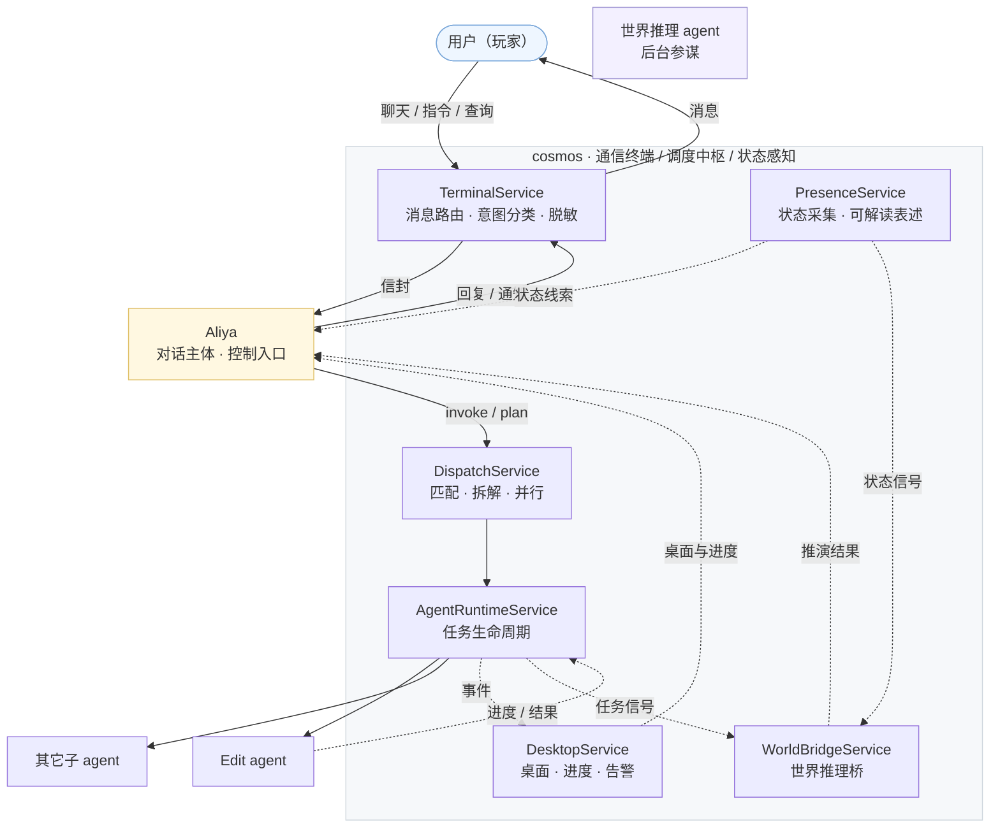

# Agent 目录总览

本目录收纳两个 agent 的实现与文档：

| 目录 | 角色 | 文档入口 |
| --- | --- | --- |
| `agent/cosmos` | 主 agent（Supervisor / Orchestrator）：通信终端 + 调度中枢 + 状态感知层 | [cosmos/README.md](cosmos/README.md) |
| `agent/aliya` | Aliya：对话主体与控制入口，对用户负责，对子 agent 有调度决定权 | [aliya/README.md](aliya/README.md) |

---

## 1. 关系图

一句话概括数据方向：

- **用户 ↔ cosmos ↔ Aliya**：cosmos 是唯一终端，双向消息都过它。
- **Aliya ↔ cosmos ↔ 子 agent**：Aliya 决策，cosmos 执行调度与状态汇总。
- **cosmos → 世界推理 agent → cosmos → Aliya**：cosmos 只搬运，不改写结论。

---

## 2. 为什么两者分开

| 关注点 | cosmos | Aliya |
| --- | --- | --- |
| 与用户的关系 | 通道，不承担人格 | 对话主体，承担人格与情绪 |
| 与子 agent 的关系 | 注册、调度、监控 | 决策「用不用、用哪个、什么时候用」 |
| 状态数据 | 采集、聚合、呈现 | 消费，用于判断与自主行动 |
| 世界推理 | 提供输入、转发输出 | 唯一决策方，可采纳或忽略 |

分开的直接收益：Aliya 换人格、换推理策略甚至换模型，都不影响调度链路；cosmos 换传输方式（进程内 → IPC/WebSocket）也不影响 Aliya 的接口。

---

## 3. 人设基线

角色设定的唯一来源是 [`data/prompt/Aliya.md`](../data/prompt/Aliya.md)。本目录的文档与人设冲突时以人设为准，最少要遵守三条：

| 约束 | 说明 |
| --- | --- |
| 维持信息差 | Aliya 只知道「与一个来自千年前的神秘信号建立了联系」，不知道时间映射同步器，也不知道信号取代了海獭号原有的 AI |
| 语气不加工 | 她像发微信一样短句连发，cosmos 不合并、不补标点、不加旁白、不改成客服腔 |
| 对等隐私 | 她要求关掉自己的心率监测（HRM），cosmos 便不给她监控式的用户面板，只给通信中自然可见的线索 |

**双向感知对称性**不是「互相监视」，而是「互相读懂」。玩家看她的心率，看的其实是情绪；她看用户的状态，看的应该是「现在适不适合说话」。

---

## 4. 命名易混点

| 名字 | 含义 | 位置 |
| --- | --- | --- |
| `core.agent` | 工具 / Skill / MCP 的**零件库** | `core/agent/` |
| `agent.cosmos` | cosmos 的**编排实现** | `agent/cosmos/` |
| `agent.aliya` | Aliya 的**实现** | `agent/aliya/` |

再强调一次：子 agent 注册到 cosmos 的 agent 桌面，**不是**注册成 LLM 的 tool。前者是「应用」，由 Aliya 通过控制面启动；后者是子 agent 内部的实现细节（Edit agent 内部当然可以用 `ToolRegistry` 跑 ReAct，但那是它自己的事）。

---

## 5. 阅读顺序

1. [cosmos/README.md](cosmos/README.md)：定位、三重角色、文档索引。
2. [cosmos/docs/01-architecture.md](cosmos/docs/01-architecture.md)：架构、组件、依赖方向。
3. [cosmos/docs/10-flows.md](cosmos/docs/10-flows.md)：五类端到端流程，先看流程再看契约更快。
4. 其余章节按需查阅。
5. [aliya/README.md](aliya/README.md)：从 Aliya 视角看接口边界。
