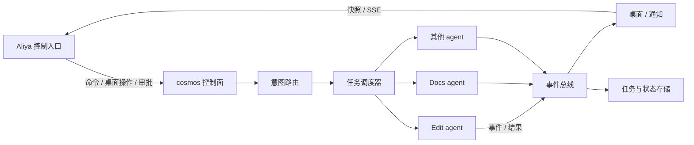
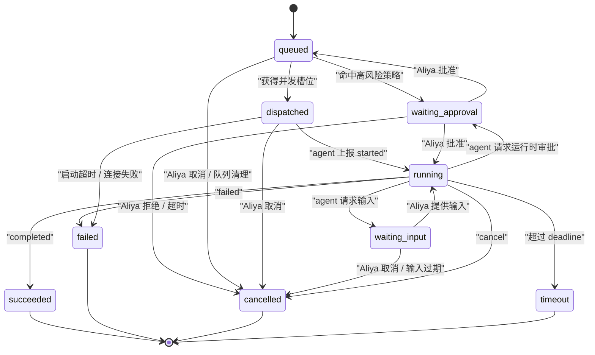

# 1. 架构说明

本文定义 Aliya、cosmos、子 agent 的职责边界、组件划分、通信方式与任务生命周期。阅读后应能回答三个问题：请求从哪进、状态从哪来、失败在哪一层收口。

## 1.1 三层关系

| 层 | 职责 | 关键约束 |
| --- | --- | --- |
| Aliya | 唯一控制者；下达自然语言指令、点击桌面卡片、审批风险操作、查看状态与告警 | 不直接连接子 agent；不维护调度状态副本 |
| cosmos | 意图识别、任务拆解、路由、并发调度、状态聚合、桌面与通知 | 不执行任何业务操作；不把内部 agent 地址暴露给 Aliya |
| 子 agent | 在能力边界内执行具体任务，上报事件与工件 | 不面向 Aliya；不跨 agent 调用；不修改 cosmos 状态 |

cosmos 对 Aliya 呈现两个面：命令面（聊天/指令输入）与桌面面（agent 网格、状态仪表、通知中心）。两个面共享同一套任务与状态模型。

## 1.2 组件划分

| 组件 | 职责 | 主要输入 | 主要输出 |
| --- | --- | --- | --- |
| 控制面 `api` | 鉴权、参数校验、会话管理、SSE 连接 | Aliya 的 HTTP 请求 | 任务、桌面快照、事件流 |
| 注册表 `registry` | agent 清单校验、探测、启停、版本管理 | agent 清单 | 注册结果、能力索引 |
| 路由 `router` | 归一化请求、候选生成、打分、澄清 | 指令或桌面调用 | 目标 agent、置信度、路由轨迹 |
| 调度 `scheduler` / `dispatcher` | 任务拆解、依赖编排、并发与优先级、取消传播 | 路由结果 | TaskEnvelope、聚合结果 |
| 事件总线 `events` | 事件接收、去重、排序、扇出、断点续传 | agent 事件、内部状态变化 | SSE 事件、桌面补丁、通知触发 |
| 桌面 `desktop` | 卡片派生、布局、分组、排序、快照 | 注册表与事件 | 桌面快照、卡片补丁 |
| 通知 `notifications` | 完成/失败/待输入/离线告警、去重、静默时段 | 事件总线 | 通知记录、webhook 推送 |
| 任务存储 `store` | 任务、事件、结果、审批与审计记录 | 调度与事件 | 查询、重放、恢复 |

组件之间通过显式接口协作，避免隐式全局状态。事件总线是唯一的状态扩散通道，桌面与通知都是订阅者。

## 1.3 通信方式

| 链路 | 方向 | 默认传输 | 模式 | 说明 |
| --- | --- | --- | --- | --- |
| 命令 | Aliya -> cosmos | HTTP `POST /v1/commands` | 同步受理，异步执行 | 默认立即返回 `task_id`；可选短暂等待结果 |
| 桌面读取 | Aliya -> cosmos | HTTP `GET /v1/desktop` | 同步 | 获取带版本号与事件游标的快照 |
| 桌面操作 | Aliya -> cosmos | HTTP `PATCH /v1/desktop/layout` | 同步 | 排序、分组、可见性、固定 |
| 状态推送 | cosmos -> Aliya | SSE（默认）/ WebSocket（可选） | 异步 | 卡片、任务、通知、系统告警 |
| 任务委派 | cosmos -> agent | 进程内调用或 HTTP `POST /v1/tasks` | 异步 | 进程内模式直接 await；HTTP 模式立即返回受理 |
| 事件上报 | agent -> cosmos | HTTP `POST /v1/tasks/{task_id}/events` | 异步、至少一次 | 进程内模式使用 `EventEmitter` |
| 取消 / 输入 / 审批 | cosmos -> agent | HTTP 或进程内调用 | 同步受理 | agent 必须幂等处理 |
| 通知外发 | cosmos -> Aliya | 桌面事件 + 可选 webhook | 异步 | 与状态推送分离，支持重试与静默时段 |

同步用于「受理与查询」，异步用于「执行与状态」。任何可能超过 2 秒的业务执行都走异步任务，避免 Aliya 侧连接超时。

三种通信模式的边界：

| 模式 | 触发 | Aliya 的参与 | 典型场景 |
| --- | --- | --- | --- |
| 同步 | Aliya 主动请求 | 等待响应 | 打开桌面、查询任务、提交调用并立即拿到 `task_id` |
| 异步 | 任务执行、状态变化 | 不阻塞，接收推送 | 进度、心跳、工件、完成、失败、离线告警 |
| 自动委派 | Aliya 下达自然语言指令 | 只确认结果或澄清 | cosmos 自动匹配 agent 并下发，无需 Aliya 选择目标 |

自动委派仍然保留完整路由轨迹。Aliya 可以在任务详情中查看候选与分数，并通过改派纠正错误匹配。

## 1.4 任务生命周期

| 状态 | 含义 | 是否终态 | 桌面表现 |
| --- | --- | --- | --- |
| `queued` | 已创建，等待并发槽位或依赖 | 否 | 卡片显示排队数 |
| `waiting_approval` | 等待 Aliya 审批 | 否 | 卡片等待态，弹出审批通知 |
| `dispatched` | 已下发，等待 agent 确认启动 | 否 | 卡片运行中，进度未知 |
| `running` | agent 已确认执行 | 否 | 卡片运行中，展示进度与当前步骤 |
| `waiting_input` | agent 需要补充信息 | 否 | 卡片等待态，弹出输入通知 |
| `succeeded` | 正常完成 | 是 | 卡片回到空闲，展示成功徽标 |
| `failed` | 执行失败 | 是 | 卡片异常，展示失败原因 |
| `cancelled` | Aliya 或 cosmos 取消 | 是 | 卡片回到空闲或异常，取决于原因 |
| `timeout` | 超过截止时间 | 是 | 卡片异常，触发告警 |

任务状态由 cosmos 维护。agent 上报的是执行事实，cosmos 负责状态机迁移，避免 agent 直接改写全局状态。

## 1.5 并发模型

- 全局并发上限 `cosmos.max_running_tasks`，默认 8。
- 每个 agent 的并发上限来自清单 `concurrency.max_running`，默认 1，范围 1 到 16。
- 每个 agent 的队列上限来自 `concurrency.queue_limit`，默认 20；超出时新任务返回 `RESOURCE_EXHAUSTED`，由 Aliya 决定等待或取消。
- 优先级从高到低为 `critical`、`high`、`normal`、`low`；同优先级按入队时间排序。
- 队列启用老化机制：等待超过 `aging_ms`（默认 60 秒）的任务提升一级，避免低优先级任务长期饥饿。
- 同一 agent 的写类任务默认串行，读类任务可并发，按清单中的 `concurrency.mode` 决定。
- 取消会沿依赖图向下传播；被依赖任务取消后，下游任务标记为 `cancelled` 并附带 `DEPENDENCY_CANCELLED`。

## 1.6 时间与状态同步

cosmos 是唯一时间权威。任务信封中的 `issued_at`、`deadline_at`、事件中的 `at` 都以 cosmos 时钟为准。

| 机制 | 规则 |
| --- | --- |
| 截止时间 | `deadline_at = issued_at + policy.timeout_ms`，agent 必须在截止前上报终态 |
| 心跳 | agent 每 `heartbeat_ms` 上报一次，默认 5 秒，允许 1 到 60 秒 |
| 降级 | 连续丢失 3 个心跳窗口，agent 标记 `degraded`，任务维持 `running` 并触发降级告警 |
| 离线 | 连续丢失 6 个心跳窗口，agent 标记 `offline`，运行中任务进入 `timeout` 流程 |
| 时钟偏差 | 允许 agent 与 cosmos 相差 2 秒；超出时以 cosmos 收到事件的时间修正展示 |
| 断线重连 | Aliya 使用 `stream_seq` 或 `Last-Event-ID` 续传；缺口过大时重新拉取桌面快照 |

心跳与进度分离：agent 可以长时间没有进度变化，但必须持续心跳。心跳丢失代表存活问题，进度停滞代表执行问题。

## 1.7 部署形态

| 形态 | 适用阶段 | 特点 |
| --- | --- | --- |
| 进程内 | 单机开发、早期集成 | agent 作为 Python 对象注册，`execute(task, emit)` 直接调用；事件不经过网络 |
| HTTP 分离 | 多语言 agent、独立扩缩容 | agent 暴露统一 HTTP 接口；cosmos 负责重试、超时与回调鉴权 |
| 混合 | 迁移期 | 内置 agent 走进程内，外部 agent 走 HTTP；对上层契约一致 |

部署形态属于注册表与适配器细节，不影响 Aliya 看到的桌面与任务模型。

## 1.8 失败域与收口

| 故障 | 表现 | cosmos 处理 |
| --- | --- | --- |
| agent 进程崩溃 | 心跳中断、连接失败 | 标记 offline，运行中任务转 timeout，推送 critical 告警 |
| agent 卡死 | 心跳正常但进度不变 | 超过 `stall_ms` 标记 degraded，提示 Aliya 取消或等待 |
| 回调丢失 | 事件缺口 | 按 `event_id` 去重、按 `seq` 排序；缺口超时后向 agent 拉取任务快照 |
| 事件重复 | 同一事件多次到达 | 按 `event_id` 幂等丢弃，不重复触发通知 |
| cosmos 重启 | 内存状态丢失 | 从任务快照与 agent 状态重建；运行中任务标记为 `failed`（`COSMOS_RESTARTED`）并询问 Aliya 是否重试 |
| 队列饱和 | 新任务无法入队 | 返回 `RESOURCE_EXHAUSTED`，桌面展示排队压力 |
| 审批超时 | 任务长期等待 | 默认 10 分钟超时，任务取消并通知 Aliya |
| 时钟漂移 | 耗时计算异常 | 用 cosmos 接收时间与 agent 上报时间双轨计算，展示以 cosmos 为准 |

cosmos 在失败时优先保证「状态可见」与「Aliya 可干预」，自动重试默认关闭，避免在未知副作用下重复执行。

## 1.9 安全边界

- 控制面只监听内部地址，Aliya 使用短期会话令牌访问，端用户无法直连。
- 每个 agent 清单声明 `permissions.scopes`，cosmos 在委派前校验；agent 侧必须再次校验。
- 高风险能力在清单中声明 `risk` 与 `approval_required_for`，未审批不得下发。
- 回调令牌按任务签发，绑定 `task_id` 与 `agent_id`，短时有效，不能跨任务复用。
- 事件与工件默认脱敏；密钥、令牌、完整文件内容不进入事件流。
- 所有控制操作写入审计日志，包含操作者、动作、目标、请求 ID 与结果。
