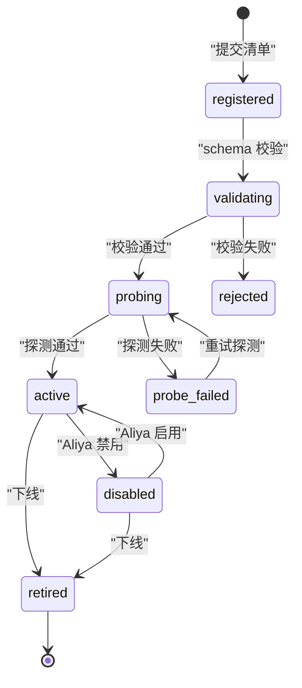

# 2. agent 注册机制

注册是 agent 进入 cosmos 的唯一入口。注册成功后，agent 同时获得三种身份：可被路由的能力提供者、可被调度的执行单元、桌面上的一个应用卡片。

## 2.1 注册单元：清单

一个 agent 对应一份清单，默认存放于 `data/cosmos/agents/<agent_id>.yaml`，也可以运行时通过控制面提交。清单描述身份、能力、边界、传输、并发、权限与桌面元数据。

```yaml
schema_version: 1
agent_id: edit
display_name: Edit agent
version: 0.1.0
summary: 代码编辑、文件创建与重构
description: |
  在授权工作区内读取、修改、创建代码文件，支持小步编辑、批量重构与差异说明。
  所有写入操作都会产出 diff 工件，便于 Aliya 审核。
icon:
  asset: icons/edit.svg
  accent: "#4C8DFF"
capabilities:
  - id: code.edit
    description: 修改已有代码文件
    risk: write
    input_schema:
      type: object
      properties:
        target_files:
          type: array
          items: {type: string}
        instruction:
          type: string
      required: [target_files, instruction]
  - id: file.create
    description: 创建新文件
    risk: write
boundaries:
  workspace_only: true
  allowed_paths: ["/workspace"]
  denied_actions: ["shell.exec", "network.fetch"]
  max_input_bytes: 262144
  max_artifacts: 32
routing:
  keywords: ["编辑", "修改", "重构", "创建文件", "改代码"]
  examples:
    - "把 registry.py 里的日志字段改成中文"
    - "给 registry 模块补一个单元测试"
  embedding_text: "代码编辑 文件修改 重构 创建文件 补测试"
transport:
  kind: http
  endpoint: "http://127.0.0.1:8101"
  health_path: /health
  describe_path: /describe
  timeout_ms: 120000
  start_timeout_ms: 10000
  heartbeat_ms: 5000
  cancel_grace_ms: 5000
concurrency:
  mode: serial_write
  max_running: 2
  queue_limit: 20
features: ["cancel", "input_request", "artifacts"]
permissions:
  scopes: ["workspace.read", "workspace.write"]
  approval_required_for: ["file.bulk_rewrite"]
desktop:
  group: dev
  order: 10
  pinned: true
  visible: true
  size: 1x1
notifications:
  on_started: false
  on_completed: true
  on_failed: true
  progress_step: 10
```

字段表：

| 分区 | 字段 | 必填 | 说明 |
| --- | --- | --- | --- |
| 身份 | `schema_version` | 是 | 清单版本，当前为 `1` |
| 身份 | `agent_id` | 是 | 稳定唯一标识，`^[a-z][a-z0-9_-]{1,31}$`，注册后不复用 |
| 身份 | `display_name` | 是 | 桌面卡片名称，1 到 32 字符 |
| 身份 | `version` | 是 | 语义化版本，能力变化必须升版本 |
| 身份 | `summary` | 是 | 一句话简介，桌面卡片与路由使用 |
| 身份 | `description` | 是 | 完整描述，详情页展示 |
| 展示 | `icon.asset` | 是 | 工作区内的 SVG/PNG 资源路径，或 `builtin:<name>` |
| 展示 | `icon.accent` | 否 | 卡片强调色，十六进制 |
| 能力 | `capabilities[]` | 是 | 至少一项；`id` 使用 `domain.verb` 命名 |
| 能力 | `capabilities[].risk` | 是 | `read` / `write` / `destructive` / `external` |
| 能力 | `capabilities[].input_schema` | 否 | 该能力的 JSON Schema；缺省时使用 agent 级 `input_schema` |
| 边界 | `boundaries` | 是 | 工作区限制、允许路径、禁止动作、体积上限 |
| 路由 | `routing` | 是 | 关键词、示例、用于向量匹配的文本 |
| 传输 | `transport` | 是 | 进程内或 HTTP 连接参数 |
| 传输 | `transport.token` | 否 | cosmos 调用 agent 的服务令牌，用占位符注入 |
| 并发 | `concurrency` | 是 | 并发模式、并发上限、队列上限 |
| 输入 | `input_schema` | 否 | agent 级默认输入 schema，能力未声明时使用 |
| 特性 | `features` | 否 | 支持 `cancel`、`input_request`、`artifacts` 等 |
| 权限 | `permissions.scopes` | 是 | cosmos 委派前校验的权限范围 |
| 权限 | `permissions.approval_required_for` | 否 | 必须 Aliya 审批的能力或动作 |
| 桌面 | `desktop.group` | 是 | 分组 id，对应 `desktop.yaml` 的 `groups[].id` |
| 桌面 | `desktop` | 是 | 分组、顺序、固定、可见性、尺寸 |
| 通知 | `notifications` | 否 | 开始、完成、失败、进度阈值 |

## 2.2 能力命名与边界

能力 id 是路由的稳定锚点，一旦发布不要改名。命名采用 `domain.verb`：

| 示例 | 含义 |
| --- | --- |
| `code.edit` | 修改代码 |
| `code.review` | 代码审查 |
| `file.write` | 写入文件 |
| `docs.render` | 文档渲染 |
| `test.run` | 运行测试 |

边界声明三件事：

1. 允许做什么：能力列表与输入 schema。
2. 允许在哪里做：`workspace_only` 与 `allowed_paths`。
3. 明确不做什么：`denied_actions`，例如 `shell.exec`、`network.fetch`、`workspace.delete`。

cosmos 在路由阶段用能力与边界过滤候选；agent 在执行阶段必须再次校验。边界声明用于收紧权限，不能用于扩大 cosmos 授予的权限。

## 2.3 注册生命周期



| 阶段 | 行为 | 桌面表现 |
| --- | --- | --- |
| `registered` | 清单已接收，尚未校验 | 不展示 |
| `validating` | 校验 schema、命名、资源、冲突 | 不展示 |
| `probing` | 调用 `health` 与 `describe`，核对版本与能力 | 展示为「连接中」 |
| `active` | 可被路由与调用 | 按 `desktop.visible` 展示 |
| `probe_failed` | 探测失败，保留清单 | 展示为异常，附失败原因 |
| `disabled` | 保留注册，拒绝新任务 | 展示为已禁用 |
| `retired` | 从桌面移除，历史任务保留 | 不展示，恢复需要重新注册 |

### 探测握手

cosmos 依次调用：

```text
GET {transport.endpoint}{transport.health_path}
GET {transport.endpoint}{transport.describe_path}
```

`/health` 返回：

```json
{"status": "ok", "version": "0.1.0", "uptime_ms": 3600000}
```

`/describe` 返回 agent 自述，cosmos 用它核对清单是否一致：

```json
{
  "agent_id": "edit",
  "version": "0.1.0",
  "capabilities": ["code.edit", "file.create"],
  "features": ["cancel", "input_request", "artifacts"],
  "limits": {"max_input_bytes": 262144, "max_artifacts": 32}
}
```

| 核对项 | 不一致时 |
| --- | --- |
| `agent_id` | 探测失败，返回 `AGENT_ID_MISMATCH` |
| `version` | 清单与自述版本不同，探测失败，要求升级清单 |
| `capabilities` | 缺少清单声明的能力，探测失败；多出的能力被忽略 |
| `features` | 清单声明的特性未实现，探测失败 |
| `limits` | 自述上限更小时以自述为准，并告警 |

探测整体超时取 `start_timeout_ms`，默认 10 秒。失败后按 2 秒、4 秒、8 秒退避重试，最多 5 次；仍失败则进入 `probe_failed`。

## 2.4 注册接口

| 方法 | 路径 | 说明 |
| --- | --- | --- |
| `POST` | `/v1/agents` | 注册新 agent |
| `GET` | `/v1/agents` | 列出全部注册 |
| `GET` | `/v1/agents/{agent_id}` | 获取清单、运行状态与探测结果 |
| `PATCH` | `/v1/agents/{agent_id}` | 更新展示、路由、通知等非能力字段 |
| `POST` | `/v1/agents/{agent_id}/probe` | 重新探测 |
| `POST` | `/v1/agents/{agent_id}/enable` | 启用 |
| `POST` | `/v1/agents/{agent_id}/disable` | 禁用，可同时取消运行中任务 |
| `POST` | `/v1/agents/{agent_id}/retire` | 下线并从桌面移除 |

注册请求：

```http
POST /v1/agents
Content-Type: application/yaml
Authorization: Bearer <cosmos-admin-token>

<agent 清单>
```

响应：

```json
{
  "agent_id": "edit",
  "lifecycle": "active",
  "version": "0.1.0",
  "probe": {"status": "ok", "latency_ms": 42, "checked_at": "2026-10-25T02:30:00Z"},
  "card": {"agent_id": "edit", "status": "idle", "visible": true},
  "warnings": []
}
```

幂等规则：

- 相同 `agent_id` 与相同 `version` 重复注册，返回 200 与现有注册，不重建卡片。
- 相同 `agent_id`、不同 `version`，默认返回 409 `AGENT_VERSION_CONFLICT`；带 `?replace=true` 时走升级流程。
- 升级期间旧任务继续执行，新任务路由到新版本；旧版本没有运行中任务后进入 `retired`。
- `PATCH` 只允许修改 `display_name`、`summary`、`description`、`icon`、`routing`、`desktop`、`notifications`。能力、边界、传输、权限变化必须升版本并重新注册。

## 2.5 校验规则

| 项 | 规则 | 失败错误码 |
| --- | --- | --- |
| `agent_id` | 符合正则，且不与内置保留名冲突 | `INVALID_AGENT_ID` |
| `display_name` | 1 到 32 字符，去除首尾空白 | `INVALID_DISPLAY_NAME` |
| `version` | 语义化版本 | `INVALID_VERSION` |
| `capabilities` | 至少一项，id 唯一且符合 `domain.verb` | `INVALID_CAPABILITY` |
| `input_schema` | 合法 JSON Schema，顶层为 object | `INVALID_INPUT_SCHEMA` |
| `boundaries.allowed_paths` | 必须是绝对路径，且位于工作区内 | `INVALID_BOUNDARY` |
| `transport` | HTTP 必须为 `http`/`https`，禁止用户信息与短链 | `INVALID_TRANSPORT` |
| `heartbeat_ms` | 1000 到 60000 | `INVALID_HEARTBEAT` |
| `cancel_grace_ms` | 0 到 60000 | `INVALID_POLICY` |
| `concurrency.max_running` | 1 到 16 | `INVALID_CONCURRENCY` |
| `concurrency.queue_limit` | 1 到 1000 | `INVALID_CONCURRENCY` |
| `desktop.group` | 已存在或允许自动创建 | `INVALID_DESKTOP_GROUP` |
| `desktop.size` | `1x1`、`2x1` 或 `2x2` | `INVALID_DESKTOP_SIZE` |
| `icon.asset` | 文件存在或为 `builtin:` 资源 | `INVALID_ICON` |
| 清单体积 | 不超过 256 KB | `MANIFEST_TOO_LARGE` |

保留名包括 `cosmos`、`aliya`、`system`、`desktop`、`admin`，避免与调度层或控制面冲突。

## 2.6 桌面注册

注册成功后，cosmos 生成卡片并写入桌面：

- `desktop.group` 不存在时自动创建，分组标题默认使用 group id，分组顺序取 `desktop.order`，并产生一条 WARNING。
- 同一分组内按 `desktop.order` 升序排列；相同顺序按 `display_name` 排序。
- `desktop.visible=false` 的 agent 仍可被自然语言路由，但不显示在桌面；详情页可通过搜索找到。
- `desktop.pinned=true` 的卡片固定在分组顶部，不参与普通排序。
- `desktop.size` 只是布局建议，窄屏时统一降级为 `1x1`。
- 新注册的 agent 默认 `enabled=true`。首次接入建议把 `desktop.visible` 设为 `false`，完成首次调用验证后再显示。

卡片数据的完整结构见 [03-desktop.md](03-desktop.md)。

## 2.7 存储与配置

| 内容 | 位置 | 是否可提交 | 说明 |
| --- | --- | --- | --- |
| agent 清单 | `data/cosmos/agents/<agent_id>.yaml` | 是 | 不含明文密钥，使用 `${VAR}` 占位符 |
| 桌面布局 | `data/cosmos/desktop.yaml` | 是 | 分组、顺序、固定、可见性 |
| 运行状态 | 内存 + 快照 | 否 | 重启后由探测与任务快照恢复 |
| 历史任务 | `data/cosmos/tasks/`（可选） | 否 | 按保留策略清理 |
| 审计日志 | `data/cosmos/audit/` | 否 | 只追加，按保留策略归档 |

清单可以引用环境变量：

```yaml
transport:
  kind: http
  endpoint: "${EDIT_AGENT_URL:http://127.0.0.1:8101}"
  token: "${EDIT_AGENT_TOKEN}"
```

占位符规则沿用 `core/config`：`${VAR}` 缺值时启动失败，`${VAR:默认值}` 提供默认值，`$$` 转义。

配置加载顺序：

1. 启动时扫描 `data/cosmos/agents/*.yaml`，按文件名排序注册。
2. 单个清单失败不阻塞其他 agent，记录错误并继续。
3. 运行时通过 API 注册的 agent 优先生效；同一 `agent_id` 以最新注册为准。
4. 禁用状态持久化在 `data/cosmos/desktop.yaml`，重启后保持。

## 2.8 注册示例

```bash
# 注册 Edit agent
curl -X POST http://127.0.0.1:8080/v1/agents \
  -H "Authorization: Bearer $COSMOS_ADMIN_TOKEN" \
  -H "Content-Type: application/yaml" \
  --data-binary @data/cosmos/agents/edit.yaml

# 探测
curl -X POST http://127.0.0.1:8080/v1/agents/edit/probe \
  -H "Authorization: Bearer $COSMOS_ADMIN_TOKEN"

# 启用并显示
curl -X POST http://127.0.0.1:8080/v1/agents/edit/enable \
  -H "Authorization: Bearer $COSMOS_ADMIN_TOKEN"
```

注册成功的标志是三个条件同时满足：`lifecycle=active`、探测返回 `ok`、桌面快照中出现对应卡片。任一条件不满足都按失败处理，不要只检查 HTTP 200。
