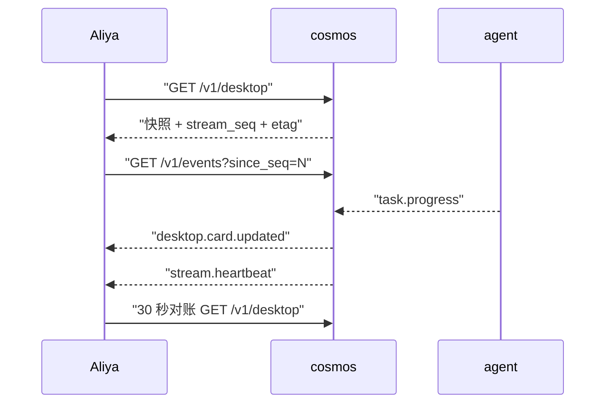

# 3. agent 桌面展示规范

桌面是 Aliya 的 agent 控制面板，形态接近手机桌面：每个 agent 是一张卡片，点击打开详情或发起调用；分组、排序、启停、状态监控都在这一层完成。桌面同时承担「仪表盘」职责，把子 agent 的运行状态压缩成可扫视的指标。

## 3.1 桌面布局

```text
+--------------------------------------------------------------+
| 系统栏：cosmos 状态 | 运行中 2 | 排队 1 | 告警 1 | 服务器时间 |
+--------------------------------------------------------------+
| 开发工具                                          固定 2 项   |
| +------------+ +------------+ +------------+                 |
| | Edit agent | | Test agent | | Docs agent |                 |
| | 编辑中 40% | | 空闲       | | 离线       |                 |
| +------------+ +------------+ +------------+                 |
|                                                              |
| 研究工具                                                      |
| +------------+                                               |
| | Search     |                                               |
| | 等待输入   |                                               |
| +------------+                                               |
+--------------------------------------------------------------+
| 通知中心：Edit agent 已完成（2 分钟前）                       |
+--------------------------------------------------------------+
```

| 区域 | 内容 | 刷新方式 |
| --- | --- | --- |
| 系统栏 | cosmos 健康、运行中任务数、排队数、未读告警、服务器时间、事件流状态 | 事件驱动 + 1 秒本地时钟 |
| agent 网格 | 按分组排列的卡片，支持固定与手动排序 | 卡片补丁 |
| 详情抽屉 | 单个 agent 的仪表、任务、事件、能力边界、清单 | 打开时拉取 + 订阅该 agent 事件 |
| 通知中心 | 完成、失败、待输入、审批、离线告警 | 通知事件 |
| 告警横幅 | critical 级别问题，需确认后消失 | 告警事件 |

桌面只呈现状态与入口，不承载业务表单的长期状态。调用表单由 agent 的 `input_schema` 动态生成，提交后关闭。

## 3.2 卡片数据结构

```json
{
  "agent_id": "edit",
  "display_name": "Edit agent",
  "version": "0.1.0",
  "icon": {"asset": "icons/edit.svg", "accent": "#4C8DFF"},
  "summary": "代码编辑、文件创建与重构",
  "group": "dev",
  "order": 10,
  "pinned": true,
  "visible": true,
  "enabled": true,
  "lifecycle": "active",
  "status": "running",
  "status_text": "编辑中",
  "health": "healthy",
  "badge": {"running": 1, "waiting": 0, "failed_24h": 2},
  "metrics": {
    "progress": 0.4,
    "current_step": "修改 core/agent/registry.py",
    "elapsed_ms": 18200,
    "queue_depth": 0,
    "last_heartbeat_at": "2026-10-25T02:31:12Z",
    "heartbeat_latency_ms": 18,
    "resources": {"cpu_pct": 3.2, "mem_mb": 86},
    "success_rate_24h": 0.95,
    "p95_latency_ms": 12400
  },
  "active_tasks": [
    {
      "task_id": "01JAV3M8Z9K2Q4W6R8T0Y2B4C6",
      "status": "running",
      "progress": 0.4,
      "current_step": "修改 core/agent/registry.py",
      "started_at": "2026-10-25T02:30:00Z"
    }
  ],
  "last_task": {
    "task_id": "01JAV2Q1A2B3C4D5E6F7G8H9J0",
    "status": "succeeded",
    "finished_at": "2026-10-25T02:10:00Z"
  },
  "alert": null,
  "actions": ["open", "invoke", "details", "disable"]
}
```

| 字段 | 类型 | 说明 |
| --- | --- | --- |
| `agent_id` | string | 稳定标识，卡片主键 |
| `display_name` | string | 卡片标题 |
| `version` | string | 当前注册版本 |
| `icon` | object | `asset` 为资源路径，`accent` 为强调色 |
| `summary` | string | 一句话简介，最多两行 |
| `group` | string | 分组 id，对应 `desktop.yaml` 中 `groups[].id` |
| `order` | int | 分组内顺序，越小越靠前 |
| `pinned` | bool | 是否固定在分组顶部 |
| `visible` | bool | 是否出现在桌面 |
| `enabled` | bool | 是否接受新任务 |
| `lifecycle` | string | 注册生命周期，见注册文档 |
| `status` | string | 派生展示状态，见 3.3 |
| `status_text` | string | 面向 Aliya 的中文状态，如「编辑中」 |
| `health` | string | `healthy` / `degraded` / `unhealthy` / `unknown` |
| `badge` | object | 运行中、等待中、24 小时失败数 |
| `metrics` | object | 仪表指标，字段可缺省 |
| `active_tasks` | array | 当前未结束任务，最多返回 5 条 |
| `last_task` | object | 最近一次终态任务摘要 |
| `alert` | object | 当前最高级别告警：`level`、`text`、`since`；无告警为 `null` |
| `actions` | array | 当前可用操作，由状态与权限派生 |

`metrics` 的字段全部可选。agent 不提供资源指标时，卡片隐藏对应仪表，不显示占位假数据。

## 3.3 状态模型

展示状态由 agent 生命周期、健康度、任务状态共同派生：

| 优先级 | `status` | 中文 | 触发条件 | 颜色 | 卡片表现 |
| --- | --- | --- | --- | --- | --- |
| 1 | `disabled` | 已禁用 | `enabled=false` | `#8A8F98` | 整体降低透明度，显示禁用标签 |
| 2 | `offline` | 离线 | 心跳丢失达到离线阈值 | `#8A8F98` | 灰色，显示最后在线时间 |
| 3 | `error` | 异常 | `health=unhealthy`，或最近任务失败且无运行中任务 | `#E5484D` | 红色告警条，显示失败原因 |
| 4 | `degraded` | 状态异常 | `health=degraded`，或心跳丢失达到降级阈值 | `#F5A623` | 橙色边框，显示降级原因 |
| 5 | `waiting` | 等待输入 | 存在 `waiting_input` 或 `waiting_approval` 任务 | `#F5A623` | 呼吸边框，显示待办徽标 |
| 6 | `running` | 运行中 | 存在 `running` 或 `dispatched` 任务 | `#4C8DFF` | 进度条与当前步骤 |
| 7 | `idle` | 空闲 | 已启用、健康、无未结束任务 | `#30A46C` | 静态，显示最近成功时间 |

派生规则：

1. 先看 `enabled`，禁用优先于一切。
2. 再看心跳与健康，离线优先于任务状态。
3. 再看任务：存在等待类任务时显示 `waiting`，存在运行类任务时显示 `running`。
4. 无活动任务时，最近任务失败且未确认则显示 `error`，否则显示 `idle`。
5. `status_text` 可以由 agent 覆盖，例如 `running` 时显示「编辑中」「审查中」「生成中」。覆盖文案必须来自清单或事件，不由前端拼接。

`error` 状态的清除条件：Aliya 打开详情并确认、执行重试成功、或由最近任务失败产生的 `error` 超过 `error_retention_ms`（默认 10 分钟）自动回到 `idle`。由 `health=unhealthy` 产生的 `error` 随健康恢复清除。清除只影响卡片展示，不改变历史任务记录。

任务状态与卡片状态的映射：

| 任务状态 | 卡片 `status` | 卡片文案 |
| --- | --- | --- |
| `queued` | `running` | 排队中 |
| `waiting_approval` | `waiting` | 等待审批 |
| `dispatched` | `running` | 启动中 |
| `running` | `running` | agent 提供的动态文案 |
| `waiting_input` | `waiting` | 等待输入 |
| `succeeded` | `idle` 或 `running` | 成功，若还有其他任务则继续运行 |
| `failed` | `error` | 执行失败 |
| `cancelled` | `idle` | 已取消 |
| `timeout` | `error` | 执行超时 |

## 3.4 状态监控面板

游戏用氧气、心率等仪表描述飞船状态。桌面用同一思路，把 agent 的存活、执行、资源、质量压缩成四类指标。

| 游戏仪表 | 对应指标 | 数据来源 | 展示形式 |
| --- | --- | --- | --- |
| 心率 | `last_heartbeat_at`、`heartbeat_latency_ms` | 心跳事件 | 详情页心跳波形与最后心跳时间 |
| 氧气 | `progress`、`current_step` | 进度事件 | 卡片进度环与当前步骤 |
| 能耗 | `resources.cpu_pct`、`resources.mem_mb` | 心跳或进度事件 | 详情页资源条，卡片默认不展示 |
| 警报 | `alert.level`、`badge.failed_24h` | 告警与任务结果 | 卡片角标、系统栏告警数、横幅 |
| 航向 | 计划步骤、当前步骤序号 | 调度器与进度事件 | 详情页步骤时间线 |
| 舱门 | `queue_depth`、并发占用 | 调度器 | 卡片排队徽标，详情页队列列表 |
| 通讯 | 事件流连接状态、最后事件时间 | cosmos 自身 | 系统栏连接指示灯 |
| 生命值 | `success_rate_24h`、`p95_latency_ms` | 任务历史 | 详情页成功率与延迟趋势 |

### 卡片层

卡片只展示一个主指标与最多三个辅助徽标，避免信息过载：

- 主指标：`running` 时显示进度环；`waiting` 时显示待办类型；`error` 时显示失败原因摘要；`idle` 时显示最近成功时间。
- 辅助徽标：运行中任务数、排队数、24 小时失败数。
- 多个运行中任务时，主指标取最早开始的任务；徽标显示任务总数。
- 心跳异常时用文字标签「心跳异常」替代数值，颜色不作为唯一信号。

### 详情抽屉

详情抽屉是完整仪表盘，包含：

1. 概览：状态、版本、健康、最后心跳、最近成功时间。
2. 当前任务：进度、当前步骤、耗时、截止时间、排队位置。
3. 仪表：心跳波形、进度环、24 小时成功率、P95 耗时、资源占用。
4. 任务历史：最近 20 条，按时间倒序，支持跳转任务详情。
5. 事件流：当前任务的进度、日志、工件、告警。
6. 能力与边界：能力列表、风险等级、允许路径、禁止动作。
7. 操作：调用、禁用、重新探测、查看清单。

### 系统栏

系统栏提供全局态势：

- cosmos 自身健康与版本。
- 全局运行中任务数、排队数、今日完成数、今日失败数。
- 未读告警数，按级别着色。
- 事件流连接状态：`connected`、`reconnecting`、`gap`。
- 服务器时间，Aliya 侧据此校正本地耗时显示。

## 3.5 排序与分组

默认按清单声明的分组与顺序展示。桌面配置保存在 `data/cosmos/desktop.yaml`：

```yaml
groups:
  - id: dev
    title: 开发工具
    order: 10
    collapsed: false
    color: "#4C8DFF"
    auto_sort: false
  - id: research
    title: 研究工具
    order: 20
    collapsed: false
    color: "#30A46C"
    auto_sort: false
```

排序规则：

1. 分组按 `groups[].order` 升序；未配置的分组排在最后，按标题排序。
2. 分组内 `pinned=true` 的卡片优先，按 `order` 升序。
3. 其余卡片按 `order` 升序，相同顺序按 `display_name` 排序。
4. 分组 `auto_sort=true` 时，运行中与等待中的卡片上浮，其余按原顺序；Aliya 手动拖动会关闭该分组的自动排序。
5. 新注册卡片追加到目标分组末尾，`order` 取当前最大值加 10。
6. 隐藏卡片不参与布局，但仍可搜索与自然语言路由。

分组视图支持三种模式：

| 模式 | 说明 |
| --- | --- |
| 按业务分组 | 默认，使用 `desktop.group` |
| 按状态分组 | 运行中、等待中、异常、空闲、离线 |
| 按能力分组 | 使用能力 id 的 `domain` 前缀 |

视图切换只影响展示，不修改持久化配置。

## 3.6 刷新机制

桌面采用「快照 + 增量补丁 + 周期对账」三层机制：



| 机制 | 触发 | 行为 |
| --- | --- | --- |
| 快照 | 首次连接、重连缺口过大、手动刷新 | 返回完整桌面、`stream_seq`、`layout_version`、`etag`、服务器时间 |
| 增量补丁 | 注册、状态、任务、布局、通知变化 | SSE 推送 `desktop.card.updated` 等事件，携带最小 patch |
| 周期对账 | 每 30 秒 | 客户端带 `If-None-Match` 拉取快照；未变化返回 304 |
| 本地时钟 | 每 1 秒 | 根据 `started_at` 与服务器时间偏移重算耗时，不触发网络请求 |
| 心跳检测 | 每 5 秒 | 检查 agent 最后心跳，更新 `degraded` / `offline` |
| 更新合并 | 高频进度事件 | 同一卡片 1 秒内最多推送 1 次，保留最后一个进度 |

断点续传：

- 每个 SSE 事件带全局递增 `stream_seq`。
- 客户端记录最后处理的 `stream_seq`，重连时通过 `Last-Event-ID` 或 `since_seq` 续传。
- 服务端保留最近 10 分钟或 10000 条事件；缺口超出保留窗口时发送 `stream.gap`，客户端重新拉取快照。
- 客户端按 `stream_seq` 丢弃重复事件，按顺序应用补丁；乱序时先缓存，缺口补齐后再应用。

心跳与状态阈值：

| 参数 | 默认 | 说明 |
| --- | --- | --- |
| `heartbeat_ms` | 5000 | agent 上报间隔，来自清单 |
| `degraded_after_missed` | 3 | 连续丢失窗口数达到后降级 |
| `offline_after_missed` | 6 | 连续丢失窗口数达到后离线 |
| `reconcile_ms` | 30000 | 快照对账间隔 |
| `card_throttle_ms` | 1000 | 单卡片高频更新合并窗口 |

## 3.7 交互行为

| 操作 | 触发 | 行为 |
| --- | --- | --- |
| 打开详情 | 单击卡片 | 打开详情抽屉，拉取该 agent 的最新状态与任务 |
| 发起调用 | 点击卡片主按钮「调用」 | 根据 `input_schema` 生成表单；提交后走桌面调用路径 |
| 快速调用 | 双击卡片 | 打开调用表单，聚焦第一个必填字段 |
| 拖动排序 | 长按后拖动 | 更新 `order` 与分组；释放时提交 `PATCH /v1/desktop/layout` |
| 固定 | 右键菜单或卡片角标 | 切换 `pinned`，固定卡片置顶 |
| 隐藏 | 右键菜单 | 设置 `visible=false`，卡片从桌面移除，仍可搜索 |
| 禁用 | 右键菜单或详情页 | 调用 `POST /v1/agents/{id}/disable`；有运行中任务时二次确认 |
| 批量操作 | 多选后右键 | 批量启用、禁用、移动分组 |
| 查看清单 | 详情页 | 展示版本、能力、边界、传输、权限与探测结果 |
| 搜索 | 顶部搜索框 | 按名称、简介、能力、agent_id 搜索，包含隐藏卡片 |
| 键盘导航 | Tab / 方向键 / Enter | 聚焦卡片、打开详情、提交调用 |

点击卡片与自然语言指令走同一套调用管线，区别只在请求来源：

```json
{
  "source": "desktop",
  "target_agent_id": "edit",
  "input": {"target_files": ["core/agent/registry.py"], "instruction": "日志字段改成中文"}
}
```

自然语言请求的 `source` 为 `natural_language`，没有 `target_agent_id`，由路由器补齐。两条路径在调度器汇合，见 [04-dispatch.md](04-dispatch.md)。

## 3.8 通知与告警

通知是异步推送，不依赖 Aliya 主动刷新桌面。

| 通知类型 | 级别 | 触发 | 默认表现 |
| --- | --- | --- | --- |
| 任务完成 | info | `task.completed` | 轻提示 + 通知中心，卡片回到空闲 |
| 任务失败 | warning | `task.failed` | 轻提示 + 卡片异常角标 |
| 等待输入 | warning | `task.needs_input` | 持续提示直到输入或过期 |
| 等待审批 | warning | `task.approval_required` | 弹出审批卡片，critical 风险用横幅 |
| agent 离线 | critical | 心跳丢失达到离线阈值 | 横幅 + 通知中心，需确认 |
| agent 恢复 | info | 离线后首次心跳 | 通知中心 |
| 注册变化 | info | 注册、启用、禁用、下线 | 通知中心，桌面同步更新 |

通知字段：

```json
{
  "notification_id": "ntf-01JAV4A7",
  "level": "warning",
  "title": "Edit agent 执行失败",
  "body": "修改 core/agent/registry.py 时发生冲突，可重试或查看详情。",
  "agent_id": "edit",
  "task_id": "01JAV3M8Z9K2Q4W6R8T0Y2B4C6",
  "created_at": "2026-10-25T02:32:10Z",
  "dedupe_key": "task-failed:01JAV3M8Z9K2Q4W6R8T0Y2B4C6",
  "requires_ack": false,
  "actions": [
    {"id": "retry", "label": "重试", "method": "POST", "path": "/v1/tasks/01JAV3M8Z9K2Q4W6R8T0Y2B4C6/retry"},
    {"id": "details", "label": "查看详情", "method": "GET", "path": "/v1/tasks/01JAV3M8Z9K2Q4W6R8T0Y2B4C6"}
  ]
}
```

通知规则：

- 按 `dedupe_key` 在 60 秒窗口内去重；同 key 只保留最高级别。
- 同一 agent 的进度通知最多每 10% 或每 30 秒一次，取先到者。
- `critical` 通知需要确认，未确认时每 5 分钟重复提醒一次，最多 3 次。
- 静默时段默认 23:00 到 08:00，只抑制 `info` 与 `warning` 的轻提示，通知中心仍记录；`critical` 不受静默时段影响。
- 通知与桌面补丁分离：即使事件流断开，通知也可以通过 webhook 或下次快照补发。

## 3.9 边界状态

| 场景 | 桌面表现 | 可执行操作 |
| --- | --- | --- |
| 没有 agent | 空状态插画 + 「注册 agent」入口 | 打开注册指引 |
| 全部禁用 | 系统栏提示「无可用 agent」 | 启用、查看清单 |
| agent 离线 | 灰色卡片，显示最后在线时间 | 重新探测、禁用、查看历史任务 |
| 探测失败 | 异常卡片，显示失败原因 | 重新探测、编辑清单 |
| 事件流断开 | 系统栏 `reconnecting`，卡片保留最后状态并标注「数据可能过期」 | 手动刷新、查看快照时间 |
| 任务队列饱和 | 系统栏排队数高亮，卡片显示排队位置 | 取消低优先级任务、调整并发 |

## 3.10 可访问性

- 状态同时用文字、图标与颜色表达，禁止只靠颜色区分。
- 卡片支持键盘聚焦与 Enter 打开，焦点顺序与视觉顺序一致。
- 动态进度使用 `aria-live=polite`，critical 告警使用 `aria-live=assertive`。
- 动画遵循 `prefers-reduced-motion`，关闭呼吸边框与进度环动画后仍保留数值。
- 文本对比度满足 WCAG 2.1 AA；强调色只用于点缀，正文使用中性色。
