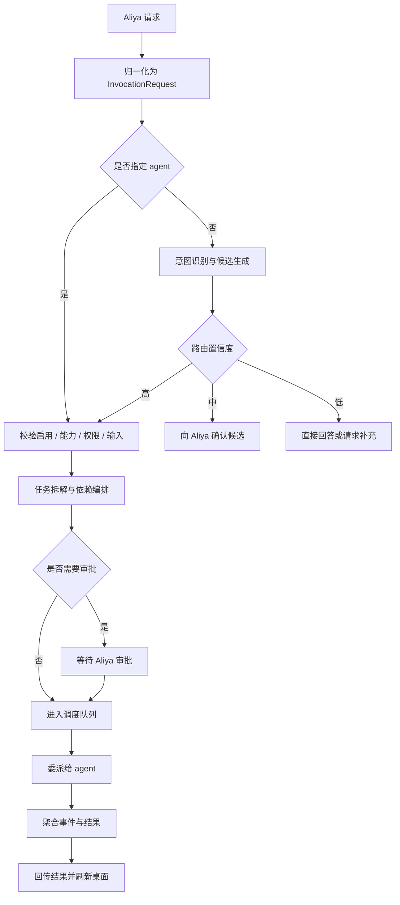
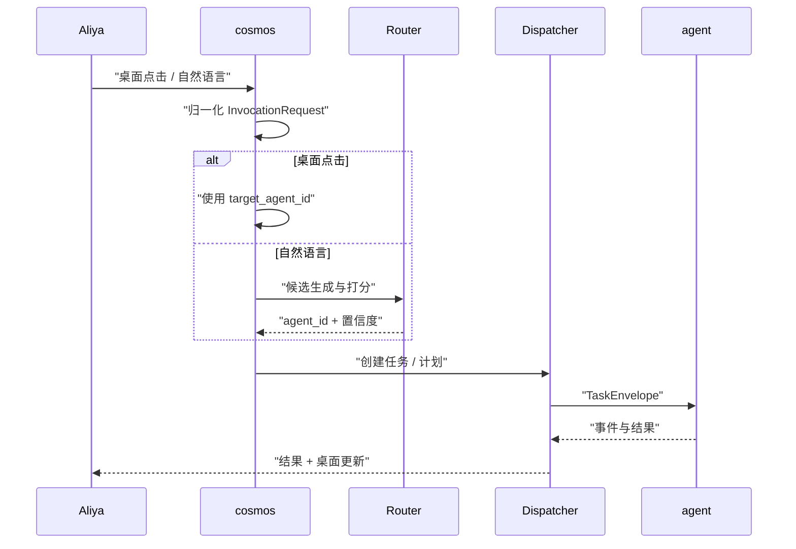

# 4. 任务分发策略

分发的目标是把 Aliya 的一次请求，稳定地落到正确的 agent、正确的并发槽位与正确的执行顺序上。桌面点击与自然语言指令共用同一条管线，差异只在请求来源与目标是否已知。

## 4.1 统一管线



| 阶段 | 输入 | 输出 | 失败处理 |
| --- | --- | --- | --- |
| 归一化 | 指令、桌面调用、系统触发 | `InvocationRequest` | 参数非法返回 `INVALID_INPUT` |
| 目标确定 | 请求、注册表、能力索引 | 单个或多个 `agent_id` | 无匹配返回澄清 |
| 校验 | 目标 agent、输入 | 可执行任务 | 禁用、离线、越权直接拒绝 |
| 拆解 | 多意图请求 | 计划 DAG | 无法拆解转为澄清 |
| 审批 | 风险声明 | 批准或拒绝 | 超时取消 |
| 调度 | 任务、并发与优先级 | 执行中的任务 | 队列满返回 `RESOURCE_EXHAUSTED` |
| 聚合 | 事件与结果 | 面向 Aliya 的摘要 | 部分失败按策略处理 |

## 4.2 请求归一化

无论来源，cosmos 都转换成同一个结构：

```json
{
  "request_id": "req-20261025-0001",
  "session_id": "s-01",
  "source": "natural_language",
  "target_agent_id": null,
  "text": "把 core/agent/registry.py 里的日志字段改成中文",
  "input": null,
  "attachments": [],
  "constraints": {
    "priority": "normal",
    "deadline_ms": 120000,
    "max_parallel_steps": 4
  },
  "risk_ack": false
}
```

| 字段 | 说明 |
| --- | --- |
| `request_id` | 幂等键，由 Aliya 或控制面生成；重复提交返回同一任务 |
| `session_id` | 会话上下文，用于指代消解与澄清追问 |
| `source` | `desktop`、`natural_language`、`auto`、`retry` |
| `target_agent_id` | 桌面调用时必填；自然语言请求为空 |
| `text` | 原始自然语言，桌面调用可为空 |
| `input` | 桌面调用时按 `input_schema` 填写的结构化参数 |
| `attachments` | 文件、代码片段等引用，带类型与校验和 |
| `constraints` | 优先级、截止时间、并行度上限 |
| `risk_ack` | 是否已对高风险操作做过一次性确认 |

桌面调用与自然语言调用的差异：

| 维度 | 桌面调用 | 自然语言调用 |
| --- | --- | --- |
| 目标 | 已确定 | 由路由器推断 |
| 输入 | 结构化，前端按 schema 校验 | 需要抽取与补全 |
| 路由成本 | 低，跳过候选生成 | 高，需要意图识别 |
| 澄清 | 表单字段错误时直接提示 | 可能追问目标、范围、约束 |
| 后续 | 完全一致 | 完全一致 |

## 4.3 意图识别

自然语言请求经过四路信号，按权重融合：

| 信号 | 权重 | 来源 | 说明 |
| --- | --- | --- | --- |
| 能力标签 | 0.35 | 清单 `capabilities` | 请求动作与能力 id 的语义匹配 |
| 关键词 | 0.20 | 清单 `routing.keywords` | 精确或近义词命中，强规则信号 |
| 向量相似度 | 0.30 | `routing.embedding_text` 与请求文本 | 使用 `core/embedding`，取 top-k 候选 |
| 模型判断 | 0.15 | `core/decision` | 在候选集内做二选一或多选一，降低误配 |

融合分数：

```text
score = 0.35 * capability_match
      + 0.20 * keyword_match
      + 0.30 * embedding_similarity
      + 0.15 * model_choice
```

分数范围为 0 到 1。阈值可配置：

| 区间 | 行为 |
| --- | --- |
| `score >= 0.75` | 自动路由到得分最高的 agent |
| `0.50 <= score < 0.75` | 返回候选列表，请 Aliya 确认 |
| `score < 0.50` | 不创建任务，直接回答或请求补充信息 |

强制规则优先于分数：

- 请求显式点名 agent（如「用 Edit agent 改」）时，直接选目标，跳过打分。
- 目标 agent 已禁用、离线或缺少能力时，从候选中剔除并说明原因。
- 请求命中高风险能力且未审批时，进入审批流程。
- 同一 `request_id` 已存在任务时，直接返回已有任务，不重复路由。

多候选得分接近（最高分与次高分差小于 0.08）时，即使最高分超过阈值也返回澄清，避免在相近能力间误选。

## 4.4 路由轨迹

每次路由都保留可解释轨迹，写入任务详情：

```json
{
  "source": "natural_language",
  "selected_agent_id": "edit",
  "confidence": 0.93,
  "threshold": 0.75,
  "candidates": [
    {"agent_id": "edit", "score": 0.93, "reasons": ["capability:code.edit", "keyword:修改", "embedding:0.88"]},
    {"agent_id": "test", "score": 0.41, "reasons": ["capability:test.run", "keyword:测试"]},
    {"agent_id": "docs", "score": 0.18, "reasons": ["embedding:0.31"]}
  ],
  "rules_applied": ["explicit_capability_match"],
  "decided_at": "2026-10-25T02:30:00Z"
}
```

Aliya 可以在任务详情中看到候选、分数与原因，并对错误路由执行「改派」。改派会取消原任务并创建新任务，任务详情保留改派前后的关联记录。

## 4.5 决策矩阵

| 场景 | 处理方式 | 返回形态 |
| --- | --- | --- |
| 状态查询：agent 列表、任务进度、能力帮助 | cosmos 直接回答 | `mode=direct`，附桌面快照引用 |
| 单一明确业务请求 | 委派给一个 agent | `mode=delegated`，返回 `task_id` |
| 多个独立意图 | 并行委派多个 agent | `mode=delegated`，返回 `plan_id` 与多个 `task_id` |
| 多个有依赖意图 | 按 DAG 顺序执行 | `mode=delegated`，返回计划 |
| 候选接近或信息不足 | 请求 Aliya 确认或补充 | `mode=clarify`，不创建任务 |
| 无匹配能力 | 直接说明并给出可行建议 | `mode=direct` |
| 高风险操作 | 先审批再委派 | `mode=approval`，任务停在 `waiting_approval` |
| 目标禁用或离线 | 拒绝并给出替代候选 | `mode=clarify` 或错误 |
| 队列饱和 | 拒绝新任务或建议排队 | 错误 `RESOURCE_EXHAUSTED` |
| 重复请求 | 返回已有任务 | `mode=delegated`，`deduplicated=true` |

cosmos 直接回答的范围仅限调度与状态：agent 列表、任务状态、能力说明、桌面操作结果、历史摘要。任何涉及文件、代码、外部系统的动作都委派给 agent。

## 4.6 任务拆解

多意图请求由调度器拆成计划：

```json
{
  "plan_id": "plan-01JAV5C2",
  "request_id": "req-20261025-0002",
  "failure_policy": "all",
  "steps": [
    {
      "step_id": "s1",
      "agent_id": "edit",
      "intent": "修改日志字段",
      "input": {"target_files": ["core/agent/registry.py"], "instruction": "日志字段改成中文"},
      "depends_on": []
    },
    {
      "step_id": "s2",
      "agent_id": "test",
      "intent": "运行相关测试",
      "input": {"paths": ["tests/agent"]},
      "depends_on": ["s1"]
    }
  ]
}
```

拆解规则：

1. 按动作、对象、约束抽取意图；同一个 agent 的连续小步骤合并为一个任务，减少往返。
2. 无数据依赖的步骤并行；有依赖的步骤串行。
3. 单个请求的并行步骤默认不超过 `max_parallel_steps`（默认 4），超出时排队。
4. 每步的输入必须能通过目标 agent 的 `input_schema` 校验；无法补全时转为澄清。
5. 前一步产出被后一步引用时，使用 `artifacts` 或 `output` 字段传值，不传自然语言摘要。

失败策略：

| 策略 | 行为 | 适用 |
| --- | --- | --- |
| `all` | 任一步失败，取消未开始步骤，整体失败 | 默认，强一致场景 |
| `any` | 任一步成功即可，取消其余步骤 | 多源查询、冗余执行 |
| `quorum:n` | 成功数达到 n 即整体成功 | 多路校验 |
| `continue` | 失败不阻塞后续无依赖步骤，最终汇总部分失败 | 批量独立操作 |

部分失败时，cosmos 返回已完成步骤的结果、失败步骤的错误与未执行步骤的原因，不用一句「整体失败」覆盖细节。

## 4.7 调度与并发

| 规则 | 默认 | 说明 |
| --- | --- | --- |
| 全局并发 | 8 | cosmos 同时运行的任务上限 |
| agent 并发 | 清单 `concurrency.max_running` | 单 agent 同时运行上限 |
| 写入串行 | 清单 `concurrency.mode` | `serial_write` 时同一 agent 的写任务串行 |
| 队列上限 | 清单 `concurrency.queue_limit` | 超出拒绝 |
| 优先级 | `normal` | `critical` > `high` > `normal` > `low` |
| 老化 | 60 秒 | 等待超时提升一级，防止饥饿 |
| 截止时间 | 120 秒 | 到时取消并通知 |
| 取消传播 | 开启 | 上游取消时下游一并取消 |

抢占默认关闭。`critical` 任务可以插队到 `low` 任务之前，但不会中断正在执行的任务；需要中断时由 Aliya 显式取消。

## 4.8 两条调用路径的统一



统一的关键点：

1. 两条路径都产生 `InvocationRequest`，都经过权限、能力、输入与风险的同一套校验。
2. 桌面路径只跳过路由打分，不跳过审批、并发控制与事件流。
3. 自然语言路径可以产生多个任务；桌面路径当前只产生单任务，后续可扩展为「组合调用」。
4. 两条路径的任务在存储、事件、通知与桌面状态上完全一致，不区分来源做特殊展示。

## 4.9 澄清与审批

澄清请求不创建任务，返回：

```json
{
  "mode": "clarify",
  "request_id": "req-20261025-0003",
  "question": "要修改哪个文件？",
  "options": [
    {"id": "registry", "label": "core/agent/registry.py", "agent_id": "edit"},
    {"id": "prompt", "label": "core/agent/prompt.py", "agent_id": "edit"}
  ],
  "expires_at": "2026-10-25T02:35:00Z"
}
```

- 澄清默认 5 分钟过期，过期后请求丢弃，不占用队列。
- Aliya 的回复沿用同一 `session_id`，cosmos 用上下文补全原请求。
- 连续两次澄清仍无法确定目标时，返回候选清单与建议，停止自动追问。

审批分两类：

| 类型 | 触发 | 处理 |
| --- | --- | --- |
| 下发前审批 | 清单 `permissions.approval_required_for` 命中 | 任务创建后停在 `waiting_approval`，不占用 agent 并发槽位 |
| 运行时审批 | agent 上报 `task.approval_required` | 任务已在执行，暂停在等待点，Aliya 批准后继续 |

审批请求包含动作、影响范围、风险等级、可回滚性与超时时间。拒绝时任务转为 `cancelled`，并记录拒绝原因。

## 4.10 重试与降级

- 默认不自动重试。业务失败可能带有副作用，自动重试需要 agent 在清单中声明 `retry_safe=true`。
- 可重试错误（`retryable=true`）由 Aliya 手动触发，生成新任务并记录 `retry_of`。
- 自动重试仅用于「下发失败」这类没有执行副作用的场景，例如连接失败、启动超时。
- 默认不做跨 agent 自动降级。目标失败时返回错误与替代候选，由 Aliya 决定改派。
- 清单可以声明 `fallback_agent_id`；只有 Aliya 预先授权 `fallback=auto` 时才自动切换，并在结果中标注实际执行者。

## 4.11 配置示例

在 `data/config/cosmos.yaml` 中增加：

```yaml
cosmos:
  max_running_tasks: 8
  max_parallel_steps: 4
  routing:
    auto_threshold: 0.75
    clarify_threshold: 0.50
    tie_margin: 0.08
  queue:
    aging_ms: 60000
  task:
    default_timeout_ms: 120000
    default_priority: normal
  approval:
    timeout_ms: 600000
  clarification:
    timeout_ms: 300000
```

阈值调整应配合路由评估集使用，避免为了单个案例把自动路由阈值降到产生误配的水平。
