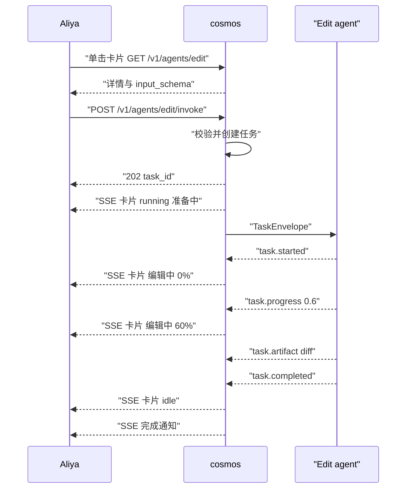
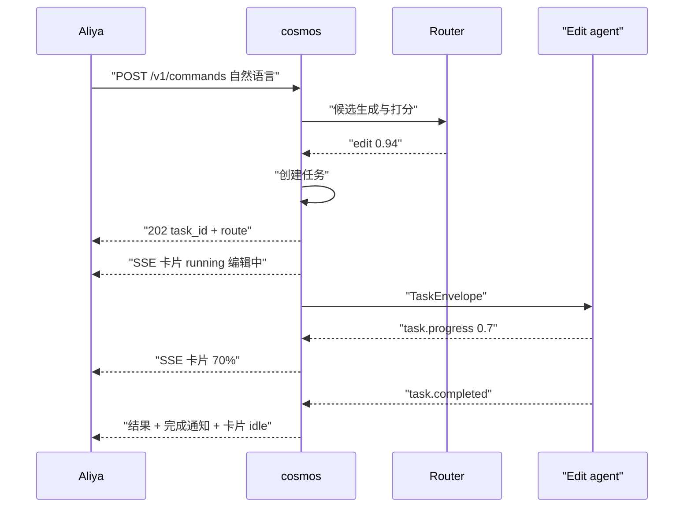

# 7. 示例：Edit agent 的两条调用路径

本示例展示同一次代码编辑请求的两种入口：Aliya 在桌面点击 Edit agent，以及 Aliya 用自然语言下达指令。两条路径最终进入同一个调度管线，桌面状态与通知行为完全一致。

示例中的 Edit agent 清单见 [02-registration.md](02-registration.md) 的 2.1 节。

## 7.1 场景准备

初始状态下 Edit agent 已注册并通过探测：

```json
{
  "agent_id": "edit",
  "lifecycle": "active",
  "enabled": true,
  "health": "healthy",
  "status": "idle",
  "status_text": "空闲",
  "metrics": {"queue_depth": 0, "success_rate_24h": 0.95}
}
```

Aliya 打开桌面：

```http
GET /v1/desktop
Authorization: Bearer <token>
```

桌面返回三个 agent，Edit agent 位于「开发工具」分组：

```json
{
  "stream_seq": 100,
  "groups": [{"id": "dev", "title": "开发工具", "order": 10}],
  "cards": [
    {"agent_id": "edit", "display_name": "Edit agent", "status": "idle", "status_text": "空闲"},
    {"agent_id": "test", "display_name": "Test agent", "status": "running", "metrics": {"progress": 0.7}},
    {"agent_id": "docs", "display_name": "Docs agent", "status": "offline"}
  ]
}
```

## 7.2 路径一：桌面点击 Edit agent

### 步骤 1：打开详情并填写表单

Aliya 单击卡片，cosmos 返回详情与输入 schema：

```http
GET /v1/agents/edit
```

```json
{
  "agent_id": "edit",
  "display_name": "Edit agent",
  "version": "0.1.0",
  "capabilities": [
    {
      "id": "code.edit",
      "description": "修改已有代码文件",
      "risk": "write",
      "input_schema": {
        "type": "object",
        "properties": {
          "target_files": {"type": "array", "items": {"type": "string"}},
          "instruction": {"type": "string"},
          "mode": {"type": "string", "enum": ["patch", "rewrite"]}
        },
        "required": ["target_files", "instruction"]
      }
    }
  ],
  "boundaries": {"workspace_only": true, "allowed_paths": ["/workspace"]},
  "status": "idle"
}
```

Aliya 填写：

- 目标文件：`core/agent/registry.py`
- 指令：`把日志字段改成中文，逻辑保持不变`
- 模式：`patch`

### 步骤 2：提交调用

```http
POST /v1/agents/edit/invoke
Content-Type: application/json

{
  "request_id": "req-A-20261025-0001",
  "session_id": "s-01",
  "input": {
    "target_files": ["core/agent/registry.py"],
    "instruction": "把日志字段改成中文，逻辑保持不变",
    "mode": "patch"
  },
  "constraints": {"priority": "normal", "deadline_ms": 120000}
}
```

cosmos 完成校验：agent 已启用、健康、输入通过 schema、调用方具备 `cosmos:invoke`、`code.edit` 风险为 `write` 且未命中审批规则。创建任务后返回：

```json
{
  "mode": "delegated",
  "request_id": "req-A-20261025-0001",
  "task_id": "01JAV3M8Z9K2Q4W6R8T0Y2B4C6",
  "agent_id": "edit",
  "route": {"source": "desktop", "selected_agent_id": "edit", "confidence": 1.0},
  "accepted_at": "2026-10-25T02:30:00.000Z"
}
```

### 步骤 3：桌面立即进入运行态

cosmos 向 Aliya 推送：

```text
event: desktop.card.updated
id: 101
data: {"stream_seq":101,"at":"2026-10-25T02:30:00.100Z","agent_id":"edit","patch":{"status":"running","status_text":"准备中","metrics":{"progress":0.0,"current_step":"准备中","elapsed_ms":0},"active_tasks":[{"task_id":"01JAV3M8Z9K2Q4W6R8T0Y2B4C6","status":"dispatched","progress":0.0}]}}
```

桌面卡片显示「准备中」，进度环为 0。

### 步骤 4：委派给 Edit agent

```json
{
  "schema_version": "1.0",
  "task_id": "01JAV3M8Z9K2Q4W6R8T0Y2B4C6",
  "request_id": "req-A-20261025-0001",
  "trace_id": "4bf92f3577b34da6a3ce929d0e0e4736",
  "agent_id": "edit",
  "parent_task_id": null,
  "retry_of": null,
  "issued_by": "cosmos",
  "issued_at": "2026-10-25T02:30:00.200Z",
  "deadline_at": "2026-10-25T02:32:00.200Z",
  "priority": "normal",
  "intent": {
    "summary": "把 registry.py 的日志字段改成中文",
    "raw_text": null,
    "action": "edit",
    "objects": ["core/agent/registry.py"]
  },
  "input": {
    "target_files": ["core/agent/registry.py"],
    "instruction": "把日志字段改成中文，逻辑保持不变",
    "mode": "patch"
  },
  "context": {"session_id": "s-01", "workspace": "/workspace", "locale": "zh-CN", "attachments": []},
  "callback": {
    "events_url": "http://127.0.0.1:8080/v1/tasks/01JAV3M8Z9K2Q4W6R8T0Y2B4C6/events",
    "artifacts_url": "http://127.0.0.1:8080/v1/tasks/01JAV3M8Z9K2Q4W6R8T0Y2B4C6/artifacts",
    "token": "<task-scoped-token>",
    "heartbeat_ms": 5000
  },
  "policy": {"timeout_ms": 120000, "max_retries": 0, "retry_safe": false, "requires_approval": false},
  "metadata": {"route_source": "desktop", "plan_id": null, "step_id": null}
}
```

### 步骤 5：执行事件

| 时间 | `seq` | 事件 | 关键内容 | 桌面表现 |
| --- | --- | --- | --- | --- |
| 02:30:01 | 1 | `task.started` | 开始执行 | 「编辑中」，0% |
| 02:30:03 | 2 | `task.progress` | 0.2，读取文件 | 「编辑中」，20% |
| 02:30:06 | 3 | `task.heartbeat` | 健康，耗时 5 秒 | 心跳更新 |
| 02:30:08 | 4 | `task.progress` | 0.6，已修改日志字段 | 「编辑中」，60% |
| 02:30:11 | 5 | `task.heartbeat` | 健康，耗时 10 秒 | 心跳更新 |
| 02:30:14 | 6 | `task.artifact` | `registry.py.diff` | 详情页出现工件 |
| 02:30:16 | 7 | `task.heartbeat` | 健康，耗时 15 秒 | 心跳更新 |
| 02:30:19 | 8 | `task.completed` | 结果与工件 | 「空闲」，完成通知 |

关键事件：

```json
{
  "schema_version": "1.0",
  "event_id": "evt-01JAV6E2",
  "task_id": "01JAV3M8Z9K2Q4W6R8T0Y2B4C6",
  "agent_id": "edit",
  "seq": 4,
  "type": "task.progress",
  "at": "2026-10-25T02:30:08.000Z",
  "payload": {
    "progress": 0.6,
    "current_step": "修改 core/agent/registry.py",
    "message": "已完成日志字段替换",
    "metrics": {"elapsed_ms": 7000, "tokens": 820}
  }
}
```

```json
{
  "schema_version": "1.0",
  "event_id": "evt-01JAV6J7",
  "task_id": "01JAV3M8Z9K2Q4W6R8T0Y2B4C6",
  "agent_id": "edit",
  "seq": 8,
  "type": "task.completed",
  "at": "2026-10-25T02:30:19.000Z",
  "payload": {
    "result": {
      "schema_version": "1.0",
      "task_id": "01JAV3M8Z9K2Q4W6R8T0Y2B4C6",
      "agent_id": "edit",
      "status": "succeeded",
      "started_at": "2026-10-25T02:30:01.000Z",
      "finished_at": "2026-10-25T02:30:19.000Z",
      "output": {
        "summary": "已将 registry.py 的日志字段改为中文，逻辑未变。",
        "changes": [{"path": "core/agent/registry.py", "added": 6, "removed": 6}]
      },
      "artifacts": [
        {
          "artifact_id": "art-01JAV6D1",
          "kind": "diff",
          "name": "registry.py.diff",
          "mime": "text/x-diff",
          "size_bytes": 2048,
          "sha256": "5ff3f7a4dd6310635ab5c8853b209b48f07fa293b3a38d8853478d7d58d12bc9",
          "uri": "cosmos://tasks/01JAV3M8Z9K2Q4W6R8T0Y2B4C6/artifacts/art-01JAV6D1"
        }
      ],
      "metrics": {"elapsed_ms": 18200, "steps": 5, "tokens": 1200},
      "error": null
    }
  }
}
```

### 步骤 6：桌面收尾与通知

```text
event: desktop.card.updated
id: 106
data: {"stream_seq":106,"at":"2026-10-25T02:30:19.100Z","agent_id":"edit","patch":{"status":"idle","status_text":"空闲","metrics":{"progress":0.0,"current_step":null,"elapsed_ms":0,"queue_depth":0,"last_heartbeat_at":"2026-10-25T02:30:16.000Z","success_rate_24h":0.96},"last_task":{"task_id":"01JAV3M8Z9K2Q4W6R8T0Y2B4C6","status":"succeeded","finished_at":"2026-10-25T02:30:19.000Z"}}}
```

```text
event: notification.created
id: 107
data: {"stream_seq":107,"at":"2026-10-25T02:30:19.200Z","notification":{"notification_id":"ntf-01JAV6K6","level":"info","title":"Edit agent 已完成","body":"已修改 core/agent/registry.py，产出 1 个 diff。","agent_id":"edit","task_id":"01JAV3M8Z9K2Q4W6R8T0Y2B4C6","requires_ack":false}}
```

Aliya 看到：卡片从「编辑中」回到「空闲」，通知中心新增一条完成记录，详情页可查看 diff。

### 时序



## 7.3 路径二：自然语言指令

### 步骤 1：发送指令

```http
POST /v1/commands
Content-Type: application/json

{
  "request_id": "req-B-20261025-0001",
  "session_id": "s-01",
  "text": "把 core/agent/registry.py 里的日志字段改成中文，别动逻辑",
  "constraints": {"priority": "normal", "deadline_ms": 120000}
}
```

### 步骤 2：路由识别

cosmos 抽取意图：动作 `edit`，对象 `core/agent/registry.py`，约束「不改逻辑」。候选与分数：

```json
{
  "source": "natural_language",
  "selected_agent_id": "edit",
  "confidence": 0.94,
  "threshold": 0.75,
  "candidates": [
    {"agent_id": "edit", "score": 0.94, "reasons": ["capability:code.edit", "keyword:改代码", "embedding:0.91"]},
    {"agent_id": "test", "score": 0.32, "reasons": ["embedding:0.34"]},
    {"agent_id": "docs", "score": 0.16, "reasons": ["embedding:0.21"]}
  ],
  "rules_applied": ["explicit_capability_match", "workspace_path_detected"],
  "decided_at": "2026-10-25T02:30:00.000Z"
}
```

最高分 0.94 超过自动阈值 0.75，且与次高分差距 0.62 超过 0.08，直接路由到 Edit agent。输入由 cosmos 结构化：

```json
{
  "target_files": ["core/agent/registry.py"],
  "instruction": "把日志字段改成中文，别动逻辑",
  "mode": "patch"
}
```

### 步骤 3：受理并更新桌面

```json
{
  "mode": "delegated",
  "request_id": "req-B-20261025-0001",
  "task_id": "01JAV8P1Q2R3S4T5U6V7W8X9Y0",
  "route": {
    "source": "natural_language",
    "selected_agent_id": "edit",
    "confidence": 0.94,
    "candidates": [
      {"agent_id": "edit", "score": 0.94},
      {"agent_id": "test", "score": 0.32},
      {"agent_id": "docs", "score": 0.16}
    ]
  },
  "accepted_at": "2026-10-25T02:30:00.100Z"
}
```

```text
event: desktop.card.updated
id: 201
data: {"stream_seq":201,"at":"2026-10-25T02:30:00.200Z","agent_id":"edit","patch":{"status":"running","status_text":"编辑中","metrics":{"progress":0.0,"current_step":"准备编辑"}}}
```

### 步骤 4：委派与执行

任务信封与路径一结构一致，差异在 `metadata.route_source` 为 `natural_language`，`intent.raw_text` 保留原始指令。

| 时间 | `seq` | 事件 | 桌面表现 |
| --- | --- | --- | --- |
| 02:30:01 | 1 | `task.started` | 「编辑中」0% |
| 02:30:03 | 2 | `task.progress` 0.3 | 「编辑中」30% |
| 02:30:06 | 3 | `task.heartbeat` | 心跳更新 |
| 02:30:10 | 4 | `task.progress` 0.7 | 「编辑中」70% |
| 02:30:11 | 5 | `task.heartbeat` | 心跳更新 |
| 02:30:16 | 6 | `task.heartbeat` | 心跳更新 |
| 02:30:17 | 7 | `task.artifact` | 详情页出现 diff |
| 02:30:18 | 8 | `task.completed` | 「空闲」+ 完成通知 |

完成结果：

```json
{
  "schema_version": "1.0",
  "task_id": "01JAV8P1Q2R3S4T5U6V7W8X9Y0",
  "agent_id": "edit",
  "status": "succeeded",
  "started_at": "2026-10-25T02:30:01.000Z",
  "finished_at": "2026-10-25T02:30:18.000Z",
  "output": {
    "summary": "已将 core/agent/registry.py 的日志字段改为中文，未改动业务逻辑。",
    "changes": [{"path": "core/agent/registry.py", "added": 6, "removed": 6}]
  },
  "artifacts": [
    {
      "artifact_id": "art-01JAV8Q2",
      "kind": "diff",
      "name": "registry.py.diff",
      "mime": "text/x-diff",
      "size_bytes": 1980,
      "sha256": "5ff3f7a4dd6310635ab5c8853b209b48f07fa293b3a38d8853478d7d58d12bc9",
      "uri": "cosmos://tasks/01JAV8P1Q2R3S4T5U6V7W8X9Y0/artifacts/art-01JAV8Q2",
      "created_at": "2026-10-25T02:30:17.000Z"
    }
  ],
  "metrics": {"elapsed_ms": 17800, "steps": 5, "tokens": 1180},
  "error": null
}
```

cosmos 回传的结果消息与通知：

```json
{
  "task_id": "01JAV8P1Q2R3S4T5U6V7W8X9Y0",
  "agent_id": "edit",
  "status": "succeeded",
  "reply": {
    "text": "已完成：core/agent/registry.py 的日志字段已改为中文，逻辑未变。附 1 个 diff。",
    "refs": ["cosmos://tasks/01JAV8P1Q2R3S4T5U6V7W8X9Y0/artifacts/art-01JAV8Q2"]
  }
}
```

### 时序



## 7.4 两条路径对照

| 维度 | 桌面点击 | 自然语言 |
| --- | --- | --- |
| 目标确定 | 直接指定 `edit` | 路由打分 `0.94` |
| 输入来源 | 表单按 schema 生成 | cosmos 从文本抽取 |
| 校验 | schema、启停、权限、风险 | 同左，额外做意图置信度判断 |
| 任务模型 | 完全相同 | 完全相同 |
| 事件流 | 完全相同 | 完全相同 |
| 桌面更新 | 完全相同 | 完全相同 |
| 通知 | 完全相同 | 完全相同 |

两条路径只在「目标如何确定」与「输入如何产生」上不同，进入调度器后不再区分来源。

## 7.5 变体一：需要澄清

Aliya 发送：

```text
处理一下这个文件
```

路由结果：

```json
{
  "candidates": [
    {"agent_id": "edit", "score": 0.62},
    {"agent_id": "docs", "score": 0.55}
  ],
  "tie": true
}
```

最高分低于自动阈值，且与次高分接近，cosmos 返回澄清：

```json
{
  "mode": "clarify",
  "request_id": "req-C-20261025-0001",
  "question": "要处理哪个文件，做什么操作？",
  "options": [
    {"id": "edit-registry", "label": "修改 core/agent/registry.py", "agent_id": "edit"},
    {"id": "docs-registry", "label": "为 registry.py 补文档", "agent_id": "docs"}
  ],
  "expires_at": "2026-10-25T02:35:00.000Z"
}
```

不创建任务，不占用队列。Aliya 选择后，cosmos 用同一 `session_id` 补全请求并进入正常委派流程。

## 7.6 变体二：需要审批

Aliya 发送：

```text
把 core/agent 下的旧实现全部重写
```

请求命中 Edit agent 的 `file.bulk_rewrite`，cosmos 创建任务但停在 `waiting_approval`：

```json
{
  "mode": "approval",
  "request_id": "req-D-20261025-0001",
  "task_id": "01JAV9A1B2C3D4E5F6G7H8J9K0",
  "approval": {
    "approval_id": "apr-01JAV9A1",
    "agent_id": "edit",
    "action": "file.bulk_rewrite",
    "risk": "write",
    "summary": "将重写 12 个文件，预计删除 340 行、新增 410 行",
    "expires_at": "2026-10-25T02:40:00.000Z"
  }
}
```

桌面卡片显示「等待审批」，通知中心出现审批卡片。Aliya 批准：

```http
POST /v1/tasks/01JAV9A1B2C3D4E5F6G7H8J9K0/approve
Content-Type: application/json

{"approval_id": "apr-01JAV9A1", "reason": "确认重构范围"}
```

cosmos 将任务从 `waiting_approval` 转回 `queued`，随后按正常流程下发。拒绝则任务转为 `cancelled`，不产生任何文件改动。

## 7.7 变体三：执行失败与重试

Edit agent 在运行中发现目标文件已被其他任务修改，上报：

```json
{
  "schema_version": "1.0",
  "event_id": "evt-01JAV9B2",
  "task_id": "01JAV9C1D2E3F4G5H6J7K8M9N0",
  "agent_id": "edit",
  "seq": 5,
  "type": "task.failed",
  "at": "2026-10-25T02:31:00.000Z",
  "payload": {
    "error": {
      "code": "EDIT_CONFLICT",
      "message": "目标文件已被其他任务修改，请确认后重试。",
      "retryable": true,
      "details": {"path": "core/agent/registry.py"}
    },
    "partial_output": {"summary": "已完成读取与差异分析，未写入文件。"}
  }
}
```

桌面表现：

```text
event: desktop.card.updated
id: 301
data: {"stream_seq":301,"at":"2026-10-25T02:31:00.100Z","agent_id":"edit","patch":{"status":"error","status_text":"执行失败","alert":{"level":"warning","text":"文件冲突，可重试"},"badge":{"running":0,"waiting":0,"failed_24h":3}}}
```

```text
event: notification.created
id: 302
data: {"stream_seq":302,"at":"2026-10-25T02:31:00.200Z","notification":{"notification_id":"ntf-01JAV9B3","level":"warning","title":"Edit agent 执行失败","body":"目标文件已被其他任务修改，可重试或查看详情。","agent_id":"edit","task_id":"01JAV9C1D2E3F4G5H6J7K8M9N0","requires_ack":false,"actions":[{"id":"retry","label":"重试","method":"POST","path":"/v1/tasks/01JAV9C1D2E3F4G5H6J7K8M9N0/retry"}]}}
```

Aliya 点击「重试」：

```http
POST /v1/tasks/01JAV9C1D2E3F4G5H6J7K8M9N0/retry
Content-Type: application/json

{"request_id": "req-E-20261025-0001"}
```

cosmos 创建新任务：

```json
{
  "task_id": "01JAV9D1E2F3G4H5J6K7M8N9P0",
  "retry_of": "01JAV9C1D2E3F4G5H6J7K8M9N0",
  "agent_id": "edit",
  "status": "queued"
}
```

卡片从「执行失败」切回「运行中」，失败计数保留在 24 小时统计中。重试成功后，卡片回到「空闲」，失败告警自动清除。

## 7.8 状态时间线

| 阶段 | 任务状态 | 卡片状态 | 卡片文案 | 通知 |
| --- | --- | --- | --- | --- |
| 受理 | `queued` | `running` | 排队中 | 无 |
| 下发 | `dispatched` | `running` | 准备中 | 无 |
| 启动 | `running` | `running` | 编辑中 | 无 |
| 进度 | `running` | `running` | 编辑中 60% | 无 |
| 完成 | `succeeded` | `idle` | 空闲 | 完成通知 |
| 失败 | `failed` | `error` | 执行失败 | 失败通知 |
| 取消 | `cancelled` | `idle` | 已取消 | 取消通知 |
| 超时 | `timeout` | `error` | 执行超时 | 告警通知 |

示例说明一件事：cosmos 的价值在「同一套状态机与展示模型」上。无论请求从桌面点击还是自然语言进入，Aliya 看到的进度、通知、错误与干预入口都一致。
