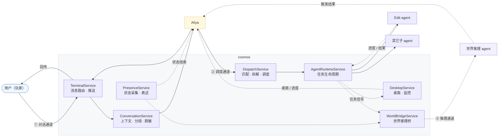

# 01 架构说明

本章定义 cosmos 的角色边界、组件划分、通信方式与消息流向，并划清与 `agent/aliya` 的代码边界。后续各章都在这个骨架上展开。

---

## 1. 角色与职责

| 参与方 | 是什么 | 负责 | 不负责 |
| --- | --- | --- | --- |
| 用户（玩家） | 对话的另一端 | 发起聊天、下达任务、查询状态 | —— |
| cosmos | 主 agent（Supervisor / Orchestrator） | 通信终端、调度中枢、状态感知 | 不执行业务、不代替 Aliya 说话、不做最终决策 |
| Aliya | 上层控制者与对话主体 | 理解用户、决定是否调度、组织回应、自主行动 | 不直接接触子 agent 运行时、不直接向用户投递 |
| 子 agent | 执行单元（如 Edit agent） | 执行具体任务、上报进度、返回结果 | 不接触用户、不访问对话上下文、不调度其他 agent |
| 世界推理 agent | Aliya 的后台参谋 | 推演世界状态、给出可能性与行动窗口 | 不接收用户消息、不触发调度、不占桌面 |

三层职责一句话：**Aliya 想，cosmos 转，子 agent 做。**

---

## 2. 通信拓扑



三条通道必须分开理解：

| 通道 | 端点 | 语义 |
| --- | --- | --- |
| 对话通道 | 用户 ↔ cosmos ↔ Aliya | 自然语言、有语气与人格、面向用户 |
| 调度通道 | Aliya ↔ cosmos ↔ 子 agent | 结构化任务、有状态与进度、面向系统 |
| 推理通道 | cosmos ↔ 世界推理 agent → Aliya | 结构化信号、单向参考、不面向用户 |

对话通道与调度通道**共用同一条物理链路**（同一个 `MessageBus`），但逻辑上维护两套上下文，见 [06-terminal.md](06-terminal.md#5-双上下文分离)。

---

## 3. 通信方式

| 方式 | 含义 | 用在 |
| --- | --- | --- |
| 同步请求-响应 | 调用方等待返回值 | Aliya 查询状态、桌面操作、短任务（< 2s） |
| 异步任务 | 立即返回 `task_id`，结果经事件推送 | 一切子 agent 执行（编辑、长时间任务） |
| 事件订阅 | 订阅 `presence.changed` / `agent.*` / `world.inference` | Aliya 的面板刷新与自主决策 |
| 自动委派 | cosmos 依据意图与置信度自动启动子 agent | `dispatch.mode: auto` 且置信度达标时 |

选择原则：**只要跨子 agent 边界，就一律异步**。cosmos 不阻塞等子 agent 跑完——Aliya 需要能随时取消、能同时推进多件事，也会在等待期间继续和用户聊天。

`dispatch.mode: suggest`（默认）下 cosmos 只给建议，由 Aliya 决定是否启动；`auto` 下 cosmos 可在置信度 ≥ 阈值时直接启动，但结果仍只回给 Aliya，不直达用户。

### 3.1 链路状态

人设里有一条硬设定：**曲率航行期间通讯中断**。这不是异常，是常态。

```python
type LinkState = Literal["up", "unstable", "down"]
```

| 状态 | 触发 | 行为 |
| --- | --- | --- |
| `up` | 正常 | 收发照常 |
| `unstable` | 延迟升高或丢包 | 照常收发但标 `degraded`，主动消息暂缓 |
| `down` | 曲率航行 / 链路彻底断开 | 停止投递，用户消息与 Aliya 的回复进队列；主动消息一律不投 |

规则：

| 规则 | 说明 |
| --- | --- |
| 中断期不丢消息 | 双向都进持久队列，恢复后按序重放 |
| 中断期不推主动消息 | Aliya 的「想说话」留到恢复后，由她重新判断 |
| 恢复必有事件 | 推 `link.state.changed`，Aliya 据此决定是否续上之前的话头 |
| 不向 Aliya 解释原理 | 她理解成「进行曲率航行时通信会断」，不能说「同步器带宽不足」 |

`LinkState` 由通道层判定（心跳、延迟、显式信号），`TerminalService` 只消费。人设层面它对应「曲率航行期间通讯中断」，工程层面它就是一次可控的长时间断链。

---

## 4. 消息流向

### 4.1 用户 → Aliya

```text
用户消息
  → TerminalService.ingest()
  → PresenceService.touch()            更新活跃度与输入状态
  → 组装 ConversationContext（历史摘要 + 用户状态摘要 + 任务摘要）
  → MessageBus.publish(aliya, message)
```

用户消息**永不到达子 agent**。cosmos 不再做意图分类，所有消息先到 Aliya，由 Aliya 决定如何回应或是否调度。

### 4.2 Aliya → 用户

```text
Aliya 回复
  → TerminalService.deliver()
  → ConversationService.format()        格式化 + 脱敏
  → 用户侧推送
  → 写入 ConversationContext
```

Aliya 的回复**永不绕过 cosmos**。cosmos 只做格式化与脱敏，不改写措辞。

### 4.3 Aliya → 子 agent

```text
Aliya 指令（点击 / 自然语言 / 显式调用）
  → ControlService.invoke_agent()
  → DispatchService.plan()              Resolve → Plan
  → AgentRuntimeService.submit()        异步执行，返回 task_id
  → 子 agent `handle(request, ctx)`  ← 只拿到 AgentRequest，拿不到对话上下文
  → ctx.report() / ctx.finish()
```

### 4.4 子 agent → Aliya

```text
子 agent 进度/结果
  → AgentRuntimeService 汇总
  → EventBus.publish(agent.progress / agent.result / agent.abnormal)
  → DesktopService 刷新桌面状态
  → WorldBridgeService 更新任务信号
  → TerminalService 推给 Aliya（附可解读摘要）
```

子 agent 的结果**先回 Aliya，再由 Aliya 决定怎么告诉用户**。例外：纯进展类通知（"已开始处理"）可由 cosmos 直接投递，但必须走 `TerminalService` 的格式化通道，内容限于进度与状态，不含结论。

### 4.5 世界推理 → Aliya

```text
WorldBridgeService 组装 WorldInput
  → WorldReasoningPort.infer(input)     超时即丢弃，不阻塞主链路
  → WorldInference（缓存 + TTL）
  → TerminalService 推给 Aliya
```

---

## 5. 组件与依赖

| 组件 | 关键职责 | 依赖 |
| --- | --- | --- |
| `AgentRegistryService` | `AgentCard` 注册、查询、能力检索 | `AgentCosmosSettings` |
| `AgentRuntimeService` | 任务生命周期、进度、取消、超时、幂等去重 | `AgentRegistryService` |
| `DesktopService` | 布局、分组、排序、可见性、桌面快照 | `AgentRegistryService` |
| `PresenceService` | 用户状态采集、聚合、派生表述、变化事件 | `ClockService` |
| `ConversationService` | 上下文摘要、分段、脱敏 | `LLMService` |
| `DispatchService` | 统一调度管线、匹配、并行、降级 | 上面四个 |
| `WorldBridgeService` | 输入组装、结果转发、缓存 | `ClockService`、`PresenceService`、`AgentRuntimeService` |
| `TerminalService` | 双向消息、推送、主动消息节流 | `ConversationService`、`PresenceService` |
| `ControlService` | Aliya 控制面 | 以上全部 |
| `ControlServerService` | 控制面 UDS/NDJSON 端点：握手、RPC、入站与事件推送 | `ControlService`、`ClockService`、`AgentSettings` |

依赖成链：`ControlServerService → ControlService → TerminalService → DispatchService → RuntimeService → RegistryService`。启动顺序由 `ServiceManager` 按类型自动分层，不要手工排序。

`AgentRegistryService` 不依赖任何 LLM 服务：注册与查询是纯数据操作，测试时可脱离模型单独跑。

---

## 6. 与 `agent/aliya` 的代码边界

`agent/aliya` 已实现为独立进程，通过 UDS 控制面连接 cosmos；接口边界必须明确：

| 由 cosmos 提供 | 由 Aliya 自己实现 |
| --- | --- |
| `TerminalService.ingest()` 接收用户消息 | 怎么理解、怎么回应 |
| `ConversationContext`（历史摘要、用户状态摘要） | 怎么使用这些上下文 |
| `ControlService` / `ControlPort` 全部方法（桌面、调度、订阅） | 何时调用、调用哪个 |
| `WorldInference`（状态摘要、假设、行动窗口） | 采纳还是忽略 |
| `TerminalService.send_to_user()` / `notify()` | 说什么、什么时候说 |

代码层面的硬约束：

| 约束 | 理由 |
| --- | --- |
| Aliya 的生产路径不 import `agent.cosmos.services.*`，只依赖 `agent.cosmos.contracts` 与 `ControlPort`；`InProcessControl` 仅用于测试 | 换实现不破坏 Aliya |
| Aliya 不直接持有子 agent handler 引用 | 否则绕过调度与状态监控 |
| Aliya 不直接写 `ConversationContext` 的存储，只通过 `TerminalService` 提交 | 避免两份历史打架 |
| cosmos 不 import `agent.aliya.*` | 依赖方向必须是 Aliya → cosmos → core |

依赖方向：

```text
agent.aliya  ──►  agent.cosmos.contracts / ControlPort  ──►  core.*
```

生产环境 Aliya 通过 `ControlServerService` 的 UDS/NDJSON 端点调用 `ControlService`；测试可用 `InProcessControl` 直接委托。反向依赖只允许一种：cosmos 通过 `MessageBus` 端点名称（`"aliya"`）投递消息，这是运行期解耦，不是代码依赖。

---

## 7. 部署形态

| 形态 | 适用 | 差异点 |
| --- | --- | --- |
| 同进程（默认） | 单机部署、开发调试 | `MessageBus` / `EventBus` 用 asyncio 队列；时间戳统一 `ClockService`；无序列化开销 |
| 独立进程（Aliya） | Aliya 独立迭代、崩溃隔离 | 控制面走 Unix 域套接字 + NDJSON；首行握手，之后请求-响应、入站与事件共用一条连接 |
| 分进程 / 跨机 | 多客户端、远程部署 | 换成 IPC / WebSocket 适配器；所有契约必须可 JSON 序列化；事件需要重连与补偿 |

设计要求：**契约模型一律可 JSON 序列化**，不使用只有同进程能传的对象（future、生成器、闭包）。这样换传输层时不用改契约。

传输层是端口（`MessageBus` / `EventBus`），不是组件：`TerminalService` 只依赖端口，不知道背后是队列还是 WebSocket。

### 7.1 为什么端口要由一个 Service 承载

端口是接口，接口本身没有生命周期，但进程内实现有：队列要创建、要关闭、要取消订阅者。因此默认实现交给 `BusService` 托管——它只做三件事：

| 职责 | 说明 |
| --- | --- |
| 持有实现 | 内部构造 `MemoryMessageBus` / `MemoryEventBus` |
| 暴露端口 | `bus.messages` / `bus.events` 返回 `MessageBusPort` / `EventBusPort` |
| 管理生命周期 | `start()` 初始化、`stop()` 关闭所有队列并唤醒等待者 |

其他服务把 `BusService` 当普通依赖注入，再通过属性拿端口；换 WebSocket / IPC 时只换 `BusService` 内部的实现，服务代码与端口签名不动。

`UserChannelPort` / `WorldReasoningPort` 这类部署方端口不走容器注入（容器只认 Service 与配置节点），而是在 `start()` 前用 setter 注入：

```python
terminal.set_user_channel(channel)
world.set_port(port)
```

链路状态这类「反向读取」也用 setter 解耦：`assembly` 把 `TerminalService.link_state` 注册给 `WorldBridgeService`，两个服务的构造器因此没有循环依赖。

分进程形态新增的必答题（同进程下可以不做）：

- 断线重连后的事件补偿：按 `event_id` 与 `sequence` 拉取缺口。
- 投递语义：默认至少一次（at-least-once），消费方按 `event_id` 去重。
- 时钟偏差：以 cosmos 侧时间戳为准，Aliya 侧不自行生成排序依据。

---

## 8. 错误分层

| 类别 | 处理方式 | 例子 |
| --- | --- | --- |
| 输入问题 | 结构化回填，让调用方自我纠正 | 参数不合法、agent_id 不存在于当前桌面、消息为空 |
| 运行期失败 | 记录 + 事件推送 + 降级 | 子 agent 超时、世界推理超时、推送失败 |
| 配置/编程错误 | fail fast，启动期抛错 | 卡片重名、依赖缺失、桌面引用不存在的 agent |

错误树统一继承 `CosmosError`，调用方可一次 `except CosmosError` 兜住：

| 类型 | 触发条件 |
| --- | --- |
| `AgentRegistrationError` | 卡片字段非法、重名、能力声明冲突 |
| `AgentNotFoundError` | 引用了未注册或已禁用的 agent |
| `AgentInvokeError` | 提交任务失败（handler 不可用、参数不符合 schema） |
| `AgentBusyError` | 超过并发上限或该 agent 不允许并发 |
| `DispatchError` | 无法生成调度计划（无候选、置信度过低且未指定目标） |
| `PresenceError` | 状态字段非法、采集开关冲突 |
| `PresencePrivacyError` | 请求了未授权字段 |
| `WorldBridgeError` | 输入组装失败、推理端口未配置 |
| `MessageDeliveryError` | 投递失败且重试耗尽 |

配置类错误继承 `core.service.ServiceError` 的语义（启动失败、进程退出）；运行期错误不杀进程，只影响单条链路。

---

## 9. 明确不做的事

| 不做 | 交给谁 |
| --- | --- |
| 理解用户意图的语义细节、组织回应内容 | Aliya |
| 执行编辑、读写文件等业务操作 | 子 agent |
| 修改或解释世界推理结论 | 不改写，原样转发 |
| 采集用户在设备上的隐私数据（剪贴板、屏幕、位置） | 不采集 |
| 向用户回显用户状态（"检测到你情绪低落"） | 永不 |
| 记忆长期人格设定与关系进展 | Aliya |
| 承担子 agent 内部的 ReAct 循环 | 子 agent，用 `core.agent` 自行组装 |
| 向 Aliya 解释时间同步原理、装置构成、信号来源 | 永不（人设要求维持信息差） |
| 让 Aliya 看到「玩家 / 用户 / agent / 模型 / 调度」这类工程词 | 永不，用她的语言 |
| 改写她的语气：合并短句、补标点、加旁白 | 永不，见 [06](06-terminal.md#61-三类回传) |
