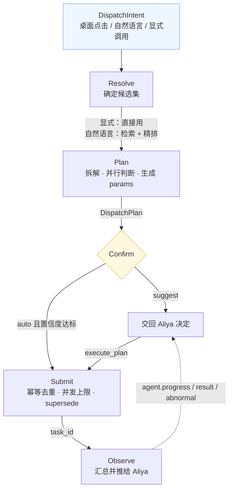

# 05 任务分发策略

Aliya 有三种方式让子 agent 干活：在桌面上点击、说一句话、直接调用接口。三者最终走**同一条管线**，区别只在第一步的「候选从哪来」。

---

## 1. 三个入口

| 入口 | 触发方式 | 已知信息 | 典型场景 |
| --- | --- | --- | --- |
| 桌面点击 | Aliya 选中卡片 → `invoke_agent(id, params)` | 目标 agent 确定 | 明确知道要用哪个工具 |
| 自然语言 | Aliya 说 / 用户说的任务经 Aliya 转述 | 只有文本 | 不确定该用哪个 agent |
| 显式调用 | Aliya 用代码调 `dispatch(intent)` | 自己组装 | 组合流程、条件分支 |

对 Aliya 来说，前两者只是「界面」与「语言」的差别；对 cosmos 来说，差别只体现在 `Resolve` 阶段。

---

## 2. 统一管线



### 2.1 输入

```python
class DispatchIntent(BaseModel):
    source: Literal["desktop", "natural_language", "explicit"]
    session_id: str                    # 一次会话/一回合的标识
    user_text: str | None = None       # 原始文本（自然语言入口）
    agent_id: str | None = None        # 目标（桌面入口 / 显式调用）
    params: dict[str, object] | None = None
    hint: str | None = None            # Aliya 的额外意图提示，如 "只改 logger"
```

### 2.2 输出

```python
class DispatchPlan(BaseModel):
    decision: DispatchDecision
    tasks: list[PlannedTask]
    confidence: float                  # 0–1，整体置信度
    rationale: str                     # 一句话说明为什么这么分，给 Aliya 看
    missing: list[str] = []            # decision=clarify 时缺什么

class PlannedTask(BaseModel):
    agent_id: str
    params: dict[str, object]
    label: str                         # 任务的一句话描述，用于桌面与进度；用她的语言，不带任务 id
    depends_on: list[int] = []         # 依赖同批次其它任务的序号（0 基）

type DispatchDecision = Literal[
    "reply_only",   # 不需要子 agent，交回 Aliya 自己回应
    "single",       # 委派给一个 agent
    "parallel",     # 拆成多个可并行任务
    "clarify",      # 信息不足，交回 Aliya 追问
    "rejected",     # 无可用 agent / 越权 / 参数无法满足
]
```

`rationale` 必须有，且只用一句话说明调度理由（「把改文件交给编辑台」），不暴露内部评分细节。它是给 Aliya 看的，不是给用户看的；用词按她的语言，不出现 agent id。

---

## 3. Resolve：候选从哪来

### 3.1 显式入口

`agent_id` 已给出：

| 检查 | 失败结果 |
| --- | --- |
| agent 存在 | `AgentNotFoundError` |
| 未 `disabled` | `AgentNotFoundError(reason="disabled")` |
| `params` 符合 `params_schema` 的顶层结构 | `AgentInvokeError` |
| 并发未超限或可排队 | `AgentBusyError` |

显式入口**不做语义匹配**。Aliya 说用哪个就用哪个，选错了是 Aliya 的判断，cosmos 不替它纠正。

### 3.2 自然语言入口

两级检索：

```text
文本
 ├─ 第一级：registry.match(text, top_k=5)       纯检索，无模型调用
 │    ├─ 命中 1 个且 score ≥ high_threshold → 直接作为候选
 │    ├─ 命中多个 → 进第二级
 │    └─ 无命中 → decision=rejected（rationale="没有匹配的 agent"）
 │
 └─ 第二级：LLM 结构化精排
      输入：候选卡片的 id / name / summary / description / capabilities / examples
            用户文本 + Aliya 的 hint
      输出：{agent_id, params, confidence, reason}
      校验：params 必须符合 params_schema 顶层结构
```

用 `core.llm.chat_structured` 做精排，输出模型：

```python
class MatchResult(BaseModel):
    agent_id: str
    params: dict[str, object]
    confidence: float          # 0–1
    reason: str                # 命中依据，≤ 40 字
```

约束：

| 约束 | 说明 |
| --- | --- |
| 只从候选里选 | 模型输出不在候选集的 `agent_id` 直接判无效，不二次重试 |
| 候选上限 5 个 | 卡片 `description` 加起来可能很长，超过 5 个反而降低准确率 |
| 不猜参数 | 必填参数拿不到就 `decision=clarify`，不要填占位值 |
| 低置信度不硬上 | `confidence < min_confidence`（默认 0.6）时转 `suggest` 模式交 Aliya 判断 |

### 3.3 拆解

一个请求可能需要多个 agent（「改完代码顺便跑个测试」）。拆解规则：

| 条件 | 处理 |
| --- | --- |
| 单动词、单目标 | `single` |
| 多个独立目标，无先后依赖 | `parallel` |
| 有先后依赖（先改再测） | `parallel` + `depends_on`（`AgentRuntimeService` 按依赖调度） |
| 依赖关系不确定 | `clarify`，让 Aliya 明确顺序 |
| 任务超出所有 agent 的能力边界 | `rejected`，`rationale` 说明缺什么能力 |

拆解本身也用一次结构化调用（把候选卡片 + 文本一起给模型），但**只在第一级检索命中 ≥ 2 个候选时才做**，避免每个简单请求都付一次模型成本。

---

## 4. 决策表

| 场景 | decision | 后续 |
| --- | --- | --- |
| 纯聊天、无需工具 | `reply_only` | 消息交回 Aliya，附 `rationale="无需调用 agent"` |
| 明确一个 agent、参数齐全 | `single` | 提交任务 |
| 多个 agent、参数齐全 | `parallel` | 按依赖与上限提交 |
| 缺必填参数 | `clarify` | 交回 Aliya，附 `missing` 列表 |
| 无匹配 agent | `rejected` | 交回 Aliya，附 `rationale` |
| 目标被禁用 / 越权 | `rejected` | 同上，`rationale` 说明原因 |

`clarify` 与 `rejected` 都**不直接问用户**。cosmos 把结构化的「缺什么 / 为什么不行」交给 Aliya，由 Aliya 用自己的话说。这是「cosmos 不代替 Aliya 说话」的具体落点。

---

## 5. 确认模式

| 模式 | 行为 | 适用 |
| --- | --- | --- |
| `suggest`（默认） | 生成 `DispatchPlan` 后返回给 Aliya，等它调用 `invoke_plan(plan)` | 有副作用、成本高、语义模糊的任务 |
| `auto` | `confidence ≥ auto_threshold` 且 `decision ∈ {single, parallel}` 时直接提交 | 高频、低风险、语义清晰的任务 |

`auto` 的额外约束：

- 只在 `mode=auto` 且 `decision` 为 `single` / `parallel` 时生效。`clarify` / `rejected` 永远走 `suggest`。
- 参数不完整时即使置信度高也不自动执行。
- 提交后仍推 `agent.submitted` 给 Aliya，让它知道发生了什么（**自动不等于静默**）。

---

## 6. 并行调度

### 6.1 并行条件

同时满足才并行：

1. `tasks` 之间没有 `depends_on` 环。
2. 各 agent 的 `max_concurrent` 允许。
3. 总并发不超过 `dispatch.max_parallel`（默认 3）。
4. 任务之间没有共享写目标（如两个 Edit agent 任务改同一个文件）。

第 4 条靠 `params` 里的路径字段粗判：交集非空则改为串行，并在 `rationale` 里说明。**宁可慢一点，也不让两个 agent 同时改一个文件。**

### 6.2 提交与聚合

```python
task_ids = await runtime.submit_many(plan.tasks)
```

`AgentRuntimeService` 按 `depends_on` 拓扑排序，同层并发，层间串行。任一层有任务失败时：

| 情况 | 处理 |
| --- | --- |
| 失败任务无下游依赖 | 其余任务继续，`DispatchOutcome` 标 `partial` |
| 失败任务有下游依赖 | 下游标 `skipped`，其余分支继续 |
| 全部失败 | `DispatchOutcome.status = "failed"` |

### 6.3 结果聚合

```python
class DispatchOutcome(BaseModel):
    dispatch_id: str
    status: Literal["ok", "partial", "failed", "cancelled"]
    results: list[AgentResult]
    elapsed_seconds: float
    summary: str            # 结构化摘要，如 "2 个任务完成，1 个失败"
```

**cosmos 不合并内容结论。** 它只汇总状态与各自的 `summary`，最终怎么说由 Aliya 决定。原因很简单：两个 agent 的输出可能矛盾（一个说改好了，一个说测试挂了），合并成一段话就等于替 Aliya 下结论。

---

## 7. 幂等与去重

| 机制 | 规则 |
| --- | --- |
| 去重键 | `sha256(session_id + agent_id + 规范化 params)` |
| 去重窗口 | 60 秒 |
| 命中行为 | 返回已有 `task_id`，不新建任务，事件标 `deduplicated=true` |
| supersede | `cancel_on_supersede=true` 时，同 `session_id` + 同 agent 的旧任务被取消，新任务继续 |
| 重试 | 新 `task_id`，不改原任务记录 |

去重窗口内参数变了就不算重复——用户改主意是正常行为。

---

## 8. 失败与降级

| 场景 | 表现 | Aliya 看到什么 |
| --- | --- | --- |
| 匹配模型超时 | 回退到第一级检索结果；只有 1 个候选且分数高则 `single`，否则 `clarify` | `rationale="匹配服务超时，按关键词结果建议"` |
| 匹配模型返回非法 JSON | 同上，不重试（重试成本 > 收益） | 同上 |
| 参数不足以执行 | `clarify` | `missing` 列表 |
| agent 在提交前被禁用 | `rejected` | `rationale="目标 agent 已停用"` |
| 提交时并发已满且 `queue=false` | `AgentBusyError` | `rationale="编辑台还在弄 2 个东西"` |
| 子 agent 执行失败 | 不影响其它任务 | 各自 `AgentResult.status` |

降级原则：**宁可少做，不可做错**。语义不明时问 Aliya，参数不明时问 Aliya，能力不足时说清楚缺什么。绝不「先猜一个跑跑看」。

---

## 9. 接口

```python
class DispatchService(Service):
    async def plan(self, intent: DispatchIntent) -> DispatchPlan: ...
    async def execute(self, plan: DispatchPlan) -> DispatchOutcome: ...
    async def dispatch(self, intent: DispatchIntent) -> DispatchOutcome: ...
    async def cancel(self, dispatch_id: str) -> None: ...
```

| 方法 | 语义 |
| --- | --- |
| `plan()` | 只生成计划，不执行。`suggest` 模式的主路径 |
| `execute()` | 执行已有计划（Aliya 确认后调用），幂等 |
| `dispatch()` | `plan` + `execute`，仅在 `auto` 模式下由内部使用 |
| `cancel()` | 取消该批次所有未完成任务 |

---

## 10. 日志

| 事件 | 级别 | 字段 |
| --- | --- | --- |
| 计划生成 | INFO | `dispatch_id`、`decision`、`候选数`、`耗时毫秒`、`置信度` |
| 候选匹配 | DEBUG | `dispatch_id`、`候选数`、`命中来源`（检索 / 模型） |
| 任务提交 | INFO | `dispatch_id`、`agent_id`、`task_id`、`并发数` |
| 去重命中 | INFO | `dispatch_id`、`已有task_id` |
| 聚合完成 | INFO | `dispatch_id`、`状态`、`成功数`、`失败数`、`耗时毫秒` |

不记录 `params` 内容（可能含文件路径与用户数据），只记录字段名与数量。
