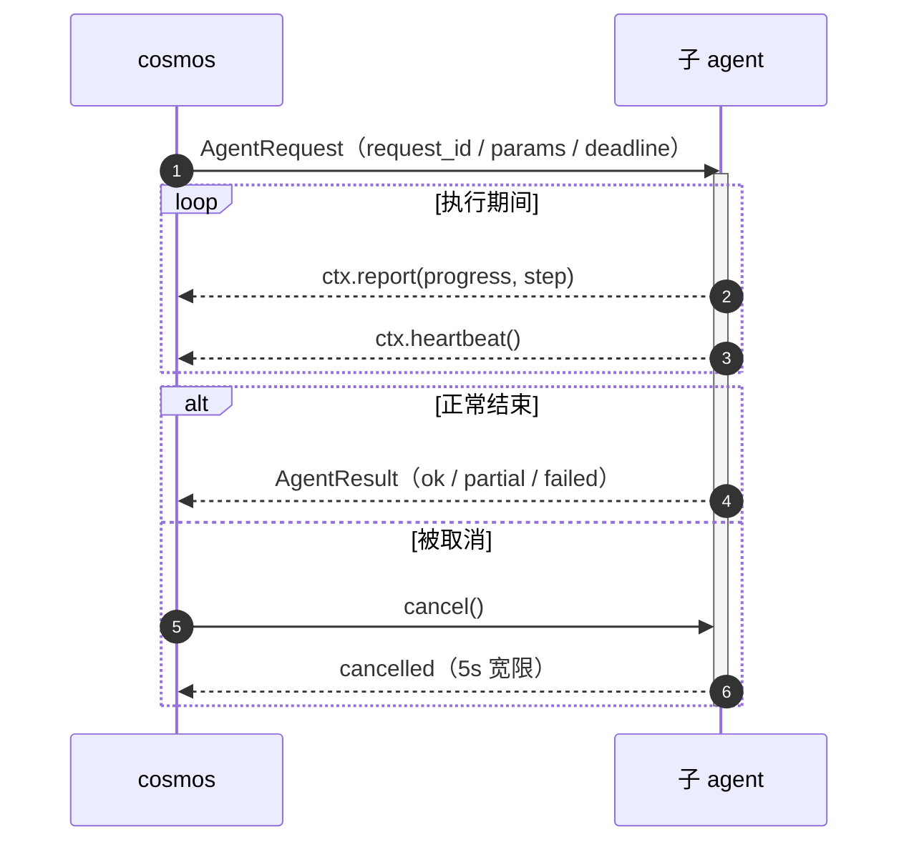
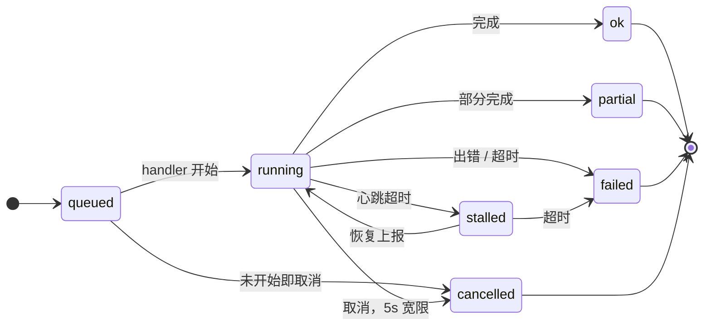

# 08 子 agent 接口规范

子 agent 是执行单元。它只做一件事：**拿到结构化任务，执行，返回结构化结果并如实上报过程**。

它不知道用户是谁，不知道对话上下文，也不能直接对用户说话。

---

## 1. 契约总览



| 契约 | 模型 | 提供方 |
| --- | --- | --- |
| 输入 | `AgentRequest` | cosmos |
| 运行时能力 | `AgentContext` | cosmos |
| 输出 | `AgentResult` | 子 agent |
| 过程上报 | `ctx.report()` / `ctx.heartbeat()` | 子 agent 调用 |
| 取消 | `asyncio.CancelledError` | cosmos 触发 |

handler 签名唯一：

```python
async def handle(request: AgentRequest, ctx: AgentContext) -> AgentResult: ...
```

同步实现不被接受：cosmos 无法在同步函数执行期间响应取消。需要跑阻塞操作时，在 handler 内部用 `asyncio.to_thread`。

---

## 2. AgentRequest

```python
class AgentRequest(BaseModel):
    request_id: str                 # 幂等键，同一 request_id 不得重复执行副作用
    agent_id: str
    params: dict[str, object]       # 已通过 params_schema 顶层校验
    label: str                      # 任务的一句话描述，用于桌面与进度
    created_at: datetime
    deadline_at: datetime | None    # 绝对截止时间；None 表示无硬截止
    correlation_id: str             # 不透明关联号，用于日志串联，不含用户信息
```

### 2.1 刻意不提供的字段

| 不提供 | 原因 |
| --- | --- |
| 用户 id / 昵称 / 设备 | 执行任务不需要，拿到就可能被滥用 |
| 对话历史 | 任务参数应当自包含；需要上下文就写进 `params` |
| `PresenceSnapshot` | 默认无权；确需时走 `permissions.read_presence` 白名单 |
| 其它 agent 的信息 | 子 agent 之间不互相感知，编排是 cosmos 的事 |
| 完整 `dispatch_id` | 用 `correlation_id` 替代，避免子 agent 反查批次 |

`label` 是给人看的一句话（「改写 logger 的 3 个函数」），可以直接用于进度展示；`params` 是给机器用的，不要从 `params` 里拼展示文案。

---

## 3. AgentContext

```python
class AgentContext(Protocol):
    @property
    def request_id(self) -> str: ...
    @property
    def cancelled(self) -> bool: ...
    @property
    def remaining_seconds(self) -> float | None: ...

    async def report(
        self,
        *,
        progress: float | None = None,   # 0–100，单调不减
        step: str | None = None,        # 当前步骤，≤ 20 字
        message: str | None = None,     # 给 Aliya 的一句话，≤ 60 字
    ) -> None: ...

    async def heartbeat(self) -> None: ...
    async def emit(self, artifact: Artifact) -> None: ...
    async def read_presence(self) -> PresenceSnapshot | None: ...
    def child_scope(self, name: str) -> AbstractContextManager[None]: ...
```

### 3.1 report 的语义

| 参数 | 规则 |
| --- | --- |
| `progress` | 0–100，**单调不减**；倒退的值被丢弃并 DEBUG 记录 |
| `step` | 当前动作的短语，用于桌面「正在{step}」；不要写句子 |
| `message` | 可选的一句话，进 `agent.progress` 事件，Aliya 可决定要不要转成用户通知 |
| 频率 | 内部按 1s 节流，调用方不必自己控制；但不要在紧密循环里无意义地刷 |
| 终态 | 完成时不需要显式报 100，`AgentResult` 到达即视为完成 |

### 3.2 read_presence 的权限

`read_presence()` 只有在同时满足以下条件时返回快照，否则返回 `None`：

1. 卡片 `permissions.read_presence=true`；
2. `presence.privacy.expose_to_subagents=true`；
3. 只返回 `permissions.presence_fields` 白名单内的字段，其余字段替换为默认值，`readable` 也不提供给子 agent。

子 agent 不应依赖用户状态做核心决策；拿不到时按「未知」处理。

`report()` 是**状态上报接口**，桌面的进度条、耗时、`readable` 都由它驱动。不上报不会报错，但桌面只能显示「正在运行，无进度」，Aliya 无法判断是不是卡住了。

### 3.2 heartbeat

长时间无进度变化时（如等待外部命令），至少每 `execution.heartbeat_seconds`（默认 30s）调一次 `heartbeat()`。超过该时长没有任何上报，`AgentRuntimeService` 判 `stalled` 并推 `agent.abnormal(reason="stalled")`。

### 3.3 cancelled

协作式取消：cosmos 先置 `cancelled=True`，再 `task.cancel()`。handler 应在耗时操作前后检查：

```python
if ctx.cancelled:
    return AgentResult.cancelled(summary="任务已取消")
```

不检查也不会挂死——`CancelledError` 会在下一个 `await` 抛出。但**必须让 `CancelledError` 继续向上传播**，不要 `except Exception` 之外的兜底把它吞掉。

### 3.4 child_scope

需要并发子步骤时用它，日志会带上层级：

```python
with ctx.child_scope("parse"):
    ...
```

### 3.5 emit

产出中间产物（补丁、报告、截图）用 `emit()` 而不是塞进 `content`：

```python
await ctx.emit(Artifact(kind="diff", name="logger.patch", uri="file:///tmp/xxx.patch"))
```

`Artifact` 会被 `AgentResult.artifacts` 汇总，cosmos 只做登记与转发，不解析内容。

---

## 4. AgentResult

```python
class AgentResult(BaseModel):
    request_id: str
    status: Literal["ok", "partial", "failed", "cancelled"]
    summary: str                    # 给 Aliya 的一句话结论，≤ 60 字
    content: str | None = None      # 完整结果（Markdown），由 Aliya 决定是否给用户
    artifacts: list[Artifact] = []
    error: AgentErrorInfo | None = None
    metrics: AgentMetrics | None = None
```

```python
class AgentErrorInfo(BaseModel):
    code: str               # 机器可读：invalid_params / not_found / conflict / timeout / internal
    message: str            # 给 Aliya 的技术说明，≤ 120 字
    retriable: bool
    user_hint: str | None   # 可选：用户可读的原因，Aliya 可改写后使用

class AgentMetrics(BaseModel):
    steps: int | None = None
    tokens: int | None = None
    files_touched: int | None = None
```

### 4.1 summary 与 content 的分工

| 字段 | 面向 | 内容 |
| --- | --- | --- |
| `summary` | Aliya | 结论：成没成、改了什么、有几个问题 |
| `content` | Aliya（再决定是否给用户） | 完整结果、细节、diff、清单 |
| `error.user_hint` | Aliya（可改写后给用户） | 用户能听懂的原因 |

**`content` 不是给用户看的最终文案**。子 agent 不掌握对话语气，也不该替 Aliya 说话。Aliya 拿到 `content` 后自行组织语言。

### 4.2 构造辅助

```python
AgentResult.ok(summary="改写了 3 个文件", content="...", artifacts=[...])
AgentResult.partial(summary="2 个文件改好，1 个被占用", content="...", error=...)
AgentResult.failed(code="not_found", message="路径不存在", retriable=False, user_hint="文件可能被移动了")
AgentResult.cancelled(summary="用户取消了任务")
```

约束：

| 字段 | 规则 |
| --- | --- |
| `status=ok` | `error` 必须为 `None` |
| `status=partial` | 必须给 `error` 说明哪部分没完成 |
| `status=failed` | 必须给 `error`，`summary` 说明失败结果 |
| `status=cancelled` | `error.code="cancelled"` |
| `summary` 为空 | 非法，运行期判 `failed(internal)` |
| `content` 超长 | 超过 `max_content_chars`（默认 20000）截断并标 `truncated=true` |

---

## 5. 超时、取消、重试

| 项 | 规则 |
| --- | --- |
| 超时 | 超过 `execution.timeout_seconds` 后先置 `cancelled`，5s 宽限，仍未退出则强制丢弃并判 `failed(timeout)` |
| 用户在等待中取消 | 立即置 `cancelled` + `task.cancel()` |
| supersede | 同 `session_id` 同 agent 的新任务 + `cancel_on_supersede=true` 时取消旧任务 |
| 重试 | 新 `task_id`、新 `request_id`；子 agent 不得假设能读取上次的中间状态 |
| 幂等 | 同一 `request_id` 重复投递时，`AgentRuntimeService` 返回缓存结果，不再调用 handler |

**子 agent 必须能在「被取消」和「中途失败」两种情况下安全退出**：关闭自己打开的文件、释放子进程、清理临时目录。cosmos 不会替它清理。

---

## 6. 错误分类

| 类别 | 例子 | 处理 |
| --- | --- | --- |
| 输入问题 | 参数缺失、路径不存在、格式不支持 | 返回 `failed` + `code=invalid_params`/`not_found`，`retriable=false` |
| 环境问题 | 文件被占用、网络超时 | 返回 `failed` + `retriable=true` |
| 可降级 | 部分文件改失败 | 返回 `partial` |
| 编程错误 | 未捕获 `KeyError`、签名不符 | 运行期捕获，判 `failed(internal)`，堆栈进日志不进结果 |
| 取消 | `CancelledError` | 返回 `cancelled`，或让它传播（两者都接受，运行期统一成 `cancelled`） |

**不要用异常表达业务失败。** 参数不合法不是异常，是 `AgentResult.failed`。异常只用于「我没想到会这样」。

---

## 7. 安全边界

| 禁止 | 说明 |
| --- | --- |
| 直接向用户发消息 | 没有通道，也无法拿到 `TerminalService` |
| 读取对话上下文 | `AgentRequest` 里没有；也不提供查询接口 |
| 调用其它子 agent | 编排是 cosmos 的职责；需要组合任务时由 Aliya 拆解 |
| 注册新 agent 或修改桌面 | 需要管理面权限，子 agent 一律没有 |
| 请求用户状态 | 默认拒绝；白名单见 `permissions` |
| 访问 `agent/cosmos` 的内部状态 | 只依赖 `contracts` 与 `AgentContext` |
| 把敏感内容写日志 | 文件内容、用户数据、密钥一律不进日志 |

文件系统、网络、命令执行的权限由子 agent 自身实现决定（例如编辑台与检索台限定在 `data/Aliya/workspace` 内），cosmos 不做路径级沙箱——它看不到 `params` 的语义，也负不了这个责。**权限边界必须在子 agent 内部实现，并在 `description` 里写清楚。**

---

## 8. 生命周期



每次状态变化都产生 `agent.state.changed`；`running → 终态` 额外产生 `agent.result`。

---

## 9. Edit agent 契约示例

下面是**契约演示**，用最少的代码展示参数自包含、进度单调、失败分类与结果不给用户文案。
仓库内置的 `edit` 实际参数是 `action` / `path` / `content` / `old` / `new` / `count`
（见第 11 节），差异只在业务参数，不影响契约本身。

```python
from agent.cosmos.contracts import (
    AgentCard,
    AgentContext,
    AgentErrorInfo,
    AgentRequest,
    AgentResult,
    Artifact,
    DesktopMeta,
    ExecutionPolicy,
)

CARD = AgentCard(
    id="edit",
    name="编辑台",
    icon="✏️",
    summary="编辑代码与文件",
    description=(
        "按指令修改仓库内文件：新建、改写、局部替换、批量重命名。"
        "不负责运行测试、不负责提交，也不做超出仓库根目录的路径操作。"
    ),
    capabilities=["code_edit", "file_write", "file_rename"],
    params_schema={
        "type": "object",
        "properties": {
            "instruction": {"type": "string", "description": "要做什么改动"},
            "paths": {"type": "array", "items": {"type": "string"}},
        },
        "required": ["instruction"],
    },
    desktop=DesktopMeta(group="dev", order=10, pinned=True),
    execution=ExecutionPolicy(timeout_seconds=300, max_concurrent=2, queue=True, retryable=True),
)


async def handle(request: AgentRequest, ctx: AgentContext) -> AgentResult:
    instruction = str(request.params.get("instruction", "")).strip()
    paths = [str(p) for p in request.params.get("paths", [])]

    if not instruction:
        return AgentResult.failed(
            code="invalid_params",
            message="缺少 instruction",
            retriable=False,
            user_hint="需要说明要改成什么样",
        )
    if not paths:
        return AgentResult.failed(
            code="invalid_params",
            message="缺少 paths",
            retriable=False,
            user_hint="需要指定要改哪些文件",
        )

    changed: list[Artifact] = []
    for index, path in enumerate(paths):
        if ctx.cancelled:
            return AgentResult.cancelled(summary=f"已取消，完成 {len(changed)}/{len(paths)}")

        await ctx.report(
            progress=index * 100 / len(paths),
            step=f"处理 {path.split('/')[-1]}",
            message=f"正在修改 {path}",
        )

        try:
            patch = await apply_edit(path, instruction)      # 子 agent 自己的实现
        except FileNotFoundError:
            return AgentResult.partial(
                summary=f"{len(changed)} 个文件已改，{path} 不存在",
                content=render_changes(changed),
                artifacts=changed,
                error=AgentErrorInfo(
                    code="not_found",
                    message=f"路径不存在：{path}",
                    retriable=False,
                    user_hint=f"{path} 可能被移动或删除了",
                ),
            )

        artifact = Artifact(kind="diff", name=f"{path}.patch", uri=patch.uri)
        await ctx.emit(artifact)
        changed.append(artifact)

    await ctx.report(progress=100, step="收尾")
    return AgentResult.ok(
        summary=f"改写了 {len(changed)} 个文件",
        content=render_changes(changed),
        artifacts=changed,
    )
```

这个 handler 体现了全部约定：参数自包含、进度单调、可取消、失败分类、结果不给用户文案。

---

## 10. 测试建议

| 用例 | 断言 |
| --- | --- |
| 正常输入 | `status=ok`，`summary` 非空，进度单调到 100 |
| 缺必填参数 | `status=failed`，`code=invalid_params`，`retriable=false` |
| 中途取消 | `status=cancelled`，资源已释放 |
| 环境错误 | `retriable=true` |
| 部分失败 | `status=partial` 且 `error` 非空 |
| 超时 | 5s 宽限内退出，未退出时运行期判 `failed(timeout)` |
| 心跳缺失 | 超过 `heartbeat_seconds` 判 `stalled` |

用假 `AgentContext` 实现（记录 `report` 调用与 `cancelled` 标志）即可脱离 cosmos 单测 handler，不需要起服务。

---

## 11. 内置工具

仓库内置 5 个工具，都在 `data/config/cosmos.yaml` 的 `agent.cosmos.agents[]` 里登记：

| id | 展示名 | 模块 | 职责 | 关键边界 |
| --- | --- | --- | --- | --- |
| `edit` | 编辑台 | `registry/edit.py` | `write` / `append` / `replace` 改文件 | 路径限定 `data/Aliya/workspace`；拒绝 `.git`、`.env`、`data/state`、`logs`、`data/mcp.json`；单次写入 ≤ 200k 字、目标文件 ≤ 2MB；临时文件 + `os.replace` 原子写 |
| `search` | 检索台 | `registry/search.py` | 按文件名或正文检索 | 只读，限定 `data/Aliya/workspace`；跳过依赖、缓存、版本库与敏感目录；跳过二进制与大文件 |
| `run` | 运行台 | `registry/run.py` | 执行 pytest / ruff check / python -m / uv run / git 只读查询 | cwd 限定 `data/Aliya/workspace`；无 shell；命令名不能带路径；参数不能指向工作区外；不接受 `--fix`、`format` 与任意脚本；超时/取消 kill 整个进程组 |
| `web` | 联网台 | `registry/web.py` | 抓取公开网页转纯文本 | 仅 http/https；DNS 解析后必须是公网地址；拒绝本机与内网 |
| `echo` | 回声台 | `registry/echo.py` | 原样返回指令 | 联调用，不做任何文件与网络操作 |

四个业务工具的安全边界都在各自 handler 内实现（见第 7 节：cosmos 不做路径级沙箱），
并统一复用 `core/agent/workspace.py` 的路径解析与敏感路径判断。
`edit` / `search` / `run` 的根都是 Aliya 的工作区 `data/Aliya/workspace`，不是仓库根：
她要动的文件、要跑的命令都留在自己的工作区里，避免误改项目源码。

### 11.1 最小示例：echo

`agent/cosmos/registry/echo.py` 是联调用的最小实现，用来验证「注册 → 调度 → 进度 → 结果」整条链路：

```python
from agent.cosmos.contracts import AgentCard, AgentContext, AgentRequest, AgentResult

CARD = AgentCard(
    id="echo",
    name="回声台",
    icon="🔁",
    summary="原样返回收到的指令",
    description="联调用的最小工具：把收到的文本原样返回，用来验证调度、进度与结果链路。",
    capabilities=["echo"],
    params_schema={
        "type": "object",
        "properties": {"text": {"type": "string"}},
        "required": ["text"],
    },
)


async def handle(request: AgentRequest, ctx: AgentContext) -> AgentResult:
    await ctx.report(progress=50, step="回显")
    return AgentResult.ok(summary=f"收到：{request.params['text']}")
```

handler 的类型别名与注册方式：

```python
from agent.cosmos.contracts import AgentHandler

async def handle(request: AgentRequest, ctx: AgentContext) -> AgentResult: ...

handler: AgentHandler = handle   # Callable[[AgentRequest, AgentContext], Awaitable[AgentResult]]
```

配置驱动注册只需要 `module`、`handler` 与卡片字段：

```yaml
agent:
  cosmos:
    agents:
      - id: echo
        module: agent.cosmos.registry.echo
        handler: handle
        card:
          name: 回声台
          summary: 原样返回指令
          description: 联调用的最小工具，把收到的文本原样返回。
          capabilities: [echo]
          params_schema:
            type: object
            properties: {text: {type: string}}
            required: [text]
```

`AgentRegistryService.start()` 会调用 `load_agents()` 完成导入与绑定；模块不存在或 handler 不是 `async def` 时启动期抛 `AgentRegistrationError`。

### 11.2 新增工具时的参考

按第 1–8 节实现后，在 `data/config/cosmos.yaml` 的 `agent.cosmos.agents[]` 追加一条登记即可。
内置的 `edit` / `search` / `run` / `web` 可直接作为模板，它们分别演示了：

| 关注点 | 参考实现 |
| --- | --- |
| 参数二次校验与失败分类 | `edit.handle`（缺参、路径越界、原文不存在分别给不同 `code`） |
| 只读遍历与目录剪枝 | `search._scan`（就地修改 `dirs`，跳过依赖与敏感目录） |
| 子进程、超时与输出截断 | `run._execute`（`create_subprocess_exec`，超时 kill 后 `wait`） |
| 外部请求与 SSRF 防护 | `web._host_is_public`（解析后要求所有地址 `is_global`） |
