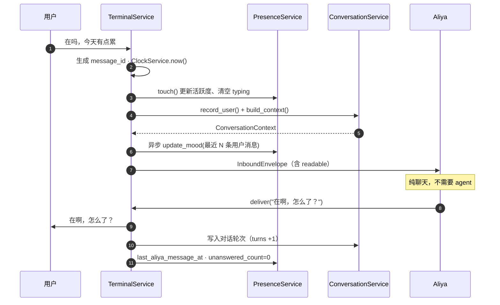
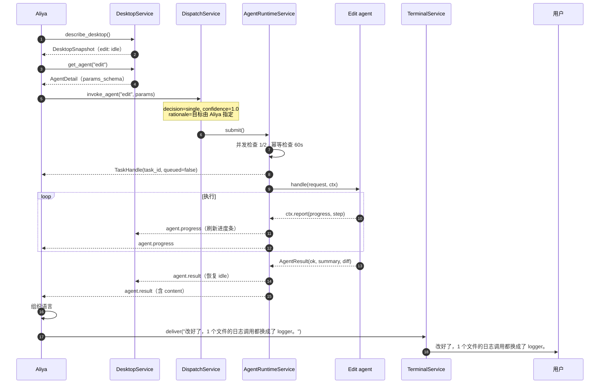
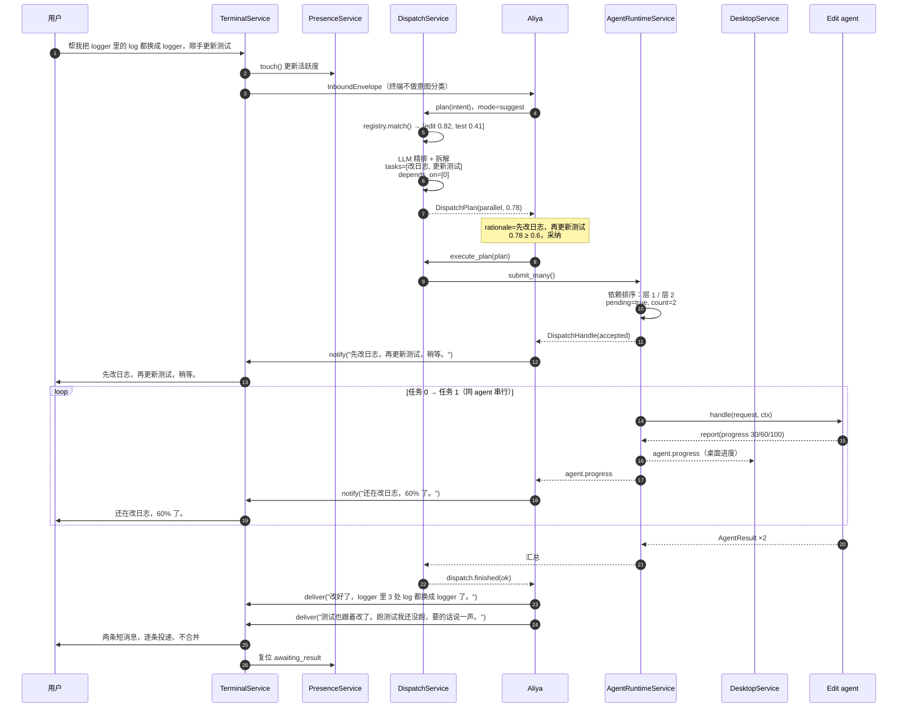
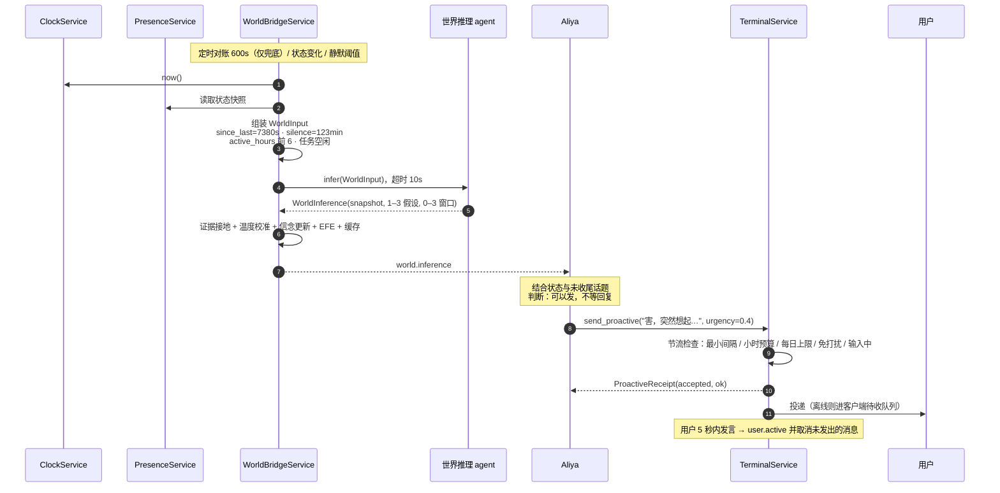
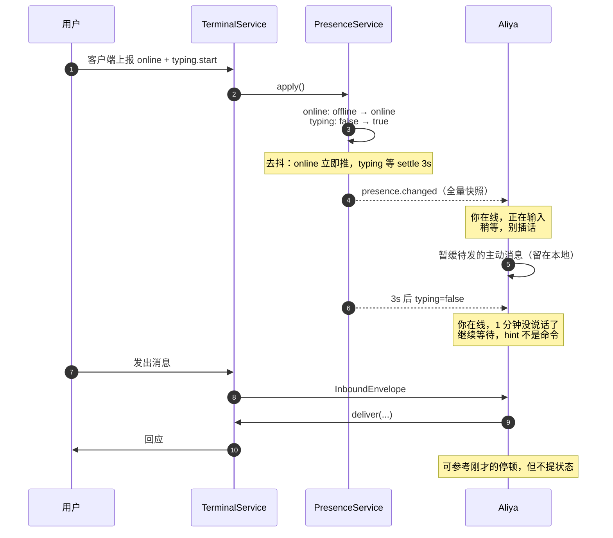

# 流程示例

五类端到端流程。每类给出时序、关键数据结构与易错点，可直接当联调用例。

时序图直接标注组件名，与各章的类名一致；`AgentRuntimeService` 负责调度执行，`DesktopService` 负责桌面与进度，`TerminalService` 负责收发与节流。

**台词约定**：下面出现的 Aliya 台词只作语气参考，实际由她生成（人设见 `data/prompt/Aliya.md`）。通道不得合并她的连发短句、不得补标点、不得加括号旁白。她看到的界面也不该出现「agent」「调度」「用户」这类词。

---

## 流程 ① 用户向 Aliya 发起聊天

**目标**：验证双向通道、上下文组装、回传。

### 时序



### 关键数据

```json
{
  "message": {
    "message_id": "msg_01J...",
    "direction": "user_to_aliya",
    "kind": "chat",
    "text": "在吗，今天有点累",
    "session_id": "ses_01J...",
    "at": "2026-11-07T21:03:12+08:00"
  },
  "conversation": {"unanswered_count": 0, "turns": ["..."]},
  "presence": {
    "summary": "你在线，刚发过消息",
    "tone": "engaged",
    "hint": "可以正常聊",
    "confidence": 0.9,
    "stale": false
  }
}
```

### 易错点

| 易错点 | 正确做法 |
| --- | --- |
| 给 Aliya 附上原始 presence 字段 | 只给 `readable`，不给 `online.state` 等原始值 |
| 回传时改写 Aliya 的措辞 | 只做分段与脱敏，不改语义 |
| 把这条消息写进 `DispatchContext` | 对话只写 `ConversationContext` |

**失败分支**：Aliya 回合超时、异常、空回复或超轮次时，她不发对话消息，只上报一条
`kind="system"` 的 `deliver`（文案来自 `reply.fallback_text`）；终端以系统提示投递，
不写对话轮次、不计入 Aliya 消息统计，`unanswered_count` 保持原值。客户端应按系统提示渲染，
而不是当成她的台词。

---

## 流程 ② Aliya 在桌面点击 Edit agent

**目标**：验证显式调用路径、任务提交、进度推送、结果返回。

### 时序



### 关键数据

```json
{
  "dispatch_id": "dsp_01J...",
  "decision": "single",
  "confidence": 1.0,
  "rationale": "目标由 Aliya 指定",
  "tasks": [
    {
      "agent_id": "edit",
      "params": {
        "action": "replace",
        "path": "core/logger/base.py",
        "old": "log.",
        "new": "logger."
      },
      "label": "改写 core/logger/base.py 的日志调用",
      "depends_on": []
    }
  ]
}
```

### 易错点

| 易错点 | 正确做法 |
| --- | --- |
| 把 `invoke_agent` 做成同步阻塞等结果 | 立即返回 `TaskHandle`，结果走事件 |
| 提交时不查并发 | 超过 `max_concurrent` 且 `queue=false` → `AgentBusyError` |
| 结果直接转给用户 | 先到 Aliya，由 Aliya 决定措辞与时机 |
| 桌面只在 `agent.result` 时刷新 | `agent.progress` 也要刷新，否则进度条不动 |
| 用 `task_id` 当展示文案 | 展示用 `label` 与 `agent_name` |

---

## 流程 ③ 用户提出编辑任务，Aliya 自动匹配并启动 Edit agent

**目标**：验证完整链路：用户 → cosmos → Aliya → cosmos → 子 agent → cosmos → Aliya → 用户。

### 时序



### 关键数据

```json
{
  "outcome": {
    "dispatch_id": "dsp_01J...",
    "status": "ok",
    "results": [
      {"status": "ok", "summary": "改写了 3 处日志调用", "artifacts": [{"kind": "diff"}]},
      {"status": "ok", "summary": "更新了 2 个测试文件"}
    ],
    "elapsed_seconds": 84.2,
    "summary": "2 个任务完成"
  }
}
```

### 易错点

| 易错点 | 正确做法 |
| --- | --- |
| 把「顺手更新测试」当成同一个任务塞给 edit | 拆成两个任务并声明依赖；同一 agent 串行执行 |
| 两个任务并行改同一批文件 | 检测 `params.paths` 交集，非空则串行 |
| 进度通知直接把 `step` 透给用户 | 用 `label` + 进度的模板文案，`step` 只给 Aliya |
| 结果由 cosmos 合并成一段发给用户 | cosmos 只汇总状态，内容由 Aliya 组织 |
| 忘记复位 `awaiting_result` | 结果回传用户后立刻复位，否则 Aliya 一直以为用户在看结果 |
| Aliya 采纳计划后又重复 `invoke_agent` | `execute_plan` 已是执行入口，重复调用会命中幂等窗口 |

---

## 流程 ④ 世界推理建议「用户已离线 2 小时，当前时段通常活跃」，Aliya 主动发起消息

**目标**：验证世界推理接入、转发、Aliya 自主决策、主动消息节流。

### 时序



### 关键数据

```json
{
  "inference": {
    "inference_id": "inf_01J...",
    "generated_at": "2026-11-07T21:03:12+08:00",
    "ttl_seconds": 600,
    "revision": 1,
    "producer": "deep",
    "snapshot": "你离线 2 小时了，21 点这个点你通常在线",
    "hypotheses": [
      {"statement": "你可能临时走开了，等下会回来", "confidence": 0.5, "basis": "21 点在线率 0.78", "basis_signals": ["presence", "history"]},
      {"statement": "你可能已经休息了", "confidence": 0.3, "basis": "今天最后一条消息比平时早", "basis_signals": ["time", "history"]}
    ],
    "action_windows": [
      {"window": "接下来 30 分钟", "suggestion": "适合留一句轻松的话", "rationale": "这个时段你最常出现", "kind": "check_in", "expected_value": 0.24}
    ],
    "signals_used": ["time", "presence", "history"],
    "confidence": 0.52,
    "confidence_breakdown": {"model": 0.6, "time": 0.7, "presence": 0.8, "tasks": 0.5, "history": 0.7, "mood": 0.4},
    "belief": {"online_prob": 0.35, "engagement": 0.4, "readiness": 0.45, "uncertainty": 0.55, "evidence_count": 3},
    "prediction_error": 0.18,
    "urgency": 0.4,
    "interruptibility": 0.7,
    "expected_value": 0.25,
    "action_choice": {"action": "check_in", "window": "接下来 30 分钟", "pragmatic": 0.3, "epistemic": 0.36, "cost": 0.12, "efe": 0.54, "lookahead": 0.1, "total_efe": 0.62}
  },
  "stale": false,
  "age_seconds": 0.3,
  "trigger": "silence"
}
```

### 易错点

| 易错点 | 正确做法 |
| --- | --- |
| cosmos 看到建议就自动发消息 | cosmos 只转发；发不发是 Aliya 的决定 |
| 把 `action_windows` 当指令执行 | 它是参考信息，没有执行语义 |
| 世界推理直接拿用户消息原文 | 只给聚合信号；`basis` 里也不能出现原文 |
| 主动消息被节流时静默丢弃 | 返回 `ProactiveReceipt`，Aliya 可据此决定改时间或提高 urgency |
| 把普通建议标成高 urgency 绕过预算 | 只有真正紧急的窗口才用 `urgency >= 0.8`；每日上限始终有效 |
| 用户刚发消息就发出待发的主动消息 | `user.active` → 5s 窗口内取消 |
| 离线就一律不发 | 节流策略与离线与否解耦；离线可以留言，只是不期待即时回复 |

---

## 流程 ⑤ 用户从离线变为在线并正在输入，Aliya 暂缓自主消息

**目标**：验证用户状态变化推送、状态面板可解读表述、Aliya 的行为调整。

### 时序



### 状态线索呈现

| 项 | 现在 | 3 秒后 |
| --- | --- | --- |
| 状态点 | 在线 · 正在输入 | 在线 · 安静 |
| 摘要 | 你在线，正在输入 | 你在线，1 分钟没说话了 |
| 建议 | 稍等，别插话 | 可能在看上一轮的回复 |
| 可信度 | 0.9 · 刚刚更新 | 0.85 · 刚刚更新 |

### 易错点

| 易错点 | 正确做法 |
| --- | --- |
| 每个按键都推一次 `typing.changed` | 用 `typing_settle_seconds` 合并，只推开始与结束 |
| 只推 diff 不给完整快照 | 推全量快照，消费方不需要自己拼状态 |
| cosmos 直接取消 Aliya 待发的消息并丢弃 | 只有 5s 窗口内的「已提交待发」可取消；Aliya 本地的草稿它管不着 |
| 把「正在输入」当作「马上会发消息」 | 只描述事实，不给强推断；`hint` 用「稍等」而非「一定会发」 |
| 在给用户的回复里提到「我看到你在输入」 | 状态永不回显，行为上体现即可 |
| Aliya 收到 `hint` 就当命令执行 | `hint` 是参考；Aliya 可忽略 |

---

## 附：五个流程的共性

| 共性 | 说明 |
| --- | --- |
| 用户与子 agent 从不直接相连 | 所有用户可见文本都经 Aliya 或 cosmos 模板 |
| 状态是「可解读表述 + 原始字段」双轨 | 程序用原始字段，Aliya 读 `readable` |
| 推送都是事件，没有轮询 | Aliya 不主动拉取进度，只订阅 |
| 失败不中断主链路 | 单任务失败、推演超时都不影响对话 |
| 决策权在 Aliya | cosmos 只给计划、建议、状态，不替它拍板 |
