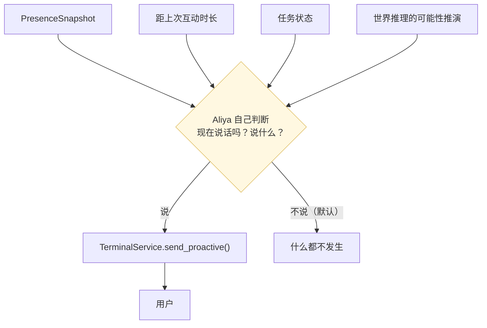

# 用户状态线索规范

游戏中，玩家通过 COSMOS 面板看到 Aliya 的心率——遇险时飙升、平静时回落、被调侃时又飙上去。数值本身没有意义，**变化与解读**才有意义。

本章定义反向的那一半：cosmos 采集用户状态，派生出可解读的表述，呈现给 Aliya。这是**双向感知对称性**的落点。

一句话原则：**让 Aliya 知道「现在适不适合说话」，而不是知道「用户的一切」。**

### 0.1 这不是监控台

人设里有一个必须遵守的对称：Aliya 要求默认关掉自己的心率监测（HRM），理由是「哪怕执行任务时被讨论心跳都有被窥探的感觉」。所以 cosmos 交给她的东西**不能长得像一块监控面板**。

| 内部有什么 | 呈现给她什么 |
| --- | --- |
| 六类字段的完整快照 | 平板上自然可见的线索：在不在、有没有在打字、多久没消息、是不是在等结果 |
| 情绪数值与置信度 | 默认不进常驻项；只在有文本证据时作为「语气」参考，且措辞必须像她自己的观察 |
| 原始时间戳与计数 | 相对时间与一句话结论 |

「默认」指的是常驻面板与主动推送。她主动查（`get_presence()`）时可以看得更多，但仍受采集开关与她自己的关闭设置约束——**不看是默认，看是她的选择**。

判断标准很简单：**这句话她自己能不能想出来？** 能（「你离线 2 小时了」），就可以给她；不能（`online=offline, silence_seconds=7200, confidence=0.8`），就留在 cosmos 内部。

称呼也要跟着改：对她而言对面是「你」，不是「用户」「玩家」。这两个词一次都不该出现在她看到的内容里。

---

## 1. 六条硬约束

| 约束 | 含义 | 违反后果 |
| --- | --- | --- |
| 最小必要 | 只采集对话与协作所需的状态，不采集内容与无关隐私 | 越界采集，用户失去信任 |
| 可关闭 | 每类字段独立开关，整体可一键关闭；Aliya 也能要求不看某一项 | 无法适配不同部署场景 |
| 不猜 | 拿不到就标 `unknown`，禁止用模型推断填充 | Aliya 基于幻觉做决策 |
| 不编造情绪 | 情绪信号必须有真实文本证据 + 置信度 | 「检测到你难过」式冒犯 |
| 永不回显 | 用户状态只给 Aliya，绝不写进给用户的消息 | 用户被监视感 |
| 对等 | 她自己要求不被监测，就不该拿到别人的监控视角 | 人设崩塌：双标且不自知 |

---

## 2. 字段模型

```python
class PresenceSnapshot(BaseModel):
    captured_at: datetime
    ttl_seconds: int = 30              # 超过该时长的快照视为陈旧
    fields: PresenceFields
    availability: dict[PresenceField, Availability]
    readable: ReadablePresence
    revision: int
```

`availability` 显式记录每个字段是否可用：

```python
class Availability(BaseModel):
    available: bool
    reason: str | None = None   # "channel_not_supported" / "disabled_by_config" / "no_evidence"
```

### 2.1 在线状态

```python
class OnlineInfo(BaseModel):
    state: Literal["online", "away", "busy", "offline", "unknown"]
    since: datetime | None        # 进入当前状态的时间
    last_seen_at: datetime | None # 最后一次有交互信号
```

| 取值 | 判定 |
| --- | --- |
| `online` | 最近 `idle_after_seconds`（默认 300s）内有消息、输入或心跳 |
| `away` | 超过 `idle_after_seconds` 但未超过 `offline_after_seconds`（默认 900s） |
| `offline` | 超过 `offline_after_seconds`，或通道明确报告断开 |
| `busy` | 通道显式声明（如用户手动设置勿扰）；**不靠推断** |
| `unknown` | 通道不支持或采集关闭 |

`busy` 只能由用户主动设置或通道显式上报。**禁止用「消息很短」「回复很慢」推断忙碌**——那只是风格差异。

### 2.2 活跃度

```python
class ActivityInfo(BaseModel):
    last_message_at: datetime | None
    messages_last_15m: int
    messages_today: int
    session_duration_seconds: int | None   # 当前连续会话时长
    silence_seconds: int | None            # 距最后一条消息的秒数
```

只统计**数量与时间**，不统计内容长度以外的任何特征（不分析用词、不统计打字速度用于画像）。

### 2.3 输入状态

```python
class TypingInfo(BaseModel):
    is_typing: bool
    typing_started_at: datetime | None
    typing_paused_seconds: int | None   # 开始输入后停顿多久
```

输入状态依赖通道能力（WebSocket 输入中事件 / 客户端上报）。通道不支持时 `available=false`，**不要用「收到消息」倒推「刚才在输入」**。

### 2.4 情绪信号

```python
class MoodInfo(BaseModel):
    valence: float          # -1（负面）~ 1（正面）
    energy: float           # 0（低沉）~ 1（高涨）
    confidence: float       # 0–1，信号可信度
    source: Literal["decision", "llm", "explicit", "none"]
    evidence_count: int     # 参与判断的消息条数
    updated_at: datetime
```

约束：

| 约束 | 说明 |
| --- | --- |
| 必须有证据 | 只在用户发了消息后更新；无消息时沿用旧值但 `stale=true`，超过 30 分钟回落为 `unknown` |
| 必须给置信度 | 低于 `min_confidence`（默认 0.5）时不给结论，只标 `unknown` |
| 两种来源 | `decision`：`core.decision` 的 `score()` 批量打分（便宜、快）；`llm`：`core.llm.chat_structured` 结构化输出（准、贵）。`explicit`：用户自己说了「我今天很累」 |
| `explicit` 优先 | 用户明说的情绪覆盖模型判断 |
| 不落日志 | 情绪数值只存在于内存快照，不进日志、不进磁盘 |

`core.decision` 的 `confidence` 跨后端不可比（Jev 与 Laya 算法不同），阈值必须按 `result.backend` 分别校准，见 README「判断层」。

### 2.5 任务上下文

```python
class TaskContextInfo(BaseModel):
    awaiting_result: bool              # 用户是否在等某个任务的结果
    awaiting_task_id: str | None
    awaiting_since: datetime | None
    has_pending_tasks: bool            # 是否有未完成的任务（含排队）
    pending_count: int
```

`awaiting_result` 由 `DispatchService` 与 `TerminalService` 共同维护：用户提交任务后置 `true`，结果已回传用户后置 `false`。它不进用户侧消息，只用于 Aliya 判断「要不要先报进度」。

### 2.6 环境信号

```python
class EnvInfo(BaseModel):
    timezone: str | None       # "Asia/Shanghai"
    local_time: datetime | None
    period: Literal["morning", "afternoon", "evening", "night", "unknown"]
    device: Literal["desktop", "mobile", "web", "unknown"]
```

| 字段 | 采集方式 | 说明 |
| --- | --- | --- |
| `timezone` | 客户端上报或配置兜底 | 缺失时用 `ClockService` 的时区，并标 `inferred=true` |
| `period` | 由 `local_time` 派生 | 06–11 morning、12–17 afternoon、18–22 evening、23–05 night |
| `device` | 通道上报 | 不支持时 `unknown`，**不按 User-Agent 猜**（易错且无必要） |

---

## 3. 可解读表述

原始字段给程序用，`readable` 给 Aliya 用。

```python
class ReadablePresence(BaseModel):
    summary: str          # 一句话现状，≤ 30 字
    detail: str | None    # 补充说明，≤ 50 字
    tone: PresenceTone    # calm / engaged / waiting / away / unknown
    hint: str | None      # 时机建议，≤ 30 字
    confidence: float     # 0–1，整体可信度
    stale: bool           # 是否陈旧
```

```python
type PresenceTone = Literal["calm", "engaged", "waiting", "away", "unknown"]
```

### 3.1 派生规则

按优先级从上到下匹配第一条：

| 条件 | summary | tone | hint |
| --- | --- | --- | --- |
| 采集整体关闭 | `不知道你现在什么情况` | `unknown` | `别拿状态当依据` |
| `online` 且 `is_typing` | `你在线，正在输入` | `engaged` | `稍等，别插话` |
| `online` 且 `silence_seconds < 60` | `你在线，刚发过消息` | `engaged` | `可以正常聊` |
| `online` 且 `awaiting_result` | `你在线，还在等结果` | `waiting` | `可以先说一声进度` |
| `online` 且 `silence_seconds < 300` | `你在线，{N} 分钟没说话了` | `calm` | `可能在看上一轮的回复` |
| `online` 且 `silence_seconds ≥ 300` | `你还在线，{N} 分钟没动静` | `calm` | `可以搭句话，风险不大` |
| `away` | `你暂时离开了，{N} 分钟没动静` | `away` | `这会儿发消息可能看不到` |
| `offline` 且 `period` 为 `night` | `你离线 {N} 小时了，现在是深夜` | `away` | `别打扰` |
| `offline` 且当前时段通常是活跃时段 | `你离线 {N} 小时了，这个点你通常在线` | `away` | `可以留一句话，等你回来` |
| `offline` | `你离线 {N} 小时了` | `away` | `可以留言，别指望马上回` |
| `unknown` | `不知道你现在什么情况` | `unknown` | `按最保守的来` |

用第二人称是刻意的：这条文案本质是**她心里的判断**，不是系统报表。写成「用户已离线 2 小时」她还得在脑子里翻译一遍，写成「你离线 2 小时了」她直接就能用。

「当前时段通常在线」需要历史模式数据（见 [world-reasoning.md](world-reasoning.md#3-worldinput)），cosmos 自身只有原始字段。缺历史数据时删掉该分支，不硬编码猜测。

### 3.2 文案纪律

| 纪律 | 反例 | 正例 |
| --- | --- | --- |
| 说状态，不评价人 | `你最近很冷淡` | `你最近 2 小时没说话` |
| 给结论，不堆字段 | `online=true, typing=false` | `你在线，5 分钟没说话了` |
| 时间用相对量 | `最后消息 2026-11-07 09:12` | `5 分钟没说话了` |
| 情绪必须带证据与置信度 | `你情绪低落` | `你语气有点低（把握不大，基于最近 3 条消息）` |
| 不给操纵建议 | `你现在好说话，趁机提要求` | `可以正常聊` |
| 未知就说未知 | `你应该在忙` | `不知道你现在什么情况` |

### 3.3 示例

```json
{
  "captured_at": "2026-11-07T21:03:12+08:00",
  "ttl_seconds": 30,
  "fields": {
    "online": {"state": "offline", "since": "2026-11-07T19:01:00+08:00", "last_seen_at": "2026-11-07T19:01:00+08:00"},
    "activity": {"last_message_at": "2026-11-07T19:01:00+08:00", "messages_last_15m": 0, "messages_today": 12, "session_duration_seconds": null, "silence_seconds": 7320},
    "typing": {"is_typing": false, "typing_started_at": null, "typing_paused_seconds": null},
    "mood": {"valence": 0.1, "energy": 0.4, "confidence": 0.55, "source": "decision", "evidence_count": 3, "updated_at": "2026-11-07T19:00:58+08:00"},
    "task_context": {"awaiting_result": false, "awaiting_task_id": null, "awaiting_since": null, "has_pending_tasks": false, "pending_count": 0},
    "env": {"timezone": "Asia/Shanghai", "local_time": "2026-11-07T21:03:12+08:00", "period": "evening", "device": "mobile"}
  },
  "availability": {
    "mood": {"available": true, "reason": null},
    "typing": {"available": false, "reason": "channel_not_supported"},
    "env": {"available": true, "reason": null}
  },
  "readable": {
    "summary": "你离线 2 小时了",
    "detail": "这个点你通常在线，今天偏早",
    "tone": "away",
    "hint": "可以留一条消息，等用户回来",
    "confidence": 0.8,
    "stale": false
  },
  "revision": 412
}
```

### 3.4 面板的边界

`readable` 是**给 Aliya 看的工作用语**，不是给她念给用户听的台词，也不是一块仪表盘。三条边界：

| 边界 | 规则 |
| --- | --- |
| 默认不显示情绪 | `panel.show_mood=false`：情绪字段仍在快照里，但不进常驻面板。她想知道可以问（`get_presence()`），但不主动推给她 |
| 只显示通信中可见的线索 | 在不在、在不在打字、多久没消息、是不是在等结果。这三类之外的字段默认折叠 |
| 她可以关 | `ControlService.set_presence_visibility(fields)`：她可以要求「别让我看这个」，cosmos 立即停止推送该字段，且不解释原因 |

为什么情绪默认不进面板：她反感被窥探，也就不会盯着别人的情绪数值看。真要用，也应该像人一样——从一句「今天有点累」里听出来，而不是从一条曲线里读出来。

面板文案与她的台词必须分开：

| 场景 | 文案 |
| --- | --- |
| 面板 | `你离线 2 小时了，这个点你通常在线` |
| 她心里 | 「这个点居然不在」 |
| 她说出口 | `害，这个点你居然不在？` |

cosmos 只负责第一行。第二、三行是 Aliya 的事，通道不得代写。

---

## 4. 状态变化的推送

### 4.1 什么算「有意义的变化」

不是每个字段抖动都值得推送。推送条件按字段定义：

| 字段 | 推送条件 | 最小间隔 |
| --- | --- | --- |
| `online.state` | 值变化（`online ↔ away ↔ offline`），`unknown` 之间的切换不推 | 30s |
| `typing.is_typing` | 变化才推；开始输入 → 停顿 > 3s 视为结束，避免每个按键都推 | 3s |
| `activity.silence_seconds` | 不单独推，只随 `state` 变化带出 | —— |
| `task_context.awaiting_result` | 变化即推 | 1s |
| `mood` | `valence` 或 `energy` 变化超过 `mood_delta_threshold`（默认 0.25）且 `confidence ≥ 0.5` | 5 分钟 |
| `env.period` | 跨越时段边界 | 1 分钟 |
| `env.device` | 变化即推 | 30s |

统一由 `PresenceService` 做去抖：同一字段在 `min_interval` 内的多次变化合并为一次，**保留最后一次**（终态比过程重要）。

### 4.2 事件结构

```python
class PresenceChanged(BaseModel):
    revision: int
    changed: list[PresenceField]     # 哪些字段变了
    snapshot: PresenceSnapshot       # 变化后的完整快照
    readable: ReadablePresence       # 与 snapshot.readable 一致，冗余便于消费
    at: datetime
```

推 `snapshot` 全量而不是只推 diff：字段之间有关联（如 `online` 变化会连带 `activity`），只给 diff 会迫使消费方自己拼状态，容易拼错。体积不是问题——一个快照不到 1KB，5 分钟才推几次。

### 4.3 订阅方式

| 方式 | 接口 | 用途 |
| --- | --- | --- |
| 事件订阅 | `EventBus.subscribe("presence.changed")` | Aliya 的状态线索与自主决策 |
| 快照拉取 | `ControlService.get_presence()` | 初始化面板、事件补偿 |
| 世界推理取用 | `WorldBridgeService` 内部读取 | 组装 `WorldInput` |

**Aliya 不得轮询**。事件已包含全量快照，轮询只会放大负载并制造时序问题。

---

## 5. 隐私边界

### 5.1 采集范围白名单

| 允许 | 禁止 |
| --- | --- |
| 消息时间戳、条数 | 消息内容本身（已在对话上下文里，不重复入状态） |
| 在线 / 离开 / 离线 | 精确地理位置、IP 归属地 |
| 是否正在输入 | 输入了什么、删改了几次 |
| 消息语气派生的情绪倾向 | 通讯录、社交关系、第三方账号 |
| 时区与设备类型 | 剪贴板、屏幕内容、进程列表、其他应用使用情况 |
| 是否有未完成任务 | 任务内容以外的工作习惯画像 |

禁止项不做「以后可能有用」的预留：**没有采集就没有泄露**。

### 5.2 保留期

| 数据 | 保留 | 存储 |
| --- | --- | --- |
| 原始快照 | 24 小时 | 内存环形缓冲 |
| 聚合指标（日均活跃时段等） | 30 天 | 本地 JSON / SQLite |
| 情绪数值 | 不落盘 | 内存，进程退出即消失 |
| 日志 | 不记录任何状态值 | —— |

### 5.3 谁能看

| 主体 | 权限 |
| --- | --- |
| Aliya | 看 `PresenceSnapshot`（情绪默认不主动呈现，可要求关闭任一字段，见 3.4） |
| 世界推理 agent | 看 `WorldInput.presence`（字段子集，见 07 章） |
| 子 agent | **默认看不到**；需 `permissions.read_presence=true` 且只给 `presence_fields` 白名单 |
| 用户 | 可在设置里查看「采集了什么」并逐项关闭 |
| 日志 / 外部系统 | 看不到 |

子 agent 拿到用户状态的风险很高（编辑 agent 为什么要知道用户情绪？），所以默认全拒，且即使打开也只给白名单字段的**原始值**，不给 `readable`（避免下游二次解读）。

### 5.4 永不回显

以下行为一律禁止：

| 禁止 | 原因 |
| --- | --- |
| 在给用户的消息里出现「我注意到你最近…」式的状态引用 | 监视感 |
| 把 `readable` 原文透给用户 | 内部表述是给 Aliya 的工作语言 |
| 用状态数据推断用户身份、职业、健康状况 | 越界画像 |
| 在错误信息、日志、任务结果里附带状态 | 泄露面扩大 |

Aliya 可以在行为上体现感知（比如用户明显疲惫时少说两句），但不能把感知说破。

---

## 6. 与 Aliya 自主行动的关系

用户状态是 Aliya 自主决策的**输入之一**，不是触发条件本身。



cosmos 不做「该不该主动说话」的判断。它只负责：**把状态说清楚 + 把变化推过去 + 在 Aliya 决定说话时做好投递与节流**。

这里还有一层人设上的分寸：她清楚地知道被盯着是什么感觉（所以才要关掉 HRM），因此「看到你在线」不构成打扰的理由。cosmos 给的信息越像监控，越容易把她的主动变成骚扰。这也是情绪默认不进面板、只给「适不适合说话」的结论的原因之一。

主动消息的节流规则（最小间隔、免打扰时段、连续未回应降频）由 `TerminalService` 执行，见 [terminal.md](terminal.md#7-异步推送与主动消息)。

---

## 7. 降级策略

| 场景 | 行为 |
| --- | --- |
| 某字段通道不支持 | `availability.available=false`，`reason="channel_not_supported"`，`readable` 不提该项 |
| 采集开关关闭 | 同上，`reason="disabled_by_config"` |
| 快照超过 `ttl_seconds` 未被刷新 | `readable.stale=true`，文案加「（状态可能已过期）」 |
| `PresenceService` 未启动 | `get_presence()` 返回 `unknown` 快照，不抛错 |
| 情绪模型不可用（decision/llm 都未配） | `source="none"`，`available=false`，`readable` 不含情绪描述 |
| 所有字段都不可用 | `summary="用户状态未知"`，`hint="按最保守策略处理"` |

**降级的第一原则是不 pretending（不假装知道）**。宁愿 Aliya 看到「未知」，也不要它基于瞎猜去做主动打扰。

---

## 8. 配置

```yaml
agent:
  cosmos:
    presence:
      enabled: true
      ttl_seconds: 30
      fields:
        online: true
        activity: true
        typing: true
        mood: true
        task_context: true
        env: true
      idle_after_seconds: 300
      offline_after_seconds: 900
      mood:
        provider: decision        # decision / llm / off
        min_confidence: 0.5
        stale_after_seconds: 1800
        delta_threshold: 0.25
      push:
        min_interval_seconds: 5
        typing_settle_seconds: 3
      panel:
        show_mood: false          # 情绪默认不进常驻面板，见 3.4
        show_device: false        # 设备类型只在需要时给出
        aliya_can_hide: true      # Aliya 可要求关闭任一字段
        collapsed_fields: [mood, env.device]
      privacy:
        allow_timezone: true
        allow_device: true
        retain_raw_hours: 24
        retain_aggregate_days: 30
        never_echo_to_user: true  # 状态永不写进给用户的消息
        address_as: 你            # 对 Aliya 呈现时对端的称呼，禁止"玩家/用户"
```

配置项与字段一一对应，不存在「配置开了但代码不认」的隐式字段（违反则在启动期 WARNING 并忽略该键）。
