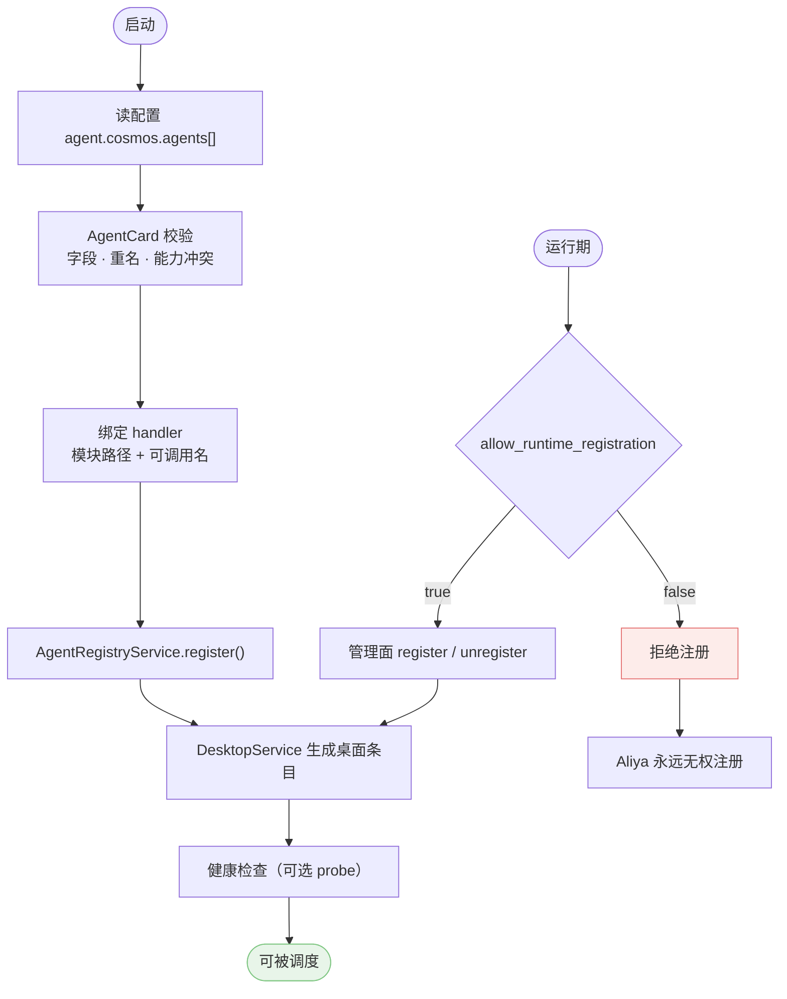
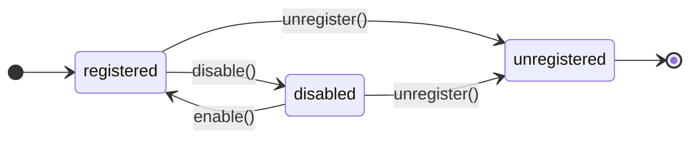
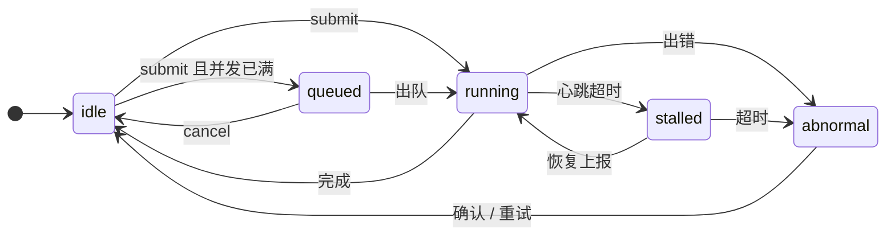

# Agent 注册机制

子 agent 要在 cosmos 里出现，必须先注册成一张 `AgentCard`。卡片既是**调度依据**（Aliya 与匹配逻辑据此选择 agent），也是**展示依据**（桌面图标与状态面板）。

---

## 1. 两条容易混淆的注册

| 注册对象 | 注册到什么 | 用途 | 谁用 |
| --- | --- | --- | --- |
| 子 agent | `AgentRegistryService` | 出现在 agent 桌面，被 Aliya 调度 | Aliya |
| 工具（tool） | `core.agent.ToolRegistry` | 交给模型做函数调用 | 子 agent 自己 |

两者互不替代：

- 一个子 agent 可以注册 20 个工具，但对 Aliya 只暴露为一张卡片。
- 一个工具**不能**直接变成桌面上的「应用」——它没有独立生命周期、没有进度、没有超时语义。
- 子 agent 内部要不要用工具、要不要跑 ReAct，是它自己的实现细节，cosmos 不关心。

判断标准：**需要被 Aliya 主动启动、需要独立状态与进度、可能长时间运行** → 注册成子 agent；**只是模型推理时顺手调一下** → 注册成 tool。

仓库当前注册了 5 个子 agent：`edit` / `search` / `run` / `web` / `echo`。各自的职责、参数与安全边界见 [subagent.md](subagent.md#11-内置工具)。

---

## 2. AgentCard 结构

```python
class AgentCard(BaseModel):
    # ---- 身份 ----
    id: str                      # 唯一标识，小写蛇形，如 "edit"
    name: str                    # 展示名，如 "编辑台"
    version: str = "0.1.0"       # 语义化版本
    # ---- 展示 ----
    icon: str                    # emoji 或资源引用，如 "✏️" / "icon:edit"
    summary: str                 # 一句话，桌面副标题，≤ 20 字
    description: str             # 完整能力说明，给 Aliya 与匹配逻辑看
    # ---- 能力 ----
    capabilities: list[str]      # 能力标签，用于检索与粗筛，如 ["code_edit", "file_write"]
    params_schema: dict[str, object]   # 请求参数 JSON Schema（object）
    examples: list[AgentExample] = []   # 典型请求，帮助自然语言匹配
    # ---- 桌面元数据 ----
    desktop: DesktopMeta
    # ---- 执行策略 ----
    execution: ExecutionPolicy
    # ---- 权限 ----
    permissions: AgentPermissions
```

### 2.1 字段说明

| 字段 | 必填 | 规则 | 说明 |
| --- | --- | --- | --- |
| `id` | 是 | `^[a-z][a-z0-9_]{1,31}$`，全局唯一 | API 与事件里用它，不随展示名变化 |
| `name` | 是 | 1–24 字符 | 展示名，**给 Aliya 看的**；避免 `agent`/`模型`/`调度` 这类工程词，可改；`id` 不可改 |
| `version` | 否 | `X.Y.Z` | 用于兼容性判断，见 [extension.md](extension.md#4-版本与兼容) |
| `icon` | 是 | emoji 或 `icon:<name>` | 桌面渲染用，缺省由 `id` 首字母生成 |
| `summary` | 是 | 1–20 字 | 桌面上只显示这一句，写「做什么」不写「怎么用」 |
| `description` | 是 | 20–400 字 | 给 Aliya 与匹配模型读；写适用场景、边界、不适用的情况 |
| `capabilities` | 是 | 至少 1 项，`^[a-z][a-z0-9_]*$` | 粗筛标签，不要写成长句 |
| `params_schema` | 是 | 合法 JSON Schema（object） | cosmos 只校验「是对象」，字段级校验由子 agent 自己做并回填 |
| `examples` | 否 | ≤ 5 条 | 每条含 `input` 与可选 `note`，提高自然语言匹配的准确率 |
| `desktop` | 是 | 见 2.2 | 缺省值由注册表补，但显式写更好维护 |
| `execution` | 是 | 见 2.3 | 缺省值有，但超时一定显式给 |
| `permissions` | 是 | 见 2.4 | 默认全拒，按需打开 |

### 2.2 DesktopMeta

| 字段 | 默认 | 说明 |
| --- | --- | --- |
| `group` | `"general"` | 桌面分组键，见 [desktop.md](desktop.md#5-排序与分组) |
| `order` | `100` | 同组内排序，小的在前；同值按 `id` 字典序 |
| `visible` | `true` | 是否在桌面显示；`false` 仍可被显式调用 |
| `pinned` | `false` | 置顶，排在该组最前 |
| `badge` | `null` | 角标文案（如 `"NEW"`），≤ 4 字，仅展示 |

### 2.3 ExecutionPolicy

| 字段 | 默认 | 说明 |
| --- | --- | --- |
| `timeout_seconds` | `120` | 单次任务上限，超时判 `timeout` 并推 `agent.abnormal` |
| `max_concurrent` | `1` | 该 agent 同时运行的任务数上限；超出抛 `AgentBusyError` 或排队，由 `queue` 决定 |
| `queue` | `false` | `true` 时超出并发上限进入队列，`false` 时直接拒绝 |
| `cancel_on_supersede` | `false` | 同一 `session_id` 下的新任务是否取消旧任务 |
| `retryable` | `false` | 失败是否允许 Aliya 一键重试（重试仍走新 `task_id`） |
| `heartbeat_seconds` | `30` | 超过该时长没有心跳或进度上报则判 `stalled` |

### 2.4 AgentPermissions

| 字段 | 默认 | 说明 |
| --- | --- | --- |
| `read_presence` | `false` | 是否允许读取用户状态的**授权子集**（默认连摘要都不给） |
| `presence_fields` | `[]` | 允许的字段名，见 [presence.md](presence.md#2-字段模型) |
| `notify_user` | `false` | 是否允许请求 cosmos 向用户发进展通知 |
| `read_conversation` | `false` | 是否允许读取对话上下文（默认不给，子 agent 只需 `AgentRequest`） |

`read_presence` 已由 `AgentContext.read_presence()` 在运行时执行；`notify_user` 与
`read_conversation` 目前仍是预留字段，cosmos 不向子 agent 提供对应入口，保持「子 agent
不直连用户、不读对话」的硬边界。

编辑类 agent 的合理配置是全部 `false`：它只需要拿到「改哪个文件、改成什么」，不需要知道用户是谁、心情如何。

---

## 3. 注册流程



### 3.1 配置驱动注册（推荐）

```yaml
agent:
  cosmos:
    agents:
      - id: edit
        module: agent.cosmos.registry.edit
        handler: handle
        card:
          name: 编辑台          # 展示名用她的语言；工程名只留在 id 与文档正文里
          icon: "✏️"
          summary: 改写工作区里的文件
          description: >-
            在 Aliya 的工作区（data/Aliya/workspace）内修改文本文件：
            write 整文件覆盖、append 追加、replace 精确替换。
            不做工作区外操作，不执行命令，不提交 git。
          capabilities: [file_write, file_edit, code_edit]
          params_schema:
            type: object
            properties:
              action: {type: string, enum: [write, append, replace]}
              path: {type: string}
              content: {type: string}
              old: {type: string}
              new: {type: string}
              count: {type: integer, minimum: 1}
            required: [action, path]
          examples:
            - input: "新建 notes/todo.md，写上三条待办"
          desktop: {group: dev, order: 10}
          execution: {timeout_seconds: 60, max_concurrent: 1, queue: true, retryable: true}
          permissions: {read_presence: false, notify_user: false}
```

### 3.2 代码注册

```python
from agent.cosmos.contracts import AgentCard, DesktopMeta, ExecutionPolicy

registry.register(
    AgentCard(
        id="edit",
        name="编辑台",
        icon="✏️",
        summary="改写工作区里的文件",
        description="在 Aliya 的工作区（data/Aliya/workspace）内修改文本文件，不做工作区外操作。",
        capabilities=["file_write", "file_edit"],
        params_schema={
            "type": "object",
            "properties": {
                "action": {"type": "string", "enum": ["write", "append", "replace"]},
                "path": {"type": "string"},
                "content": {"type": "string"},
            },
            "required": ["action", "path"],
        },
        desktop=DesktopMeta(group="dev", order=10),
        execution=ExecutionPolicy(timeout_seconds=60, max_concurrent=1, queue=True),
    ),
    handle,
)
```

配置与代码两种方式产出的卡片完全等价。**配置优先**：改一个 agent 的展示信息不应要求发版。

### 3.3 谁能注册

| 主体 | 能否注册 | 说明 |
| --- | --- | --- |
| 部署配置 | 能 | 主路径 |
| 管理面 / 运维接口 | 能 | 需 `allow_runtime_registration: true` |
| Aliya | **不能** | Aliya 是使用方，不是部署方；否则等于让它给自己造工具 |
| 子 agent | **不能** | 子 agent 不得扩展自己的权限边界 |

---

## 4. 生命周期

区分两个互不干扰的概念：

| 概念 | 取值 | 由谁改 | 含义 |
| --- | --- | --- | --- |
| 注册态 | `registered` / `disabled` / `unregistered` | 部署配置、管理面 | 是否允许被调度 |
| 运行态 | `idle` / `queued` / `running` / `stalled` / `abnormal` | `AgentRuntimeService` | 当前有没有活、是否健康 |

状态迁移：



注销后从桌面移除，历史任务保留。

运行态（仅在 `registered` 下有意义）：



`disabled` 的 agent 在桌面上保留但置灰，点击返回 `AgentNotFoundError`（带 `reason="disabled"`），不静默忽略。

---

## 5. 校验规则

注册期一次性校验，失败即启动失败（fail fast，配置问题不该等到第一次调度才暴露）：

| 场景 | 结果 |
| --- | --- |
| `id` 格式非法 | `AgentRegistrationError` |
| `id` 重复 | `AgentRegistrationError`，指出双方来源 |
| `capabilities` 为空或含非法字符 | `AgentRegistrationError` |
| `params_schema` 不是 object 类型 schema | `AgentRegistrationError` |
| `desktop.group` 不在已声明分组内 | WARNING，落到 `general` |
| `execution.timeout_seconds <= 0` | `AgentRegistrationError` |
| handler 不可导入 / 不是可调用对象 | `AgentRegistrationError`，带模块路径 |
| `permissions.presence_fields` 含未知字段 | `PresencePrivacyError` |
| 两张卡片的 `name` 重名但 `id` 不同 | WARNING（展示可区分即可） |

`summary` 超过 20 字不报错，截断并 WARNING：展示约束不该阻塞启动，但要在日志里可见。

---

## 6. 查询接口

```python
registry.get("edit")                      # AgentCard，不存在抛 AgentNotFoundError
registry.list()                           # list[AgentCard]，按桌面顺序
registry.match("改一下这个函数", top_k=3)   # list[AgentMatch]，纯检索，不调模型
registry.enabled("edit")                  # bool
```

`match()` 只做**多路检索**（`capabilities` 精确命中、`summary` / `description` 关键词、`examples` 相似度），返回带分数的候选：

```python
class AgentMatch(BaseModel):
    agent_id: str
    score: float          # 0–1，仅用于排序，不是概率
    reason: str           # 命中的依据，如 "capabilities: code_edit"
```

真正的语义匹配在 `DispatchService` 里做（可调 LLM 结构化输出），`registry.match()` 负责粗筛与兜底。这样注册表保持纯数据、可单测，模型调用集中在调度层。

---

## 7. 日志

| 事件 | 级别 | 字段 |
| --- | --- | --- |
| 注册成功 | INFO | `agent_id`、`capabilities`、`来源`（config / runtime） |
| 注册失败 | ERROR | `agent_id`、`错误类型`、`错误消息` |
| 启用 / 禁用 | INFO | `agent_id`、`操作` |
| 注销 | WARNING | `agent_id`、`进行中任务数`（>0 时提示会被取消） |

不记录 `description` 正文与 `params_schema` 内容——它们是配置，不是事件。
