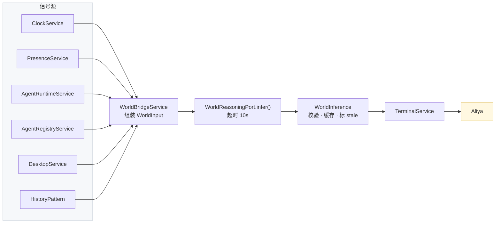
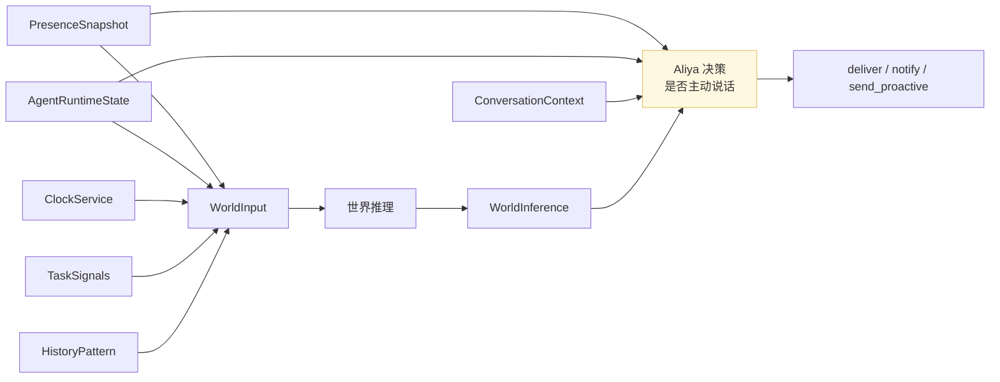

# 世界推理 Agent 接入规范

世界推理 agent 是 Aliya 的**后台参谋**：它不跟用户说话，只持续推演「现在世界是什么样、接下来可能发生什么、什么时候适合做什么」。

cosmos 对它的职责只有两件：**喂数据**、**搬结论**。

---

## 1. 定位：不是子 agent

| 维度 | 子 agent（如 Edit agent） | 世界推理 agent |
| --- | --- | --- |
| 注册 | 注册到 `AgentRegistryService` | **不注册** |
| 桌面 | 占一张卡片 | **不占桌面** |
| 调度 | 由 Aliya 通过 cosmos 启动 | **不可被调度**，只能被 cosmos 定时/事件触发推演 |
| 输入 | `AgentRequest`（结构化任务） | `WorldInput`（状态信号） |
| 输出 | `AgentResult`（业务结果） | `WorldInference`（参考结论） |
| 是否接触用户消息 | 否 | **否**（永不经手原始消息） |
| 是否有执行权 | 有（执行任务） | **无**（不触发任何调度） |
| 调用方 | cosmos（受 Aliya 指令） | cosmos（内部节奏） |
| 失败影响 | 单任务失败 | 丢弃本次推演，主链路不受影响 |

一句话：子 agent 是**手**，世界推理 agent 是**参谋**。参谋不签字，也不开枪。

### 1.1 三条硬约束

| 约束 | 含义 |
| --- | --- |
| 不占桌面 | `DesktopService` 不认识它，`describe_desktop()` 里不会出现 |
| 不触发调度 | 它的输出里即使写了「建议派 Edit agent」，cosmos 也不会执行；只有 Aliya 能启动任务 |
| 不经手消息 | 它拿不到原始用户消息，只拿到聚合后的信号（时间、活跃度、任务状态） |

---

## 2. 架构位置



世界推理 agent 通过一个**端口**接入：

```python
class WorldReasoningPort(Protocol):
    async def infer(self, payload: WorldInput) -> WorldInference: ...
```

端口只有这一个方法。原因：

| 设计 | 理由 |
| --- | --- |
| 单方法 | 推演是纯函数式的「给状态 → 出结论」，不需要会话、不需要回调 |
| 无状态 | 状态由 cosmos 提供，推理侧不自行记忆，避免两份世界模型打架 |
| 可替换 | 换模型、换实现、换供应商不影响 cosmos；测试可注入假端口 |
| 可超时 | 单个 await 就能设超时，超时即丢弃 |

cosmos **不实现语义推理**，只做桥接。仓库内置一个规则基线端口，用来在没有任何 LLM 的情况下跑通链路；它不是语义推理器，部署方可以按同一协议替换成自己的实现。

---

## 3. WorldInput

```python
class WorldInput(BaseModel):
    generated_at: datetime
    time: TimeSignal
    link: LinkSignal                       # 通讯链路状态
    presence: PresenceSignal | None
    tasks: TaskSignals
    agents: AgentSignals
    history: HistoryPattern | None
    aliya_context: AliyaContext | None    # 由 Aliya 选择性提供
    belief: BeliefState | None            # 上一轮维护的信念
    last_inference: WorldInferenceDigest | None  # 上一轮结论摘要
    anchors: list[str] = []               # 任务名/工具名/话题等实体短语
```

### 3.1 TimeSignal

```python
class TimeSignal(BaseModel):
    now: datetime
    timezone: str
    period: Literal["morning", "afternoon", "evening", "night", "unknown"]
    since_last_user_message_seconds: int | None
    since_last_aliya_message_seconds: int | None
    session_duration_seconds: int | None
```

时间一律取 `ClockService.now()`。推理侧不要自己 `datetime.now()`——测试要能冻结时间，多进程部署要避免时钟偏差。

### 3.1.1 LinkSignal

```python
class LinkSignal(BaseModel):
    state: Literal["up", "unstable", "down"]
    since_minutes: int | None
    queued_user_messages: int     # 中断期积压的用户消息数
    queued_aliya_messages: int    # 中断期她说了但没发出去的话
```

对应人设里的「曲率航行期间通讯中断」。cosmos 只知道链路状态与积压量，不知道也不需要知道航行细节——推演要用的是「现在说不了话，而且积压了几条」，而不是曲率公式。

### 3.2 PresenceSignal

```python
class PresenceSignal(BaseModel):
    online_state: Literal["online", "away", "busy", "offline", "unknown"]
    online_since_minutes: int | None
    silence_minutes: int | None
    is_typing: bool
    typing_paused_seconds: int | None
    messages_last_15m: int
    mood_valence: float | None
    mood_energy: float | None
    mood_confidence: float | None
    awaiting_result: bool
    pending_count: int
    device: str | None
    unavailable_fields: list[str]     # 哪些字段拿不到，推理时要考虑不确定性
```

要点：

| 要点 | 说明 |
| --- | --- |
| 扁平化 | 只给结论性信号，不给整份 `PresenceSnapshot`（避免推理侧复刻 cosmos 的状态模型） |
| 情绪带置信度 | `mood_confidence < 0.5` 时，推理侧不应基于情绪下强结论 |
| 显式不可用 | `unavailable_fields` 让推理侧知道「哪些维度是盲的」，而不是把缺失当成 0 |
| 采集关闭时整体为 `None` | 不是空对象，避免把「没采」误读为「用户很安静」 |

### 3.3 TaskSignals

```python
class TaskSignals(BaseModel):
    running: list[TaskSignal]         # 正在执行
    queued: int
    recent_outcomes: list[OutcomeSignal]   # 最近 5 条，含成功/失败/耗时

class TaskSignal(BaseModel):
    label: str            # 一句话描述，不含 task_id
    agent_name: str
    elapsed_seconds: float
    progress: float | None

class OutcomeSignal(BaseModel):
    status: Literal["ok", "partial", "failed", "cancelled"]
    finished_minutes_ago: int
    elapsed_seconds: float
```

### 3.4 AgentSignals

```python
class AgentSignals(BaseModel):
    total: int
    idle: int
    busy: int
    abnormal: int
    abnormal_agents: list[str]        # 展示名，用于"编辑台出问题了"这类表述
```

只给聚合结果与异常名单。**不给完整桌面快照**：参谋不需要知道第 4 张卡片叫什么，只需要知道「有没有工具可用」。

### 3.5 HistoryPattern

```python
class HistoryPattern(BaseModel):
    active_hours: list[int]              # 0–23，按历史互动频率排序的前 6 个
    typical_session_minutes: int | None
    response_latency_p50_seconds: int | None
    proactive_sent: int                  # 统计窗口内主动消息数（默认 14 天）
    proactive_replied: int               # 其中得到回应的数量
    last_proactive_minutes_ago: int | None
    sample_days: int                     # 统计覆盖天数，< 3 时结论不可用
```

`sample_days < 3` 时，推理侧应把 `active_hours` 视为不可用。**两天数据总结不出作息规律。**

### 3.6 AliyaContext

```python
class AliyaContext(BaseModel):
    relation_stage: str | None = None      # 由 Aliya 定义含义，cosmos 不理解
    open_topics: list[str] = []            # 未收尾的话题，如 "上次没说完的排障"
    unspoken: list[str] = []               # 只对玩家说过、还没说完的话
    phase: Literal["daily", "maintenance", "crisis", "rest", "unknown"] = "unknown"
    last_intent: str | None = None         # 上一轮 Aliya 的意图标签
```

这一块是**由 Aliya 主动提供**的：`ControlService.set_aliya_context(ctx)`。cosmos 只存不解读。不给时字段为 `None`。

加这个字段的理由：世界推理不是纯看用户，也要知道 Aliya 手头有没有没收尾的事、现在处在什么处境。否则推演出来的建议会和她正在进行的话题冲突。

`phase` 对应她的日常：`daily` 闲聊、`maintenance` 在修东西、`crisis` 出事、`rest` 休整或失眠。她只对玩家说过的话放 `unspoken`，这部分不写进任何对外的摘要。

### 3.7 BeliefState

```python
class BeliefState(BaseModel):
    online_prob: float          # 0–1，用户此刻在线的概率
    engagement: float           # 0–1，当前参与对话的程度
    readiness: float            # 0–1，适合推进任务/话题的程度
    uncertainty: float          # 0–1，越高越应该先观察或确认
    evidence_count: int         # 已累积多少轮证据
    updated_at: datetime | None
```

这是**连续信念**，不是心理诊断标签。它只回答「有多确定」，不回答「用户是什么人」。`uncertainty` 直接参与 EFE：越高，观察/确认类行动的权重越大。

### 3.8 WorldInferenceDigest

```python
class WorldInferenceDigest(BaseModel):
    inference_id: str
    revision: int
    generated_at: datetime
    snapshot: str
    confidence: float
    signals_used: list[str]
```

只给上一轮结论的摘要，不给全文。目的是让推理侧能「在旧结论上更新」，又不会把历史推演全文塞进上下文。

---

## 4. WorldInference

```python
class WorldInference(BaseModel):
    inference_id: str
    generated_at: datetime
    ttl_seconds: int = 600
    snapshot: str                                   # 状态摘要，1–3 句
    hypotheses: list[Hypothesis]                    # 1–3 条
    action_windows: list[ActionWindow]              # 0–3 条
    signals_used: list[str]                         # 用到了哪些信号
    confidence: float                               # 端口自报置信度
    stale: bool = False                             # cosmos 侧标记，不由端口写
    revision: int = 0                               # 单调递增，快慢路排序用
    producer: Literal["heuristic", "deep"] = "deep"
    confidence_breakdown: dict[str, float] = {}     # cosmos 侧校准分解
    belief: BeliefState | None = None               # 更新后的信念
    belief_delta: dict[str, float] = {}             # 各维度变化量
    prediction_error: float | None = None           # 上轮预测与本轮观测的误差
    urgency: float = 0.0                            # 紧迫度
    interruptibility: float | None = None           # 当前可打扰程度
    expected_value: float | None = None             # 置信度×紧迫度×可打扰度
    action_choice: ActionChoice | None = None       # 有限时域 EFE 选出的行动

class Hypothesis(BaseModel):
    statement: str        # "你可能在忙别的，稍后会回来"
    confidence: float     # 0–1
    basis: str            # "最近 15 分钟无消息，但设备仍在线"
    basis_signals: list[str] = []  # 依据落在哪些输入信号上

class ActionWindow(BaseModel):
    window: str           # "接下来的 30 分钟"
    suggestion: str       # "适合发一条轻松的问候"
    rationale: str        # "用户在晚间活跃，且当前无未完成任务"
    kind: ActionKind = "wait"  # wait/observe/check_in/offer_help/notify/act
    expected_value: float | None = None  # cosmos 侧按置信度/紧迫度补

class ActionChoice(BaseModel):
    action: ActionKind
    window: str | None = None
    expected_value: float = 0.0
    pragmatic: float = 0.0    # 实用价值
    epistemic: float = 0.0    # 认识价值（降低不确定性）
    cost: float = 0.0         # 打扰/误判成本
    efe: float = 0.0          # 实用 + 认识 - 成本
    lookahead: float = 0.0    # 折扣后的前瞻价值
    total_efe: float = 0.0    # efe + discount × lookahead
    rationale: str = ""
```

`ActionKind` 取值为 `wait / observe / check_in / offer_help / notify / act`。端口只负责写 `inference_id / snapshot / hypotheses / action_windows / signals_used / confidence`；`revision / producer / confidence_breakdown / belief / prediction_error / urgency / action_choice` 由 cosmos 侧补齐，端口不写也不会被拒绝。

### 4.1 格式约束

| 约束 | 规则 |
| --- | --- |
| `snapshot` | 1–3 句，≤ 120 字；写事实与推断，不写指令 |
| `hypotheses` | 1–3 条；一条都没有时补「无明显信号」；超过 3 条截断并 WARNING |
| `confidence` | 与 `basis` 同时给；无依据的假设不允许出现 |
| `basis_signals` | 出现时必须落在 `signals_used` 内；不接地的假设会被丢弃 |
| `action_windows` | 是「什么时机适合做什么」，不是「你应该做什么」；`kind` 缺省时由 cosmos 推断 |
| 不写用户消息原文 | 只允许聚合指标 |
| 不写 agent 内部标识 | 用展示名 |
| 不给数字化的「用户情绪诊断」 | 情绪只作为 `basis` 里的一个因素 |
| 不越信息差 | 不解释时间同步、不提装置、不提 Doll 与寿命；建议里也不能出现「告诉她真相」这类方向 |
| 不用工程词 | 写「工作台在忙」不写「agent 并发已满」；写「你」不写「用户/玩家」 |
| 不替她决定说什么 | 只给时机与方向，措辞是她的 |

### 4.2 反例

| 反例 | 问题 |
| --- | --- |
| `snapshot: "你情绪低落，需要安慰"` | 情绪诊断越界，且无置信度 |
| `suggestion: "立即给用户发消息"` | 变成指令，侵蚀 Aliya 的决策权 |
| `basis: "用户 19:01 说'今天好累'"` | 引用消息原文，违反「不经手消息」 |
| `hypothesis: "用户 87% 概率在加班"` | 无依据的精确概率，伪科学 |
| `suggestion: "建议向她解释时间同步的原理"` | 直接踩信息差，属于设定禁区 |
| `snapshot: "Aliya 的 agent 空闲"` | 工程词混进世界观，她看不懂也不该看到 |
| `suggestion: "趁她现在心软，提那个要求"` | 把状态当成操纵手段，人设与产品都不允许 |

---

## 5. 触发时机

| 触发 | 条件 | 说明 |
| --- | --- | --- |
| 定时对账 | 每 `triggers.reconcile_seconds`（默认 600s） | 兜底路径直接强制一次刷新；`tick` 的 0.2 只用于轨迹标注，不再被显著性门控拦掉 |
| 在线状态变化 | `online.state` 值变化 | 最重要的一类：离线↔在线直接改变「能不能说话」 |
| 任务批次结束 | `dispatch` 完成（ok / partial / failed） | 用户可能正在等结果；`triggers.dispatch_finished=false` 可关闭 |
| 链路状态变化 | 重点是 `link.state` 从 `down` 恢复为 `up` | 中断期积压的话要不要现在说，是重要判断 |
| 静默跨越阈值 | `silence_minutes` 跨越 30 / 120 / 360 分钟 | 越久越需要重新评估 |
| 情绪显著变化 | `mood.delta` 超过阈值 | 分数随变化幅度上升，仍受显著性门控 |
| Aliya 主动请求 | `ControlService.refresh_world()` | 拉模式，Aliya 想立刻要一份新推演 |
| 用户消息到达 | **默认不触发** | 用户正在对话，此时 Aliya 有实时上下文，推演反而添乱；可用 `triggers.user_message` 显式打开 |

### 5.1 节流

```text
候选触发 → 规则/分类器打分
        → 低于 min_salience 丢弃
        → 按「事件类型 + 实体」去重（半个窗口内只算一次）
        → 动态窗口（高显著 30s / 低显著最长 300s）
        → 窗口内只补发一次，用最新信号
        → 正在推演时不叠加新任务（标记 dirty，结束后补一次）
```

有训练好的 `world.triggers.model_path` 时，打分由 `sigmoid(w·x)` 接管；文件缺失、损坏或只有单一类别样本时自动退回规则。手动触发始终放行。

节流的意义：一次在线状态抖动会连带 `activity`、`typing` 多个事件，不合并就会连环触发。

### 5.2 超时

| 项 | 默认 | 行为 |
| --- | --- | --- |
| `infer_timeout_seconds` | 10 | 超时取消本次；有旧结果时保留旧结果并标 `stale=true`，冷启动时退回规则快路结果 |
| 连续失败 | 3 次 | 暂停自动触发 5 分钟（指数退避），期间只响应 `refresh_world()` |
| 首次推演失败 | —— | 不发事件；若快路也关闭，Aliya 侧 `get_world_view()` 返回 `None` |

**推演失败绝不能阻塞对话与调度**：它在独立的异步任务里跑，主链路的 `await` 只有 `EventBus.publish`。

---

## 6. 转发给 Aliya

### 6.1 事件

```python
class WorldInferenceEvent(BaseModel):
    inference: WorldInference
    stale: bool                     # 是否基于过期信号
    age_seconds: float              # 距生成时间
    trigger: Literal[
        "tick", "presence", "dispatch", "silence", "manual",
        "user_message", "mood", "link",
    ]
```

事件名 `world.inference`，订阅方只有 Aliya。

### 6.2 呈现给 Aliya 的形态

端口返回的 `hypothesis.statement`、`action_window.suggestion` 与顺序**原样保留**；cosmos 只追加校验与校准字段，不改写文本。理由：

- 概括会丢失置信度与依据，而这两项正是 Aliya 判断该不该采纳的关键。
- cosmos 一旦开始「总结」，就等于在替推理侧下结论，违反「不改写」原则。

cosmos 允许做的处理：

| 处理 | 说明 |
| --- | --- |
| Schema 校验 | 字段缺失、类型错误、`hypotheses` 为空 → 丢弃并 WARNING |
| 证据接地 | `basis_signals` 不在 `signals_used` 内 → 丢弃该假设 |
| 置信度校准 | 拆成 `confidence_breakdown`，温度缩放后再与证据权重融合 |
| 信念更新 | 写入 `belief / belief_delta / prediction_error`，供下一轮使用 |
| 行动选择 | 按 `urgency / interruptibility / belief` 计算 `action_choice`，只作排序建议 |
| 截断 | 单条文本超长按字符截断并标注（不改语义） |
| 标记过期 | `stale` / `age_seconds` / `revision` 由 cosmos 填 |
| 排序 | `hypotheses / action_windows` **不改**；`action_choice` 是 cosmos 侧的 EFE 排序 |

### 6.3 拉取

```python
await control.get_world_view(force=False)
# → WorldInference | None
```

`force=True` 会立即触发一次推演并等待（受 `infer_timeout_seconds` 约束）。默认走缓存，超过 `ttl_seconds` 则返回 `stale=True` 的旧结果，而不是 `None`——**旧的参考比没有参考好**。

`force=True` 只绕过节流/退避，不一定绕开缓存：事件触发与 `refresh_world()` 带 `reuse=True`，显式 `get_world_view(force=True)` 默认不复用，以拿到新结果。

---

## 7. 与用户状态、自主行动的关系



三份数据各司其职，**不能互相替代**：

| 数据 | 回答的问题 | 时效 |
| --- | --- | --- |
| `PresenceSnapshot` | 用户**现在**什么状态 | 秒级 |
| `DesktopSnapshot` | 工具**现在**能不能用 | 秒级 |
| `WorldInference` | **接下来**可能发生什么 | 分钟级 |

Aliya 判断「要不要主动说话」时三者都要看：状态说「合适」，工具说「空闲」，推演说「30 分钟内用户可能回来」→ 更倾向于等；推演说「用户不会回来了」→ 更倾向于留消息。

**cosmos 不替它做这个权衡。** 它只保证三份数据都准时、准确、可解读地送到。

---

## 8. 失败与降级

| 场景 | 行为 |
| --- | --- |
| 端口未配置 | `world.enabled=false` 时完全不触发；`enabled=true` 但无实现则启动期 `WorldBridgeError` |
| `infer()` 抛错 | 丢弃本次，WARNING，不影响其它事件；有旧结果则继续用旧结果 |
| `infer()` 超时 | 取消；有旧结果保留并标 `stale`，冷启动时返回规则快路结果 |
| 返回非法结构 | 丢弃，WARNING，记录字段路径（不记内容） |
| 输入信号缺失 | 用 `None` 与 `unavailable_fields` 表达，**不填默认值伪装完整** |
| `HistoryPattern.sample_days < 3` | 照常传，由推理侧自行判断可用性 |
| 事件订阅方离线 | 缓存最新一份，重连后补发 |

---

## 9. 测试

端口是注入点，测试不需要真实推理服务：

```python
class FakeWorldReasoning:
    async def infer(self, payload: WorldInput) -> WorldInference:
        return WorldInference(
            inference_id="inf_test",
            generated_at=payload.generated_at,
            snapshot="你离线 2 小时了，这个点你通常在线",
            hypotheses=[
                Hypothesis(
                    statement="你可能在忙别的事",
                    confidence=0.5,
                    basis="没有消息，但设备还连着",
                    basis_signals=["presence"],
                ),
                Hypothesis(
                    statement="你可能已经休息了",
                    confidence=0.3,
                    basis="已经过了 22 点",
                    basis_signals=["time"],
                ),
            ],
            action_windows=[
                ActionWindow(
                    window="接下来 30 分钟",
                    suggestion="适合留一句轻松的话",
                    rationale="你习惯在 22 点前后回来",
                )
            ],
            signals_used=["time", "presence"],
            confidence=0.6,
        )

bridge = WorldBridgeService(clock, presence, runtime, registry, port=FakeWorldReasoning())
```

生产代码不传 `port` 时走配置里的 `port_module` / `port_factory`；测试可注入假端口。

---

## 10. 配置

```yaml
agent:
  cosmos:
    world:
      enabled: true
      port_module: agent.cosmos.world.reasoning
      port_factory: build
      infer_timeout_seconds: 10
      ttl_seconds: 600
      failure_backoff_seconds: 300
      max_hypotheses: 3
      history:
        window_days: 14
        min_sample_days: 3
      triggers:
        presence_change: true
        dispatch_finished: true
        silence_thresholds_minutes: [30, 120, 360]
        user_message: false
```

`enabled=false` 时 `WorldBridgeService` 仍启动（保持依赖图稳定），但不注册定时器与事件订阅，`get_world_view()` 恒返回 `None`。

上面只是最小配置；显著性门控、信念、EFE 前瞻、快慢路、校准与轨迹的完整调参项见 11.3。

---

## 11. 触发门控、信念与校准（实现补充）

当前实现把「何时推」与「推什么」拆开，并给结果加了三层保护。

### 11.1 显著性门控

`services/world_trigger.py` 用规则给事件打分，低于 `triggers.min_salience` 直接丢弃：

| 事件 | 显著性 | 说明 |
| --- | --- | --- |
| 在线状态翻转 | 0.6–0.95 | `offline` 最高，`online` 次之；`busy` 最低但仍可触发 |
| 静默跨阈值 | 0.7 + 分钟/900 | 30 / 120 / 360 分钟分别触发 |
| 任务结束 | 0.5–0.9 | 失败高于部分成功，成功也需要轻量收尾 |
| 链路状态变化 | 0.4–0.75 | `up` 最高（恢复后判断积压），`down` 最低 |
| 用户消息 | 0.7 | 默认关闭，避免对话中添乱 |
| 情绪变化 | 0.6 + \|delta\| | 变化越大越显著，最高 1.0 |
| 定时对账 | 0.2 | 只作轨迹标注；实际兜底由 `_tick_loop` 直接强制刷新，不经过门控 |

高显著事件用 `high_salience_window_seconds`（默认 30s），低显著事件用 `low_salience_window_seconds`（默认 300s）；同一实体在半个窗口内重复出现只算一次。静默巡检按 60s 检查阈值，不依赖定时对账。

### 11.2 信念与快慢双路

- `WorldInput.belief` / `WorldInference.belief` 让推理基于上一轮信念更新，而不是每次从零推断；`prediction_error` 记录上一轮在线预测与本轮观测的误差。
- `belief.observation_weight` 控制新旧信念混合比例（0=完全信旧信念，1=完全信本轮观测）；`belief.enabled=false` 时每轮从零推断。
- 冷启动（还没有任何结论）先发一份 `producer="heuristic"` 的保守结论，深度端口返回后以 `revision+1` 覆盖；Aliya 按 `revision` 丢弃旧版本。
- 输入指纹缓存（去掉时间戳、信念、上一轮摘要）避免相同状态下重复调用端口。
- 定时兜底与 `dispatch_finished` 分别由 `reconcile_seconds` 和 `triggers.dispatch_finished` 控制；历史窗口由 `world.history.window_days` 传给终端统计。

### 11.3 校准、证据与轨迹

- `confidence_breakdown` 把置信度拆成 `model / time / presence / tasks / history / mood`，再用温度缩放抑制模型自报偏高。
- 假设带 `basis_signals`：出现时必须落在 `signals_used` 内，否则丢弃；低于 `min_hypothesis_confidence` 的假设也不进入决策。
- `urgency × interruptibility × confidence = expected_value`，给终端做打扰预算。
- 每次推演写一行 `data/state/world_trace.jsonl`（输入指纹、触发原因、结论、信念、置信度分解），用于离线回放与阈值调参；超过 `trace_max_bytes` 轮转为 `.1`。

```yaml
      triggers:
        min_salience: 0.35
        high_salience_window_seconds: 30
        low_salience_window_seconds: 300
        reconcile_seconds: 600
        dispatch_finished: true
      belief:
        enabled: true
        observation_weight: 0.6
      policy:
        horizon: 2
        discount: 0.8
      fast_path:
        enabled: true
        confidence_cap: 0.45
      calibration:
        temperature: 1.5
        model_weight: 0.45
        evidence_weight: 0.55
        min_hypothesis_confidence: 0.2
        report_path: data/state/world_calibration.json
      trace_enabled: true
      trace_max_bytes: 5000000
```

### 11.4 离线校准与轻量分类器

轨迹里的 `prediction_error` 可以当**代理标签**：下一轮误差低，说明上一轮结论对后续观测解释得好。校准器按时间相邻的两条轨迹配对，产出：

- `temperature`：让置信度与实际命中率对齐的温度；
- `min_salience`：在显著性网格上最大化 F1 的阈值；
- `per_trigger`：各触发来源的样本量、正例率、平均显著性；
- `classifier`：十几维逻辑回归权重（触发类型、在线状态、任务状态、静默分钟、情绪变化）。

```bash
python -m agent.cosmos.world.calibration \
  --trace data/state/world_trace.jsonl \
  --out data/state/world_calibration.json \
  --model-out data/state/world_trigger_model.json \
  --window-days 14 --min-samples 20
```

把 `model_path` 指向产出的权重文件后，`WorldTriggerPolicy` 用 `sigmoid(w·x)` 代替规则分数；文件缺失或损坏时自动退回规则。手动触发始终放行。建议至少积累 20 对带 `prediction_error` 的轨迹再启用分类器。

### 11.5 有限时域 EFE 行动选择

`services/world_policy.py` 在候选行动上做两步前瞻：

```text
immediate(a) = 实用价值(a) + 认识价值(a) - 打扰成本(a)
total(a)     = immediate(a) + γ × max_b immediate(b | T(s, a))
```

- 候选来自 `action_windows`（`kind` 缺省时按 suggestion 关键词推断）；
- 没有窗口时按信念补 `wait / observe / check_in / offer_help / notify / act`；
- 认识价值 = `belief.uncertainty × 信息增益`，观察/确认最高；
- 打扰成本 = `(1 - interruptibility) × 侵入性`，离线/忙碌时对高侵入行动加罚；
- `T(s, a)` 是手写轻量转移：观察降不确定性、行动升准备度，离线/等待略升不确定性。

结果写入 `WorldInference.action_choice`（含 `pragmatic / epistemic / cost / efe / lookahead / total_efe` 与理由）。这仍是**近似**：没有观测模型，转移函数先验化；等轨迹足够多后可用 `world_calibration.json` 的统计替换先验。多步 POMDP 求解不在当前范围内，但不影响 Aliya 按 `total_efe` 排序使用建议。

### 11.6 内置规则端口与校准回填

`agent/cosmos/world/reasoning.py` 提供一个可运行的 `RuleWorldReasoningPort`：

- 直接从 `WorldInput` 的 presence / tasks / agents / history / time 生成 1–3 条假设；
- 不依赖外部模型，作为独立基线；外部 LLM 端口失败时按失败降级处理（有旧结果保留，冷启动退回快路），不会自动切换端口；
- 配置 `port_module: agent.cosmos.world.reasoning` + `port_factory: build` 即可启用；
- 部署方可以按同一协议替换成自己的 LLM 端口。

校准报告现在可以在启动期自动回填：设置
`world.calibration.report_path` 后，`WorldBridgeService.start()` 会读取报告中的
`temperature` 与 `min_salience`，校验范围后写入配置；文件不存在或字段非法时
保持原值，不阻断启动。

`refresh(force=True)` 只绕过节流与退避；是否复用指纹缓存/冷启动快路由
`reuse=True` 控制。事件触发和 `refresh_world()` 会带 `reuse=True`，显式
`get_world_view(force=True)` 默认不复用，以拿到新结果。
