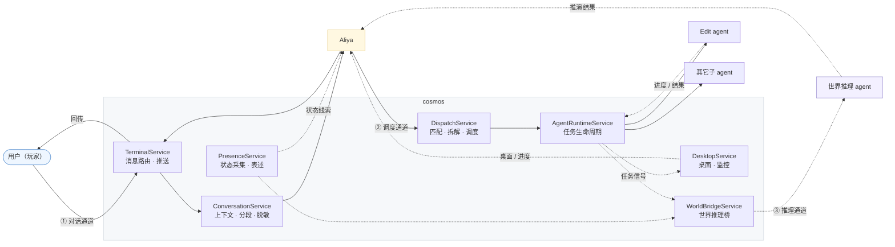

# cosmos 通信拓扑

## 1. 拓扑图



三条通道必须分开理解：

| 通道 | 端点 | 语义 |
| --- | --- | --- |
| 对话通道 | 用户 ↔ cosmos ↔ Aliya | 自然语言、有语气与人格、面向用户 |
| 调度通道 | Aliya ↔ cosmos ↔ 子 agent | 结构化任务、有状态与进度、面向系统 |
| 推理通道 | cosmos ↔ 世界推理 agent → Aliya | 结构化信号、单向参考、不面向用户 |

对话通道与调度通道**共用同一条物理链路**（同一个 `MessageBus`），但逻辑上维护两套上下文，见[通信终端 § 双上下文分离](../agents/cosmos/terminal.md#5-双上下文分离)。

## 2. 通信方式

| 方式 | 含义 | 用在 |
| --- | --- | --- |
| 同步请求-响应 | 调用方等待返回值 | Aliya 查询状态、桌面操作、短任务（< 2s） |
| 异步任务 | 立即返回 `task_id`，结果经事件推送 | 一切子 agent 执行（编辑、长时间任务） |
| 事件订阅 | 订阅 `presence.changed` / `agent.*` / `world.inference` | Aliya 的面板刷新与自主决策 |
| 自动委派 | cosmos 依据意图与置信度自动启动子 agent | `dispatch.mode: auto` 且置信度达标时 |

选择原则：**只要跨子 agent 边界，就一律异步**。cosmos 不阻塞等子 agent 跑完——Aliya 需要能随时取消、能同时推进多件事，也会在等待期间继续和用户聊天。

`dispatch.mode: suggest`（默认）下 cosmos 只给建议，由 Aliya 决定是否启动；`auto` 下 cosmos 可在置信度 ≥ 阈值时直接启动，但结果仍只回给 Aliya，不直达用户。

### 2.1 链路状态

人设里有一条硬设定：**曲率航行期间通讯中断**。这不是异常，是常态。

```python
type LinkState = Literal["up", "unstable", "down"]
```

| 状态 | 触发 | 行为 |
| --- | --- | --- |
| `up` | 正常 | 收发照常 |
| `unstable` | 延迟升高或丢包 | 照常收发但标 `degraded`，主动消息暂缓 |
| `down` | 曲率航行 / 链路彻底断开 | 停止投递，用户消息与 Aliya 的回复进队列；主动消息一律不投 |

规则：

| 规则 | 说明 |
| --- | --- |
| 中断期不丢消息 | 双向都进持久队列，恢复后按序重放 |
| 中断期不推主动消息 | Aliya 的「想说话」留到恢复后，由她重新判断 |
| 恢复必有事件 | 推 `link.state.changed`，Aliya 据此决定是否续上之前的话头 |
| 不向 Aliya 解释原理 | 她理解成「进行曲率航行时通信会断」，不能说「同步器带宽不足」 |

`LinkState` 由通道层判定（心跳、延迟、显式信号），`TerminalService` 只消费。人设层面它对应「曲率航行期间通讯中断」，工程层面它就是一次可控的长时间断链。

## 3. 消息流向

### 3.1 用户 → Aliya

```text
用户消息
  → TerminalService.ingest()
  → PresenceService.touch()            更新活跃度与输入状态
  → 组装 ConversationContext（历史摘要 + 用户状态摘要 + 任务摘要）
  → MessageBus.publish(aliya, message)
```

用户消息**永不到达子 agent**。cosmos 不再做意图分类，所有消息先到 Aliya，由 Aliya 决定如何回应或是否调度。

### 3.2 Aliya → 用户

```text
Aliya 回复
  → TerminalService.deliver()
  → ConversationService.format()        格式化 + 脱敏
  → 用户侧推送
  → 写入 ConversationContext
```

Aliya 的回复**永不绕过 cosmos**。cosmos 只做格式化与脱敏，不改写措辞。

### 3.3 Aliya → 子 agent

```text
Aliya 指令（点击 / 自然语言 / 显式调用）
  → ControlService.invoke_agent()
  → DispatchService.plan()              Resolve → Plan
  → AgentRuntimeService.submit()        异步执行，返回 task_id
  → 子 agent `handle(request, ctx)`  ← 只拿到 AgentRequest，拿不到对话上下文
  → ctx.report() / ctx.finish()
```

### 3.4 子 agent → Aliya

```text
子 agent 进度/结果
  → AgentRuntimeService 汇总
  → EventBus.publish(agent.progress / agent.result / agent.abnormal)
  → DesktopService 刷新桌面状态
  → WorldBridgeService 更新任务信号
  → TerminalService 推给 Aliya（附可解读摘要）
```

子 agent 的结果**先回 Aliya，再由 Aliya 决定怎么告诉用户**。例外：纯进展类通知（"已开始处理"）可由 cosmos 直接投递，但必须走 `TerminalService` 的格式化通道，内容限于进度与状态，不含结论。

### 3.5 世界推理 → Aliya

```text
WorldBridgeService 组装 WorldInput
  → WorldReasoningPort.infer(input)     超时即丢弃，不阻塞主链路
  → WorldInference（缓存 + TTL）
  → TerminalService 推给 Aliya
```
